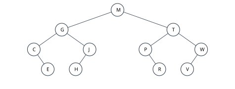
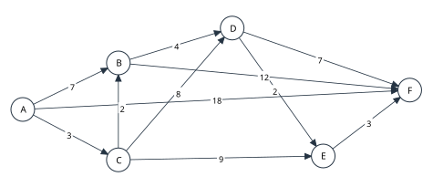
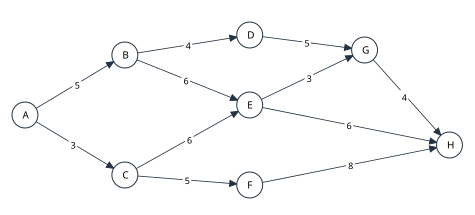

# 2027考研重邮802押题卷 第2套 逐题讲解稿

依据当前题面逐题解答；等价正确表达式及满足约束的其他算法同样有效。评分仅为教学建议。

## 一、程序阅读题

### 1（4分）

**题目**
一条带头结点的单链表按记录编号非递减排列。下面程序删除所有出现次数大于1的编号对应的整组结点；只出现一次的结点保留，删除的结点需释放。补全①、②，每空2分。
```cpp
typedef struct Node { int data; struct Node *next; } Node;
void removeRepeated(Node *head) {
    Node *pre = head, *p = head->next;
    while (p != NULL) {
        Node *q = p->next;
        while (q != NULL && q->data == p->data)
            q = q->next;
        if (p->next == q) {
            pre = p;
        } else {
            while (p != q) {
                Node *next = ①;
                free(p);
                p = next;
            }
            pre->next = ②;
        }
        p = q;
    }
}
void processBatch(Node *head) {
    removeRepeated(head);
    int remaining = 0;
    for (const Node *p=head->next; p!=NULL; p=p->next) {
        printf("%d ", p->data);
        ++remaining;
    }
    printf("count=%d", remaining);
}
```

本题被删除的结点均由malloc分配，可使用free释放。

**讲解顺序**
先确定q停在组后，随后区分单结点组与重复组。用重复组位于表头、连续两组重复、末尾重复这三个情况检查前驱更新。free之后不能再取p->next。

**参考作答**
①p->next；②q。

q是当前同值组之后的第一个结点。p->next==q表示当前组只有一个结点。删除重复组时先保存后继再free，并把前驱接到q。例如1,1,2,3,3,4,5,5最终只保留2,4。时间O(n)，辅助空间O(1)；q即使为NULL也可直接接回。

**备课出处**
《26重邮208数据结构真题回忆版.pdf》物理p2–3链表补码；删除整组为对有序条件的迁移，不同于六套保留最后同键结点。 本轮保留完整语境，固定一个机械更新式，仅留两个关键空，各2分。

### 2（4分）

**题目**
仓库按批次把非递减数组a与b合并到out，重复编号只输出一次。a和b内部均可重复，长度分别n、m，可为0；out容量至少n+m，且out与两个输入数组的存储区域均不重叠。补全①、②，每空2分。
```cpp
int mergeDistinct(const int a[], int n,
                  const int b[], int m, int out[]) {
    int i = 0, j = 0, k = 0;
    while (i < n || j < m) {
        int x;
        if (j == m || (i < n && ①))
            x = a[i++];
        else x = b[j++];
        if (k == 0 || out[k-1] != x) out[k++] = x;
        while (i < n && a[i] == x) ②;
        while (j < m && b[j] == x) ++j;
    }
    return k;
}
void consolidate() {
    int a[] = {2,2,5,8,8,11};
    int b[] = {1,2,5,5,9};
    int result[11];
    int count = mergeDistinct(a,6,b,5,result);
    for (int k=0; k<count; ++k)
        printf("%d ", result[k]);
}
```

**讲解顺序**
先解释外层为什么用或，再核取较小值时的短路求值。用一个数组为空、两数组当前值相同检验边界，不能把i<n写在a[i]访问之后。

**参考作答**
①a[i]<=b[j]（a[i]<b[j]亦等价）；②++i。

每轮选出两个剩余有序段的较小首项x，再跳过两数组剩余的所有x。相等时从任一数组取x均可，后续会跳过两边全部x。out只保存不同值，短路条件保证k=0时不访问out[-1]。例如a=1,2,2,5，b=2,3,5,5，输出1,2,3,5，新长度4。时间O(n+m)，除输出数组外辅助空间O(1)。

**备课出处**
《真题24-25.pdf》物理p3有序归并任务族；改为双数组去重归并。 本轮保留完整语境，固定一个机械更新式，仅留两个关键空，各2分。

### 3（4分）

**题目**
初始队列从队头到队尾为2,5,1,4,3。运行下面程序，写出输出序列（2分），以及DeQueue与EnQueue各自调用次数（共2分）。队列容量充分，DeQueue返回并删除队头。
```cpp
int step = 1;
while (!Empty(Q)) {
    int x = DeQueue(Q);
    printf("%d ", x);
    for (int j = 0; j < step && !Empty(Q); ++j) {
        int y = DeQueue(Q);
        EnQueue(Q, y);
    }
    ++step;
}
```

**讲解顺序**
先辨明一轮仅第一条DeQueue永久删除，循环中的DeQueue后紧接EnQueue，队列长度不变。剩余一个元素仍能旋转多次，次数不能按剩余元素个数截断。

**参考作答**
输出2 1 5 3 4。DeQueue调用15次，EnQueue调用10次。

第1轮输出2、旋转1次，队列为1,4,3,5；第2轮输出1、旋转2次，队列为5,4,3；第3轮输出5、旋转3次，队列为3,4；第4轮输出3、旋转4次，队列为4；第5轮输出4、队列变空，内层循环不执行。旋转次数1+2+3+4=10，另有5次永久出队。

**备课出处**
2025阅读循环链队列与2026队列指针状态题的完整操作序列迁移。

### 4（4分）

**题目**
下面函数统计文件目录中每个非叶结点的两个子目录是否均存在。二叉树结构为根A；A孩子B、C；B只有右孩子D；C孩子E、F；D只有左孩子G；E、F、G均为叶。填写①（2分），并写出count(T)返回值（2分）。
```cpp
int count(Node *p) {
    if (p == NULL) return 0;
    int result = count(p->left) + count(p->right);
    if (①) ++result;
    return result;
}
```

**讲解顺序**
先把“两个均有”转成逻辑与。逐结点标0或1，再沿递归返回方向相加，以防把单孩子结点也计入。

**参考作答**
①p->left!=NULL && p->right!=NULL。返回2，对应A、C。

条件要求两个孩子均存在，B、D虽然不是叶也不应计数。递归对子树先计数，再决定根自身是否贡献1。

**备课出处**
《26重邮208数据结构真题回忆版.pdf》物理p4树递归补码；由返回值反推统计目标。

### 5（4分）

**题目**
一批编号记录按到达次序存入a。处理规则是：每读入一个编号，若它与当前保留序列的末项相同，则两者一起消去；否则追加到末尾。程序把最后保留序列写入out，out容量至少n且与a不重叠。n≥0。补全①、②，每空2分。
```cpp
int cancelPairs(const int a[], int n, int out[]) {
    int top = -1;
    for (int i = 0; i < n; ++i) {
        int current = a[i];
        if (①) {
            --top;
        } else {
            ++top;
            out[top] = current;
        }
    }
    return ②;
}
void auditBatch() {
    int records[] = {4,2,2,4,3,5,5,6,6};
    int retained[9];
    int count = cancelPairs(records,9,retained);
    for (int i=0; i<count; ++i)
        printf("%d ",retained[i]);
    printf("count=%d",count);
}
```


**讲解顺序**
先把top解释成“最后保留位置”，空状态是-1，不是0。用4,2,2,4逐步推演，观察两次抵消后保留序列变空，从而确定判断中必须先检查top>=0。再用完整样例确认最后仅剩3，并用空输入核对返回长度应是top+1。此题把顺序表当作可回退的工作区，重点是保留区状态，不能按原相邻位置独立删除。

**参考作答**
①top>=0 && out[top]==current；②top+1。

out[0..top]是已经处理的输入所留下的有效记录；top=-1表示空序列。示例的保留序列依次为[4]、[4,2]、[4]、[]、[3]、[3,5]、[3]、[3,6]、[3]，最终输出3，count=1。读入2抵消后，后来的4能够继续与保留的4抵消；不能只删除原数组中相邻的一对就停止。每项只处理一次，时间O(n)，除输出数组外辅助空间O(1)。

**备课出处**
2027考纲“栈和数组的应用”；802近年线性结构代码阅读任务族。与六套共享栈、机构模拟一栈输出及循环链表括号匹配不同：本题采用数组保留区处理相邻同值抵消，含抵消后继续配对的状态；不是原题只换数据。

## 二、填空题

### 1（3分）

**题目**
四维数组A[0..2][1..4][-2..2][0..5]按行优先连续存储，每个元素占2字节，A[0][1][-2][0]的首字节地址为1000。A[2][3][1][4]的首字节地址为____。

**讲解顺序**
先列四维长度3、4、5、6，并把目标下标转成相对偏移2、2、3、4。按行优先逐层展开，计算(((2×4+2)×5+3)×6+4)，得到322个元素的偏移。每元素2字节，因此最终地址为1000+322×2=1644。讲解时先核每一维下界，再核元素偏移与字节偏移，维数增加不会改变逐层累加的规则。

**参考作答**
1644。元素偏移=(((2×4+2)×5+3)×6+4)=322，地址1000+322×2=1644。

**备课出处**
《真题24-25.pdf》物理p5、p11及《26重邮208数据结构真题回忆版.pdf》物理p4数组地址任务。

### 2（3分）

**题目**
后缀表达式“18 3 / 2 5 * + 7 4 - /”中的符号均以空格分隔，运算采用整数运算，除法截去小数部分。表达式值为____（2分），计算过程中操作数栈的最大深度为____（1分）。

**讲解顺序**
从左至右，遇数入栈；每个二元运算先弹右操作数，再弹左操作数。把每步栈内容写成一行，同时更新最大深度。

**参考作答**
5；3。18/3=6，2×5=10，先得16；7-4=3，整数除法16/3=5。最大栈深3。

**备课出处**
《真题24-25.pdf》物理p11、《26重邮208数据结构真题回忆版.pdf》物理p4后缀式求值。

### 3（3分）

**题目**
有向无环图的顶点为A～F，弧集为{A→C,A→D,B→D,C→E,D→E,D→F,E→F}。该图共有____种不同的完整拓扑序列（2分）；若前两个顶点依次固定为B,A，则共有____种完整拓扑序列（1分）。

**讲解顺序**
先用入度表找到初始候选A、B，再沿每个分支删除已输出顶点的出弧。以A开头时不能漏掉第二项选C的分支；选C之后仍必须等B输出才能选D。E必须同时等C、D完成，F又必须等E，因此只有前半段存在分支，可逐条列出5种复核。

**参考作答**
5；2。

完整序列为A,B,C,D,E,F；A,B,D,C,E,F；A,C,B,D,E,F；B,A,C,D,E,F；B,A,D,C,E,F。首项只有A或B；以A开始时第二项可为B或C，分别产生2种与1种，以B开始时第二项只能A，之后C、D可互换，产生2种。固定B,A时仅保留最后两种。

**备课出处**
2027考纲“拓扑排序”；2026真题拓扑序验证任务、机构模拟二III2所有拓扑序列。改为含共享前驱约束与固定前缀的双计数，使用不同弧集并压缩为3分填空，非完整原题复用。

### 4（3分）

**题目**
模式串为“abcababcab”，字符下标从1开始。约定next[1]=0；j>1时，next[j]等于前j-1个字符的最长相等真前缀与真后缀长度加1。写出next[1..10]：____。

**讲解顺序**
在串下方另写下标；求next[j]时只框住前j−1个字符，真前后缀不允许等于整段。不要把前缀函数的长度直接填到next里。

**参考作答**
next数组为0，1，1，1，2，3，2，3，4，5。例如最后一项只考察前9个字符，而不包含最后一个字符；逐位按该定义可得到全部值。

**备课出处**
《真题24-25.pdf》物理p5、p11的next手算，不考构造代码。

### 5（3分）

**题目**
一棵非空树中，每个结点最多有3个孩子，已知叶结点18个，恰有1个孩子的结点5个，恰有3个孩子的结点4个。恰有2个孩子的结点有____个（2分），树的结点总数为____（1分）。

**讲解顺序**
先把“孩子数”与无向图顶点的度区分开，根也按孩子数统计。用总结点减1等于总孩子数列同一个边数，解出9后再算36。回代5+2×9+3×4=35=N-1，检查没有把根额外加一次。

**参考作答**
9；36。

设有2个孩子的结点数为x。结点总数N=18+5+x+4=27+x，边数一方面为N-1=26+x，另一方面为5+2x+3×4=17+2x，联立得x=9，N=36。也可由n0=1+n2+2n3得18=1+x+8。

**备课出处**
2027考纲“树的基本概念”；机构押题一II8三叉树叶数、押题二II8度数统计同属基础任务族。本题由叶数和部分度数反推缺失类别并求总数，非照抄完整题面；替换三卷重复的广义表题位。

### 6（3分）

**题目**
一棵有1000个结点的完全二叉树按层序从1编号。以编号7为根的子树共有____个结点（2分），其中属于原二叉树的叶结点有____个（1分）。

**讲解顺序**
把子树的每一层转换成编号区间，不要假设该子树自身一定满。叶子是否成立应按原树孩子编号是否超过1000判断；本题前一层末尾也有叶子。

**参考作答**
232；116。编号7的第d层后代编号范围为[7×2ᵈ,8×2ᵈ−1]，与1～1000取交。d=0～6贡献1+2+4+8+16+32+64=127个；d=7贡献896～1000共105个，总计232。原树叶编号501～1000；本子树其中501～511有11个，896～1000有105个，共116。

**备课出处**
2024–2026填空中的完全二叉树/树森林/栈序列任务族；用编号区间、反推条件或容量约束增加综合步骤。

### 7（3分）

**题目**
森林F有94个结点、87条边，按“左孩子—右兄弟”规则转换为一棵二叉树，各树根按次序用右兄弟相连。所得二叉链表共有33个空右孩子指针。F有____棵树（1分），F中非叶结点有____个（1分），空左孩子指针有____个（1分）。

**讲解顺序**
总非空链接数按转换后单棵二叉树的n−1算，不能仍使用森林的87条边；先从空右求非空右，再补出非空左，最后映射回森林的非叶结点。

**参考作答**
7；32；62。森林树数94−87=7；转换后二叉树非空链接93条，非空右链接94−33=61条，故非空左链接93−61=32条，对应森林非叶结点。空左指针94−32=62。

**备课出处**
2024–2026填空中的完全二叉树/树森林/栈序列任务族；用编号区间、反推条件或容量约束增加综合步骤。

### 8（3分）

**题目**
小根堆以1起下标存储为(2，5，4，9，7，8，6)。依次插入3、1，使用逐级上滤。两次插入共进行____次关键字比较（1分），最终堆数组为____（2分）。只计新关键字与父关键字的比较，包括使上滤停止的最后一次比较；到根后不再比较。

**讲解顺序**
第二次从第一次完成后的堆继续，不从原堆重新插入。根处不比较，但已找到位置的最后一次失败比较要计入。

**参考作答**
6次；(1，2，4，3，7，8，6，9，5)。两次比较次数分别3、3；每次沿新叶编号⌊i/2⌋方向回溯，至根或父关键字不大于新值即停。

**备课出处**
2025填空堆插入、2026填空比较次数。

### 9（3分）

**题目**
元素1～6按递增次序依次进栈，栈容量足够。若前两个出栈元素依次为3、4，不同的完整出栈序列共有____种。

**讲解顺序**
不能把固定两项后的4个元素直接套C₄=14，因为1和2已经按固定顺序留在栈中。按下一输出只能是2、5、6分类，分别列举后再相加。

**参考作答**
9种。固定前缀后栈为[1,2]（底到顶），未入栈为5,6。若下一项输出2，余下1,5,6可形成5种；若先压5并输出5，余下[1,2]和输入6可形成3种；若再压6并先输出6，后面被迫5,2,1，仅1种。总计5+3+1=9。

**备课出处**
2024–2026填空中的完全二叉树/树森林/栈序列任务族；用编号区间、反推条件或容量约束增加综合步骤。

### 10（3分）

**题目**
无向简单图有12个顶点、9条边，允许有孤立顶点。该图的连通分量数最少为____（1分）、最多为____（2分）。

**讲解顺序**
最少分量用“每条边最多合并两个分量”建立12-9的下界，再给森林构造证明可达。最多分量时不要再套12-9；要把9条边尽量集中，4点装不下、5点可装下。用一个5点近完全图加7个孤立点得到8，再检查多一个分量会使最多容边数降到6。

**参考作答**
3；8。

每增加一条边至多使连通分量数减少1，故分量数≥12-9=3；用9条边构成3棵树可取到3。为了让分量尽量多，应把边集中在尽量少的顶点上：4个顶点最多6条边，容不下9条；5个顶点最多10条边，可以取其中9条组成一个连通分量，其余7点孤立，得到8个分量。若有9个分量，则除9个分量各自保留1个顶点外，只剩3个额外顶点；把它们全放入同一分量，至多在4点中形成6条边，故达不到9条。

**备课出处**
2027考纲“图的基本概念”；与六套给定小图数连通分量不同，本题依据顶点/边数求可达上下界，检验简单图容量与生成森林的基本关系。

## 三、综合应用题

### 1（10分）

**题目**
二叉树如图，各结点标识互不相同。

（1）写出中序、后序遍历序列。（4分）

（2）进行不带头结点的中序线索化，写出叶结点E，H，R的左、右线索分别指向哪个结点；无前驱或后继时填NULL。（3分）

（3）将图中的二叉树按“左孩子—右兄弟”规则解释为森林，写出各树根，以及各非叶结点从左至右的孩子表。（3分）



**讲解顺序**
先在根M的左右子树内分别写遍历，检查中序的C、E、G与P、R、T这些相邻片段。叶结点E、H、R的左右线索直接从完整中序序列取相邻项，例如R指向前驱P和后继T。转换森林先沿根的右链列M、T、W，再分别寻找每个根的首孩子及兄弟链。最后核M的孩子为G、J，T的孩子为P、R，W仍有孩子V，防止把最后一棵树漏掉。

**参考作答**
中序：C，E，G，H，J，M，P，R，T，V，W。后序：E，C，H，J，G，R，P，V，W，T，M。

指定叶结点的中序前驱、后继（无头结点线索化）：
|结点|左线索所指|右线索所指|
|---|---|---|
|E|C|G|
|H|G|J|
|R|P|T|

转换森林的根依次为M，T，W，各非叶结点的孩子次序为：
|结点|从左至右的孩子|
|---|---|
|M|G，J|
|G|C，E|
|J|H|
|T|P，R|
|W|V|

**备课出处**
2024综合3、2025综合1、2026综合16树遍历/线索/森林任务群。

### 2（10分）

**题目**
散列表长13，地址0～12。依次插入(18，31，44，57，22，35，48，9，62)。采用双散列，H(k)=k mod 13，步长d(k)=1+(k mod 11)，第i次探测地址为(H(k)+i×d(k)) mod 13，i从0开始。

（1）给出最终散列表和各关键字插入时的探测地址序列。（5分）

（2）计算等概率成功查找ASL。（3分）

（3）写出查找70的探测地址及比较次数；遇首个空单元即失败，空单元也算一次探测比较。（2分）

**讲解顺序**
先分别计算每个关键字的初址和固定步长，按插入顺序记录探测，例如31走5→2，44走5→6，二者同初址却走不同路线。成功查找使用这9个关键字各自的探测次数，合计16次，ASL为16/9。查找70时重新按70计算步长，沿5→10→2→7探测，不能沿用表内某个关键字的步长。地址7为空时终止，把这一空单元也计入，失败比较共4次；本题不要求对所有失败初址求平均。

**参考作答**
插入过程：
|关键字|依次探测地址|成功比较次数|
|---|---|---|
|18|5|1|
|31|5→2|2|
|44|5→6|2|
|57|5→8|2|
|22|9|1|
|35|9→12|2|
|48|9→1|2|
|9|9→6→3|3|
|62|10|1|

|地址|0|1|2|3|4|5|6|7|8|9|10|11|12|
|---|---|---|---|---|---|---|---|---|---|---|---|---|---|
|关键字|空|48|31|9|空|18|44|空|57|22|62|空|35|
成功ASL=16/9。

查找70：5→10→2→7，最后遇空单元，失败比较4次。

**备课出处**
2024综合2开放定址ASL；2025综合2双散列；2026综合散列。

### 3（10分）

**题目**
字符及频数如下：
|字符|a|b|c|d|e|f|g|h|
|---|---|---|---|---|---|---|---|---|
|频数|3|5|8|12|17|24|34|46|
构造Huffman树时每次取权值最小的两个结点，权较小者为左孩子；同权时按结点生成次序取先生成者在左，初始叶按a到h依次生成。左边编码0，右边编码1。

（1）列出每次合并的两个权值及新权值，并画树。（4分）

（2）给出各字符编码及WPL。（4分）

（3）对比8字符定长编码，给出本段全部字符用Huffman编码比定长编码节省的位数。（2分）

**讲解顺序**
先把3与5合成8，此时原叶c和新结点同为8，按生成次序把原叶c放左、新结点放右。后续每生成新权值都重新与候选表比较，按合并表完成直到根149。读出各字符的根叶编码后，用合并权之和复核WPL=391。8种字符用3位定长码，共447位，所以节省56位；同权时左右选择影响具体码字，须遵守题设约定。

**参考作答**
合并过程：
|小权|大权|合并权|
|---|---|---|
|3|5|8|
|8|8|16|
|12|16|28|
|17|24|41|
|28|34|62|
|41|46|87|
|62|87|149|

|字符|编码|码长|
|---|---|---|
|a|00110|5|
|b|00111|5|
|c|0010|4|
|d|000|3|
|e|100|3|
|f|101|3|
|g|01|2|
|h|11|2|
WPL=391，亦等于全部合并权值之和。定长编码每字符3位，原总位数149×3=447，节省56位。

树可按合并表从叶向根连接；编码给出每条根叶路径，能唯一恢复上述左右结构。

**备课出处**
2024综合5、2025综合3、2026综合22的Huffman构造编码任务。

### 4（10分）

**题目**
将关键字(30，20，10，25，28，27，50，40，45，60)依次插入初始为空的AVL树，平衡因子定义为左子树高度减右子树高度。

（1）按发生顺序列出每次失衡对应的插入关键字、最低失衡祖先及LL/LR/RL/RR类型。（4分）

（2）画出最终AVL树。（3分）

（3）计算等概率成功查找ASL，并给出所有平衡因子为0的结点。（3分）

**讲解顺序**
按给定次序逐项插入，先用插入10演示最低失衡祖先30处的LL调整，再用插入28演示30处的LR调整。继续记录插入27、40、45时发生的失衡，不能在旋转后仍沿旧树结构寻找下一次插入位置。最终根应为25，右子树根为40，先以完整最终结构核全部关键字仍满足BST次序。按最终层数求成功ASL=30/10，再逐个比较左右子树高度找平衡因子0的结点，不能只数叶结点。

**参考作答**
|插入值|最低失衡祖先|类型|
|---|---|---|
|10|30|LL|
|28|30|LR|
|27|20|RL|
|40|30|RL|
|45|28|RR|
最终树用“根(左,右)”表示为：25(20(10,∅),40(28(27,30),50(45,60)))，∅表示空。
|关键字|比较次数|
|---|---|
|25|1|
|20|2|
|10|3|
|40|2|
|28|3|
|27|4|
|30|4|
|50|3|
|45|4|
|60|4|
ASL=30/10；平衡因子0的结点：10，40，28，27，30，50，45，60。

**备课出处**
2024综合6 BST/折半/AVL对比；2025综合4、2026综合23折半判定树。

### 5（10分）

**题目**
有向带权图如图，边以表为准：
|起点|终点|权值|
|---|---|---|
|A|B|7|
|A|C|3|
|A|F|18|
|C|B|2|
|B|D|4|
|C|D|8|
|C|E|9|
|D|E|2|
|D|F|7|
|E|F|3|
|B|F|12|

以A为源点执行Dijkstra。

（1）从“选入A并松弛A的出边”这一轮开始，逐轮列出新选入顶点、已确定集合S及各顶点当前距离；距离相同时先选字母较小者。（7分）

（2）写出A到F的一条最短路径及长度。（3分）



**讲解顺序**
第一轮按题意选入A并松弛其出边，得到B=7、C=3、F=18，D和E仍为∞。下一轮选C，将B降为5；之后依次选B、D、E、F，每轮填写的是该轮松弛完成后的距离。重点跟踪F从18经17、16降到14的过程，并同步记住导致改进的前驱。最后沿前驱还原A→C→B→D→E→F，边权和为14，和最终距离一致。

**参考作答**
|本轮选入|S|A|B|C|D|E|F|
|---|---|---|---|---|---|---|---|
|A|A|0|7|3|∞|∞|18|
|C|AC|0|5|3|11|12|18|
|B|ACB|0|5|3|9|12|17|
|D|ACBD|0|5|3|9|11|16|
|E|ACBDE|0|5|3|9|11|14|
|F|ACBDEF|0|5|3|9|11|14|
A到F最短路径为A→C→B→D→E→F，长度14。松弛例如C到B把7改为5，B到D把11改为9，D到E把12改为11，E到F把16改为14。

**备课出处**
2025综合5 MST；2024综合4 Floyd；2026综合21 Dijkstra。均只要求手算，不要求实现代码。

### 6（10分）

**题目**
AOE网以A为唯一源点、H为唯一汇点，活动及工期如下（工期单位相同）：
|起点|终点|权值|
|---|---|---|
|A|B|5|
|A|C|3|
|B|D|4|
|B|E|6|
|C|E|6|
|C|F|5|
|D|G|5|
|E|G|3|
|E|H|6|
|F|H|8|
|G|H|4|

（1）求所有事件的最早发生时间ve和最迟发生时间vl。（4分）

（2）求各活动的最早开始e、最迟开始l和总时差l−e。（4分）

（3）给出最短工期及全部关键路径。（2分）



**讲解顺序**
先正向算出D=9、E=11、F=8，G由D、E两条支路共同达到14，终点H最早为18。以18作为项目工期反向求vl，再逐条求活动时差。比较E→H与E→G→H：直接活动有1单位时差，而经G的支路属于关键路径；不能只看两端事件是否关键。最后从A经B分成D、E两支，再在G汇合，写出两条完整关键路径。

**参考作答**

|事件|A|B|C|D|E|F|G|H|
|---|---|---|---|---|---|---|---|---|
|ve|0|5|3|9|11|8|14|18|
|vl|0|5|5|9|11|10|14|18|

|活动|工期|e|l|总时差|
|---|---|---|---|---|
|A→B|5|0|0|0|
|A→C|3|0|2|2|
|B→D|4|5|5|0|
|B→E|6|5|5|0|
|C→E|6|3|5|2|
|C→F|5|3|5|2|
|D→G|5|9|9|0|
|E→G|3|11|11|0|
|E→H|6|11|12|1|
|F→H|8|8|10|2|
|G→H|4|14|14|0|
最短工期18。全部关键路径：A→B→D→G→H；A→B→E→G→H。

ve按前驱完成时间取最大，vl按后继允许时间取最小；关键活动为总时差0，需沿这些活动连接A到H。非关键活动有正时差，不能只因两端事件均关键就把该活动判为关键。

**备课出处**
2025综合6、2026综合20关键路径任务；多条并行关键分支提升核算量。

### 7（10分）

**题目**
（1）对初始序列(39，12，58，24，7，43，31，66)作升序二路归并排序，采用自底向上方式，各趟被合并段长依次为1、2、4，写出每趟完成后的完整数组。（4分）

（2）磁盘文件共有105个数据块，内存提供6个同样大小的块缓冲区。生成初始归并段时，每次读入至多6块，在内存排序后写回磁盘；最后不足6块也形成一个有序段。归并时，保留1个输出缓冲区，其余各为一路输入提供1个缓冲区，采用最大可行路数作平衡归并。写出初始归并段数、每趟归并后的段数，以及全部归并趟数。（3分）

（3）一次读入或写出一个数据块分别计1次I/O。假定每趟归并均完整读写105块，即使某段本趟无需与其他段合并也仍读写复制；不计寻道等其他开销。求从生成初始归并段开始，到最终有序文件写回磁盘为止的总I/O次数。（3分）

**讲解顺序**
先完成8项内部归并的三趟结果，再把外排部分单独建模，不把内部段长1、2、4与磁盘归并路数混用。生成初始段时6块内存全部可用，105块形成18段；归并阶段必须留1块输出，所以只能5路。逐层写18→4→1，比直接算对数更易检查取整；最后明确生成阶段和2趟归并共读写3遍，得到630次块I/O。

**参考作答**
归并：
|被合并段长|整趟数组|
|---|---|
|1|12，39，24，58，7，43，31，66|
|2|12，24，39，58，7，31，43，66|
|4|7，12，24，31，39，43，58，66|

初始归并段数为⌈105/6⌉=18，其中17段各6块，最后1段3块。归并路数为6-1=5；段数按18→4→1变化，共2趟归并。

初始段生成需读105块、写105块，共210次I/O；每趟归并也需210次，故总I/O次数=2×105×(1+2)=630。这里的“1”只表示初始段生成阶段，不计入“2趟归并”。

**备课出处**
2027考纲六(十)“外部排序”；笔记“多路平衡归并”的段数、缓冲与I/O计算。408-2024-10（题库/导出/408真题.md）可核的是二路归并段比较题，不冒称外排应用题；外排应用的分步层次参照2023年408第42题（https://www.csgraduates.com/study_methods/408quiz/2023/ 题42网页转载），本题改为固定内存分段与5路块I/O，未照搬原题输入。与已交六套/机构题解的内部排序全过程有实质任务差异。

## 四、算法设计与分析题

### 1（8分）

**题目**
两个不带头结点的无环单链表A、B可能共享同一段后缀；若共享，之后所有结点均为同一批结点。请返回它们第一个公共结点的地址，不存在时返回NULL。不得修改链表，要求时间O(m+n)、辅助空间O(1)，m、n为两表长度。公共结点按地址相同判定，与data是否相等无关。实现Node *firstCommon(Node *A,Node *B)。
```cpp
typedef struct Node { int data; struct Node *next; } Node;
```


请写出算法思想、完整C/C++代码，并分析时间与辅助空间复杂度。

**讲解顺序**
先把“公共”翻译成指针相等。画长短前缀不同但公共尾段相同的链表，由到尾部距离相等推出长表先走长度差；空表无需单独制造特殊返回值。

**参考作答**
思想：分别统计长度，使长表先走长度差，再同步前进。对齐后两个指针到表尾的距离一致，第一个地址相等的位置即公共后缀首结点；若无交点则同时到NULL。
```cpp
Node *firstCommon(Node *A, Node *B) {
    int m = 0, n = 0;
    for (Node *p = A; p != NULL; p = p->next) ++m;
    for (Node *p = B; p != NULL; p = p->next) ++n;
    Node *p = A, *q = B;
    while (m > n) { p = p->next; --m; }
    while (n > m) { q = q->next; --n; }
    while (p != q) {
        p = p->next;
        q = q->next;
    }
    return p;
}
```
统计与对齐合计O(m+n)，仅常数指针和计数器，辅助空间O(1)。任一表空时最终返回NULL；A、B本就指同一首元时直接返回该地址。同值但不同地址不能判为公共。评分建议：长度对齐思想2分，正确遍历与同步推进4分，边界及复杂度2分。

**备课出处**
2025倒数k固定间距思想迁移；任务改为两个链表地址对齐，不复印倒数k。

### 2（10分）

**题目**
普通二叉树的结点值互不相同。给定树内两个不同结点的指针p、q（保证均存在），返回它们的最近公共祖先结点地址；一个结点可以是自己的祖先。树不是BST，不得依据data大小选择方向。实现TNode *lca(TNode *root,TNode *p,TNode *q)，要求最坏时间O(n)。
```cpp
typedef struct TNode { int data; struct TNode *left, *right; } TNode;
```


请写出算法思想、完整C/C++代码，并分析时间与辅助空间复杂度。

**讲解顺序**
先用左右各有一个目标、两个在同一侧、一个是另一祖先三张小树推合并规则，再写代码。每次返回必须能解释其含义，不能简单返回“第一个找到的目标”就结束全部搜索。

**参考作答**
思想：递归结果为当前子树中已找到的目标结点或已确定的最近公共祖先。根为p或q时返回根；左右子树均返回非空则两目标分居两侧，根就是答案；仅一侧非空则把该侧结果向上传递。题目保证两目标均在树中，因此无需额外的存在性标记。
```cpp
TNode *lca(TNode *root, TNode *p, TNode *q) {
    if (root == NULL || root == p || root == q)
        return root;
    TNode *left = lca(root->left, p, q);
    TNode *right = lca(root->right, p, q);
    if (left != NULL && right != NULL) return root;
    return left != NULL ? left : right;
}
```
每个被访问结点只处理一次，最坏时间O(n)，辅助空间O(h)。p是q祖先时，遇到p直接返回p符合定义。最坏不允许把普通树当BST只搜一侧；如果去掉“两目标存在”的保证，上述实现需额外计数才能判无解。评分建议：返回语义3分，三类合并与基例5分，复杂度与祖先情形2分。

**备课出处**
2024–2026二叉树递归算法任务族；少量预测为普通树祖先关系的条件组合。

### 3（12分）

**题目**
有向无环图以邻接表存储，顶点0～n−1（1≤n≤100），每条弧长度记为1。给定合法s、t，输出s到t边数最多的一条有向路径，并返回其边数；不存在时输出-1并返回-1。s=t时允许零条边的路径。若最长路径不唯一，输出任意一条。要求时间O(V+E)、辅助空间O(V)。
```cpp
#define MAXV 100
typedef struct Arc { int to; struct Arc *next; } Arc;
typedef struct { Arc *head[MAXV]; int n; } Graph;
```


请写出算法思想、完整C/C++代码，并分析时间与辅助空间复杂度。

**讲解顺序**
先强调无环条件：一般图不能用这一转移直接求最长简单路径。用两条长度不同的s→t支路演示dist和parent一起更新，再加入一个从其他源点出发的长支路检验不可达标记。

**参考作答**
思想：先计算所有顶点入度，按拓扑次序处理。dist[v]为从s出发到v的最大边数，初始化-1表示尚不可达，dist[s]=0。处理弧u→v时，仅在u可达且dist[u]+1更大时更新dist[v]和前驱。拓扑序保证v出队前其所有前驱均处理完。最后按前驱逆向回收路径再反向输出。
```cpp
int longestPath(const Graph &G, int s, int t) {
    int indeg[MAXV] = {0}, dist[MAXV], parent[MAXV];
    int q[MAXV], front = 0, rear = 0;
    for (int u = 0; u < G.n; ++u) {
        dist[u] = -1; parent[u] = -1;
        for (Arc *e = G.head[u]; e != NULL; e = e->next)
            ++indeg[e->to];
    }
    dist[s] = 0;
    for (int u = 0; u < G.n; ++u)
        if (indeg[u] == 0) q[rear++] = u;
    while (front < rear) {
        int u = q[front++];
        for (Arc *e = G.head[u]; e != NULL; e = e->next) {
            int v = e->to;
            if (dist[u] >= 0 && dist[u] + 1 > dist[v]) {
                dist[v] = dist[u] + 1;
                parent[v] = u;
            }
            if (--indeg[v] == 0) q[rear++] = v;
        }
    }
    if (dist[t] < 0) { printf("-1"); return -1; }
    int path[MAXV], len = 0;
    for (int v = t; v != -1; v = parent[v])
        path[len++] = v;
    for (int i = len - 1; i >= 0; --i) printf("%d ", path[i]);
    return dist[t];
}
```
所有顶点和弧在计算入度及拓扑扫描中各作常数次处理，时间O(V+E)，数组与路径缓存O(V)。初始化-1且更新前判断可达，防止把别的源点路径接入答案。DAG中不会有回到s的正长路径，s=t时仅输出s、返回0。评分建议：拓扑顺序与状态含义3分，初始化/转移/入度处理5分，路径恢复与无解2分，复杂度2分。

**备课出处**
2024拓扑阅读、2026拓扑校验、2025/26 AOE前驱最大值思想的算法综合；不是一般图最长简单路径。
