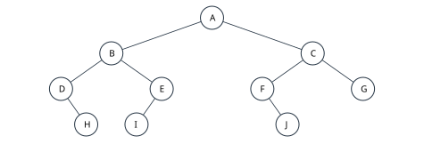
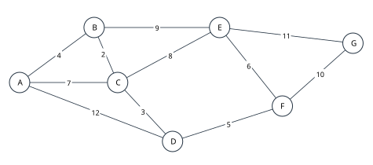
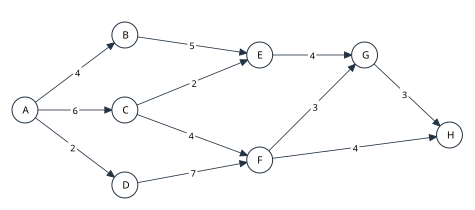

# 2027考研重邮802押题卷 第1套

满分150分，考试时间180分钟。四部分分值20、30、70、30分。
各题独立，题内约定优先。程序用C或类C记法，整数运算不溢出；算法题写基本思想、实现及时间和辅助空间复杂度。

## 一、程序阅读题

### 1（6分）

某采样系统把非递减的整数记录存入 a[0..n-1]。下面程序原地整理记录，使每个值至多保留两次；report函数只输出整理后的有效部分。补全①—③，每空2分。n≥0，数组容量充分。
```cpp
int compact(int a[], int n) {
    int write = 0;
    for (int read = 0; read < n; ++read) {
        if (write < 2 || a[read] != ①) {
            a[write] = a[read];
            ②;
        }
    }
    return ③;
}
void report() {
    int a[] = {1,1,1,2,2,3,3,3,3,5};
    int n = compact(a, 10);
    for (int i = 0; i < n; ++i)
        printf("%d ", a[i]);
}
```

### 2（6分）

系统用带头结点的单链表保存任务编号。下列函数把编号在闭区间[lo,hi]内的结点从原表摘下，按原次序接到新表B中；不释放数据结点。B是已分配的空头结点，A、B互不相同，lo≤hi。补全①—③，每空2分。
```cpp
typedef struct Node {
    int data;
    struct Node *next;
} Node;
void extract(Node *A, Node *B, int lo, int hi) {
    Node *pre = A, *p = A->next, *tail = B;
    B->next = NULL;
    while (p != NULL) {
        Node *next = p->next;
        if (lo <= p->data && p->data <= hi) {
            pre->next = ①;
            tail->next = p;
            tail = p;
            tail->next = NULL;
        } else {
            ②;
        }
        p = ③;
    }
}
void reportBatch() {
    Node A = {0, NULL}, B = {0, NULL};
    Node tasks[6] = {{8,NULL},{3,NULL},{7,NULL},
                     {2,NULL},{6,NULL},{9,NULL}};
    A.next = &tasks[0];
    for (int i=0; i<5; ++i) tasks[i].next=&tasks[i+1];
    extract(&A, &B, 3, 7);
    for (Node *p=B.next; p!=NULL; p=p->next)
        printf("%d ", p->data);
}
```

### 3（4分）

整数依次为4,1,3,2,6,5。按给定程序运行，写出输出序列（2分）、Push和Pop各自调用次数（共1分），以及Top调用总次数（1分）。栈初始为空，容量充分；Top只读取栈顶；&&按C语言从左到右短路求值，末尾清栈循环没有调用Top。
```cpp
for (int i = 0; i < 6; ++i) {
    while (!Empty(S) && Top(S) < a[i]) {
        printf("%d ", Pop(S));
    }
    Push(S, a[i]);
}
while (!Empty(S)) printf("%d ", Pop(S));
```

### 4（4分）

读取下列程序。树中结点的data均为正整数。调用f(T,1)时，T的层次结构为：根6；6的左、右孩子分别为3、8；3的左孩子为2、右孩子为空；8的左、右孩子分别为7、9。填写返回值（2分），并写出一般有n个结点、高度为h时的时间和辅助空间复杂度（各1分，高度按结点数计）。
```cpp
int f(Node *p, int depth) {
    if (p == NULL) return 0;
    int left = f(p->left, depth + 1);
    int right = f(p->right, depth + 1);
    if (p->left == NULL && p->right == NULL)
        return depth * p->data;
    return left + right;
}
```

## 二、填空题

### 1（3分）

只存储满足1≤i≤j≤k≤8的元素A[i][j][k]，其他下标不存。按如下顺序连续压缩存放：i从小到大；同一i内j从i到8；同一(i,j)内k从j到8。每元素占4字节，A[1][1][1]的地址为1000。共存储____个元素（1分），A[2][4][7]的地址为____（2分）。

### 2（3分）

后缀表达式“9 2 3 + * 8 4 / - 6 +”中的符号均以空格分隔，运算采用整数运算，除法截去小数部分。表达式值为____（2分），计算过程中操作数栈的最大深度为____（1分）。

### 3（3分）

循环队列使用长度为13的数组，下标0～12，front指队头元素，rear指下一入队位置，空出一格。初始front=9、rear=2，依次出队3个，入队6个，出队4个，入队2个，各操作均成功。最终front=____、rear=____，队列中有____个元素。（每空1分）

### 4（3分）

模式串为“ababaabbaba”，字符下标从1开始。约定next[1]=0；j>1时，next[j]等于前j-1个字符的最长相等真前缀与真后缀长度加1。写出next[1..11]：____。

### 5（3分）

无向简单图有12个顶点，其中4个顶点的度为5，2个顶点的度为3，其余顶点的度均为2。原图共有____条边（1分）。删除任意一个度为5的顶点及其全部关联边后，用普通邻接表存储剩余图，边结点总数为____（2分；每条无向边在两个端点表中各存一次）。

### 6（3分）

一棵完全二叉树的高度为10（根在第1层），倒数第二层有73个叶结点。该树最少有____个结点（2分），最多有____个结点（1分）。

### 7（3分）

森林F有121个结点、114条边。按“左孩子—右兄弟”规则转换为一棵二叉树（各树根也以右兄弟相连）后，有45个结点的左孩子指针非空。F有____棵树，F的叶结点有____个，所得二叉链表的空右孩子指针有____个。（每空1分）

### 8（3分）

一棵5阶B树有3层存关键字的结点，根为第1层，最底层存关键字的结点为第3层，不把空指针计为一层。各结点最多4个关键字；非根结点至少2个关键字；非终端结点若有r个关键字，恰有r+1个孩子。已知根恰有3个关键字，则第3层结点最少____个，全树关键字总数最少____个、最多____个（每空1分；关键字互不相同，均只在一个结点中存储）。

### 9（3分）

元素1～6按递增次序依次进栈，可随时出栈，但栈容量为3。若前两个出栈元素依次为3、2，满足条件的不同完整出栈序列共有____种。

### 10（3分）

一棵二叉树的结点标识互不相同，先序为A,B,D,E,C,F,G,H，中序为D,B,E,A,F,C,H,G。该树的后序为____（2分），高度为____（1分，根所在层为第1层）。

## 三、综合应用题

### 1（10分）

二叉树如图，各结点标识互不相同。

（1）写出中序、后序遍历序列。（4分）

（2）进行不带头结点的中序线索化，写出叶结点H，I，J的左、右线索分别指向哪个结点；无前驱或后继时填NULL。（3分）

（3）将图中的二叉树按“左孩子—右兄弟”规则解释为森林，写出各树根，以及各非叶结点从左至右的孩子表。（3分）



### 2（10分）

散列表长13，地址0～12，H(k)=k mod 13。依次插入(26，39，14，27，40，18，31，44，8)，冲突用线性探测。

（1）给出最终表及各关键字插入时的探测地址序列。（5分）

（2）计算等概率成功查找ASL。（2分）

（3）设失败查找的散列初址在0～12上等概率分布，遇首个空单元即停止，包含该空单元的比较。列出各初址的失败比较次数并求失败ASL。（3分）

### 3（10分）

字符及频数如下：
|字符|a|b|c|d|e|f|g|h|
|---|---|---|---|---|---|---|---|---|
|频数|4|6|9|13|18|25|31|40|
构造Huffman树时每次取权值最小的两个结点，权较小者为左孩子；同权时按结点生成次序取先生成者在左，初始叶按a到h依次生成。左边编码0，右边编码1。

（1）列出每次合并的两个权值及新权值，并画树。（4分）

（2）给出各字符编码及WPL。（4分）

（3）对比8字符定长编码，给出本段全部字符用Huffman编码比定长编码节省的位数。（2分）

### 4（10分）

将关键字(42，18，65，9，30，54，80，24，36，50，60)按给定次序插入空BST。另将同一组关键字升序存入数组，并按mid=⌊(low+high)/2⌋进行折半查找。

（1）画BST并计算等概率成功ASL。（4分）

（2）画折半查找判定树，计算成功ASL。（3分）

（3）把排序后的12个失败区间视为等概率，计算折半失败ASL；比较次数不含最终空位置。（3分）

### 5（10分）

无向带权图如图，边及权值以表为准：
|起点|终点|权值|
|---|---|---|
|A|B|4|
|A|C|7|
|A|D|12|
|B|C|2|
|B|E|9|
|C|D|3|
|C|E|8|
|D|F|5|
|E|F|6|
|E|G|11|
|F|G|10|

（1）从A出发执行Prim，逐轮写出新加入顶点、所选边及当前顶点集合。（4分）

（2）执行Kruskal，按实际检查顺序列出边，并标明选取或舍弃，选足6条即结束。（4分）

（3）给出最小生成树总权值。（2分）



### 6（10分）

AOE网以A为唯一源点、H为唯一汇点，活动及工期如下（工期单位相同）：
|起点|终点|权值|
|---|---|---|
|A|B|4|
|A|C|6|
|A|D|2|
|B|E|5|
|C|E|2|
|C|F|4|
|D|F|7|
|E|G|4|
|F|G|3|
|F|H|4|
|G|H|3|

（1）求所有事件的最早发生时间ve和最迟发生时间vl。（4分）

（2）求各活动的最早开始e、最迟开始l和总时差l−e。（4分）

（3）给出最短工期及全部关键路径。（2分）



### 7（10分）

对同一初始序列(46，18，63，27，9，54，35，72)分别执行两种升序排序，每种都从原序列独立开始。

（1）直接插入排序：首项视为已排序区，第i趟插入原数组位置i的元素（0起），写出全部7趟的完整数组。（5分）

（2）冒泡排序：每趟从右向左比较相邻项，把当前最小项移到未排区最左端；若某趟无交换立即结束。写出实际各趟完整数组，标出无交换结束趟（如有）。（5分）

## 四、算法设计与分析题

### 1（8分）

带头结点的单链表存放n个整数。给定k≥1，从首元起把结点每k个分为一组，将完整组内部的链接逆置；末尾不足k个的结点保持原顺序。只重连原结点，不修改data，不分配新数据结点；头结点不变。例如1→2→3→4→5→6→7→8且k=3，结果为3→2→1→6→5→4→7→8。实现void reverseGroups(Node *head,int k)。
```cpp
typedef struct Node { int data; struct Node *next; } Node;
```


请写出算法思想、完整C/C++代码，并分析时间与辅助空间复杂度。

### 2（10分）

二叉树每个结点有标记mark（0或1）。删除所有“其子树内没有任何mark=1结点”的结点，并释放被删除结点的内存；保留结点的相对父子关系不变，返回新根指针。空树允许。实现TNode *prune(TNode *root)，要求每个结点只作常数次处理。
```cpp
typedef struct TNode {
    int data, mark;
    struct TNode *left, *right;
} TNode;
```


请写出算法思想、完整C/C++代码，并分析时间与辅助空间复杂度。

本题被删除的结点均由malloc分配，可使用free释放。

### 3（12分）

有向简单图用邻接矩阵存储，顶点编号0～n−1（1≤n≤100），A[u][v]=1表示u→v，0表示无弧，无自环。给定合法顶点t。请按顶点编号递增顺序输出所有能沿有向路径到达t的顶点（包括t），并返回这些顶点的个数。实现int reachTarget(const int A[100][100],int n,int t)，要求时间O(n²)、辅助空间O(n)。

请写出算法思想、完整C/C++代码，并分析时间与辅助空间复杂度。
