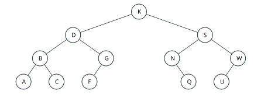
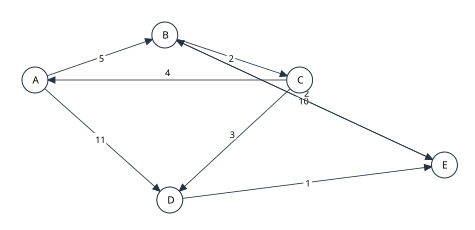
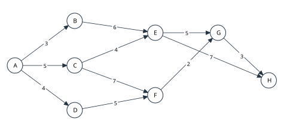

# 2027考研重邮802押题卷 第3套

满分150分，考试时间180分钟。四部分分值20、30、70、30分。
各题独立，题内约定优先。程序用C或类C记法，整数运算不溢出；算法题写基本思想、实现及时间和辅助空间复杂度。

## 一、程序阅读题

### 1（4分）

一批日志a[0..n-1]需要循环右移k位：原末尾k个元素移到最前，其余元素后移。k≥0，n≥0；允许k≥n。下面程序采用三次区间逆置完成，补全①、②，每空2分。
```cpp
void reverse(int a[], int left, int right) {
    while (left < right) {
        int temp = a[left];
        a[left] = a[right];
        a[right] = temp;
        ++left; --right;
    }
}
void rotateRight(int a[], int n, int k) {
    if (n <= 1) return;
    k = ①;
    if (k == 0) return;
    reverse(a, 0, n - 1);
    reverse(a, 0, ②);
    reverse(a, k, n - 1);
}
void report() {
    int a[] = {1,2,3,4,5,6,7};
    rotateRight(a, 7, 10);
    for (int i = 0; i < 7; ++i) printf("%d ", a[i]);
}
```


### 2（4分）

活动名单存入带头结点的单链表。程序将原奇数位结点组成A表、偶数位结点组成B表，两表内部保持原先顺序；原头结点继续作为A头结点，B已分配为空头结点，与A的所有结点均不同；拆分后可用reportLists输出两份名单。补全①、②，每空2分。
```cpp
typedef struct Node { int data; struct Node *next; } Node;
void split(Node *A, Node *B) {
    Node *p = A->next, *ta = A, *tb = B;
    int pos = 1;
    A->next = B->next = NULL;
    while (p != NULL) {
        Node *next = ①;
        p->next = NULL;
        if (pos % 2 == 1) {
            ta->next = p;
            ②;
        } else {
            tb->next = p;
            tb=p;
        }
        p = next;
        ++pos;
    }
}
void reportLists(const Node *A, const Node *B) {
    const Node *lists[2] = {A, B};
    for (int i=0; i<2; ++i) {
        for (const Node *p=lists[i]->next; p; p=p->next)
            printf("%d ", p->data);
        printf("\n");
    }
}
```

### 3（4分）

有一个初始为空的小根堆，使用1起下标、逐个上滤插入关键字序列8,3,6,1,5,2。然后执行两次删除堆顶，每次用末项补根并下滤。填写插入完成后的堆数组（1分）、两次依次删除的值（1分）、第二次删除后的堆数组（1分）及六次插入期间关键字比较总次数（1分）。插入时只计“待插入值与父结点值”的比较，失败的最后一次比较也计，根处无父结点不比较。

### 4（4分）

下列函数处理长度n=2^k（k≥0）的数组，emit每次执行用时O(1)。填写n=8时emit的总调用次数（2分），以及一般n时的时间与辅助空间复杂度（各1分）。
```cpp
void work(int a[], int n) {
    if (n <= 1) return;
    for (int i = 0; i < n; i += 2) emit(a[i]);
    work(a, n / 2);
    work(a + n / 2, n / 2);
}
```

### 5（4分）

配送网用无向图邻接矩阵g表示，有边记1、无边记0。函数统计从站点s出发，最少经过的边数不超过limit的可达站点数，包含s自身。1≤n≤100，s合法，limit≥0。补全①、②，每空2分。
```cpp
int nearby(const int g[100][100], int n,
           int s, int limit) {
    int dist[100], queue[100];
    for (int v=0; v<n; ++v) dist[v]=-1;
    int front=0, rear=0, count=0;
    dist[s]=0;
    queue[rear++]=s;
    while (front<rear) {
        int u=queue[front++];
        ++count;
        if (dist[u]==limit) continue;
        for (int v=0; v<n; ++v) {
            if (g[u][v] && ①) {
                dist[v]=②;
                queue[rear++]=v;
            }
        }
    }
    return count;
}
void reportNearby() {
    int g[100][100]={0};
    int edges[7][2]={{0,1},{0,2},{1,3},{2,3},
                      {2,4},{3,5},{4,5}};
    for (int i=0; i<7; ++i) {
        int u=edges[i][0],v=edges[i][1];
        g[u][v]=g[v][u]=1;
    }
    printf("%d",nearby(g,6,0,2));
}
```


## 二、填空题

### 1（3分）

二维数组A[1..6][-2..b]按行优先连续存储，每元素4字节。A[2][1]与A[5][1]的首字节地址分别为2056与2188，则列数为____，b=____。（前空2分，后空1分）

### 2（3分）

无向简单图的顶点为A～G，边集为{A-B,A-C,A-D,B-E,C-D,C-F,D-E,E-F,F-G,E-G}。从C开始深度优先遍历，每个顶点的邻接点均按字母递增次序扫描。顶点的首次访问序列为____（2分）；仅保留首次发现新顶点时所走的边形成DFS生成树，以C为根，其高度为____（1分，根所在层为第1层）。

### 3（3分）

循环队列使用长度为11的数组，下标0～10，front指队头元素，rear指下一入队位置，空出一格。初始front=8、rear=2，依次出队2个，入队4个，出队3个，入队1个，各操作均成功。最终front=____、rear=____，队列中有____个元素。（每空1分）

### 4（3分）

一棵4阶B+树高为3层，根为第1层，叶结点为第3层。每个内部结点最多4个孩子，非根内部结点至少2个孩子，根至少2个孩子；有r个孩子的内部结点恰存r个索引关键字，分别复制各孩子子树中的最大关键字。全部数据记录只存于叶结点，每个叶结点恰存4条记录，共24条记录，关键字互异。叶结点共有____个，内部结点中的索引关键字总数最少____个、最多____个（每空1分；索引副本不计作数据记录）。

### 5（3分）

广义表L=((a,b),(c,(d,e)),())，Head取表头元素，Tail取删去表头后的表。Head(Tail(Head(Tail(L))))=____（2分），Tail(Tail(L))=____（1分）。

### 6（3分）

一棵非空二叉树采用二叉链表存储，共有281个空孩子指针，其中右孩子空指针160个；度为2的结点有100个。仅有左孩子、仅有右孩子及叶结点的数量依次为____、____、____。（每空1分）

### 7（3分）

一个森林共有36个结点，其中度为1、2、3的结点分别为7、6、4个，无更高度结点。森林共有____棵树（1分），叶结点有____个（1分）；按左孩子—右兄弟转换成一棵二叉树后，空右孩子指针有____个（1分，各树根以右兄弟相连）。

### 8（3分）

依次向空AVL树插入关键字(40，20，60，10，30，50，70，5，1)，每次插入后立即按AVL规则调整，平衡因子定义为左子树高度减右子树高度。插入最后一个关键字1时，调整前最低失衡结点的关键字为____（1分）；全部调整完成后，平衡因子为0的结点共有____个（2分）。

### 9（3分）

一棵二叉树的结点标识互不相同，先序为A,B,C,D,E,F,G，后序为C,B,F,G,E,D,A。具有这两种遍历序列的不同二叉树共有____棵（2分，左、右孩子位置不同视为不同树），其中每棵树度为2的结点数均为____（1分）。

### 10（3分）

对有序表(3，8，12，17，23，28，34，41，49，56，64，73，85)折半查找关键字10，下标从0开始，每次mid=⌊(low+high)/2⌋。依次比较的关键字为____（2分），关键字比较次数为____（1分）。把一次与a[mid]判断大小/相等合计为一次关键字比较。

## 三、综合应用题

### 1（10分）

二叉树如图，各结点标识互不相同。

（1）写出中序、后序遍历序列。（4分）

（2）进行不带头结点的中序线索化，写出叶结点A，C，F的左、右线索分别指向哪个结点；无前驱或后继时填NULL。（3分）

（3）将图中的二叉树按“左孩子—右兄弟”规则解释为森林，写出各树根，以及各非叶结点从左至右的孩子表。（3分）



### 2（10分）

散列表长11，地址0～10，H(k)=k mod 11。依次插入(17，28，39，50，61，6，19，32)，冲突用线性探测。

（1）给出最终表及各关键字插入时的探测地址序列。（5分）

（2）计算等概率成功查找ASL。（2分）

（3）设失败查找的散列初址在0～10上等概率分布，遇首个空单元即停止，包含该空单元的比较。列出各初址的失败比较次数并求失败ASL。（3分）

### 3（10分）

字符及频数如下：
|字符|a|b|c|d|e|f|g|h|
|---|---|---|---|---|---|---|---|---|
|频数|2|7|11|16|23|29|38|51|
构造Huffman树时每次取权值最小的两个结点，权较小者为左孩子；同权时按结点生成次序取先生成者在左，初始叶按a到h依次生成。左边编码0，右边编码1。

（1）列出每次合并的两个权值及新权值，并画树。（4分）

（2）给出各字符编码及WPL。（4分）

（3）对比8字符定长编码，给出本段全部字符用Huffman编码比定长编码节省的位数。（2分）

### 4（10分）

将关键字(48，24，72，12，36，60，84，6，18，30，42，54)按给定次序插入空BST。另将同一组关键字升序存入数组，并按mid=⌊(low+high)/2⌋进行折半查找。

（1）画BST并计算等概率成功ASL。（4分）

（2）画折半查找判定树，计算成功ASL。（3分）

（3）把排序后的13个失败区间视为等概率，计算折半失败ASL；比较次数不含最终空位置。（3分）

### 5（10分）

有向带权图如图，边以表为准：
|起点|终点|权值|
|---|---|---|
|A|B|5|
|A|D|11|
|B|C|2|
|B|E|10|
|C|A|4|
|C|D|3|
|D|E|1|
|E|B|2|

采用Floyd，顶点允许作为中间点的顺序为A、B、C、D、E。D⁽⁰⁾仅含直接边、对角为0、无边为∞。

（1）给出仅允许A、允许A和B作为中间点的距离矩阵D⁽¹⁾、D⁽²⁾，以及允许全部顶点作为中间点的最终矩阵D⁽⁵⁾。（6分）

（2）写出A到E以及D到C各一条最短路径和长度。（4分）



### 6（10分）

AOE网以A为唯一源点、H为唯一汇点，活动及工期如下（工期单位相同）：
|起点|终点|权值|
|---|---|---|
|A|B|3|
|A|C|5|
|A|D|4|
|B|E|6|
|C|E|4|
|C|F|7|
|D|F|5|
|E|G|5|
|F|G|2|
|E|H|7|
|G|H|3|

（1）求所有事件的最早发生时间ve和最迟发生时间vl。（4分）

（2）求各活动的最早开始e、最迟开始l和总时差l−e。（4分）

（3）给出最短工期及全部关键路径。（2分）



### 7（10分）

（1）对初始序列(52，16，37，8，61，25，44，19)作升序快速排序，下标0～7。每次取子区间首元为枢轴，采用挖坑法：先从右向左找小于枢轴的项填左坑，再从左向右找大于枢轴的项填右坑，相遇后放枢轴；先递归左区间再递归右区间。按执行顺序写出每次非平凡划分的区间、枢轴最终下标和整个数组。（4分）

（2）文件记录依次为(17，21，5，44，10，12，56，32，8，25，29，40)。采用置换选择生成升序初始归并段，工作区最多容纳3条记录。开始读满3条；每次输出本段可用记录中最小者，并从输入顺序补入1条（若输入未尽）；新记录若小于本段刚输出的值，则冻结到下一段。当本段已无可用记录时结束本段，解除全部冻结开始下一段；输入耗尽后仍按此规则排空工作区。按生成次序写出全部初始归并段。（4分）

（3）对上面得到的初始段作二路平衡归并，每趟按生成次序将相邻段两两合并，奇数个时末段直接进入下一趟。写出每趟结束后的段数及所需归并趟数。（2分）

## 四、算法设计与分析题

### 1（8分）

不带头结点的单链表可能有环，也可能无环；若有环，首次进入环前是有限的非环前缀。只使用O(1)辅助空间，在检测到环时找到环入口并将环中指向该入口的那个next改为NULL，使从head出发能恰好访问每个原结点一次；返回原环入口地址。无环或空表返回NULL且链表不变。实现Node *breakCycle(Node *head)。
```cpp
typedef struct Node { int data; struct Node *next; } Node;
```


请写出算法思想、完整C/C++代码，并分析时间与辅助空间复杂度。

### 2（10分）

BST中关键字为互不相同的整数，给定lo≤hi。请按严格递增次序输出闭区间[lo,hi]内的全部关键字，并返回输出个数；不修改树。实现int printRange(TNode *root,int lo,int hi)，应利用BST性质跳过不可能含答案的子树。分别给出最坏时间和以树高h、输出数k表示的时间上界，分析辅助空间。
```cpp
typedef struct TNode { int data; struct TNode *left, *right; } TNode;
```


请写出算法思想、完整C/C++代码，并分析时间与辅助空间复杂度。

### 3（12分）

无向简单图以邻接表存储，顶点0～n−1（1≤n≤100），每条无向边在两个端点邻接表各出现一次。给定合法顶点w，设删除w及其所有关联边，但不允许实际修改图。请给剩余图的连通分量依次编号0、1、…，编号按“尚未编号的最小顶点”所在分量优先。把编号写入label[0..n−1]，令label[w]=-1，返回分量个数。实现int componentsWithout(const Graph &G,int w,int label[])，时间O(V+E)、辅助空间O(V)。
```cpp
#define MAXV 100
typedef struct Arc { int to; struct Arc *next; } Arc;
typedef struct { Arc *head[MAXV]; int n; } Graph;
```


请写出算法思想、完整C/C++代码，并分析时间与辅助空间复杂度。
