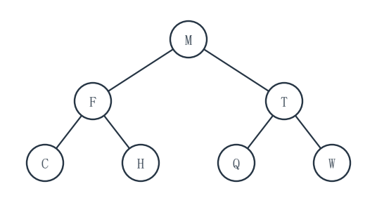
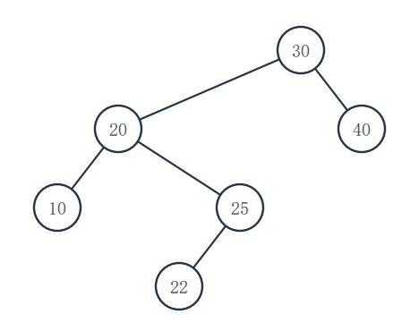
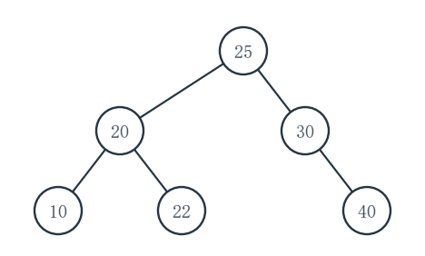
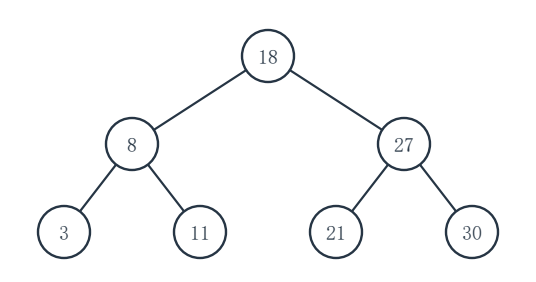

# 重邮802模拟试卷第3套参考答案

对应第6版题面。等价正确解法同样给分，复杂度应与实际实现一致。

## 一、程序阅读题

### 1（5分）

各空依次为：`1、2、4、8`；`32`；`k+1`；`O(n log n)`。

内层每轮执行 8 次，外层对样例执行 4 轮。一般 `n=2^k` 时，外层取值从 `2^0` 到 `2^k`，共 `k+1` 轮，故操作次数为 `n(k+1)`。

### 2（5分）

`__1__ = head->next`；`__2__ = p->next`；`__3__ = q->key < best->key`。

打印：`(1,-) (2,-) (4,b) (4,a)`；最坏时间复杂度：`O(n^2)`。首轮把最后的 `(1,-)` 与 `(4,a)` 整记录互换，因此原来后面的 `(4,b)` 排在 `(4,a)` 前；选第一个同键最小结点也不能保证此交换式选择排序稳定。

### 3（5分）

`__1__ = q->rear->next = p`；`__2__ = q->rear = q->front`；`__3__ = q->front == q->rear`。

打印：`4 7`；单次 `enq` 或 `deq` 均为 `O(1)`。头结点始终保留；删掉最后一个数据结点时必须把 `rear` 复位到头结点。

### 4（5分）

`__1__ = g[u][v] && !seen[v]`；`__2__ = dfs(v)`；`__3__ = !seen[u]`；时间复杂度 `O(V^2)`。

每个顶点只进入 `dfs` 一次，但每次都要扫描邻接矩阵的一整行，共 `V` 行；外层找各连通分量根的开销被 `V^2` 包含。样例会识别 `{0,1,2}` 与 `{3}` 两个分量。

## 二、填空题

### 1（3分）

依次填 `2`、`0`、`5`。四次入队后 rear=4；两次出队后 front=2、count=2；再入三次使 rear=(4+3) mod 7=0、count=5。

### 2（3分）

填 `27`。严格二叉树中叶数为内部结点数加1；设叶数 L，则总数为 `2L-1=53`。

### 3（3分）

填 `14`。首次出栈4意味着此前必须按序压入1、2、3、4并立即弹出4；其后对栈中3、2、1及待入的5、6按合法入出栈次序分支枚举，得到14个完整序列。

### 4（3分）

填 `0,1,1,2,3,1,2`。对 j=1..7，前 j-1 字符的最长真前后缀长度依次为“不适用、0、0、1、2、0、1”，按给定约定加1（首项固定0）。

### 5（3分）

填 `16`。后缀式先算 `3 2 + = 5`，得 `8×5=40`；再算 `9 5 - = 4`，得 `40÷4=10`，最后 `10+6=16`。

### 6（3分）

填 `12`。出边数为 `4×3+3×2+2×1=20`，总结点数21；已知非叶结点9个，所以叶结点12个。

### 7（3分）

填 `n`。每个顶点至少有一条出弧，故弧数至少 n；一个覆盖全部 n 个顶点的有向环恰用 n 条弧并强连通。

### 8（3分）

填 `23`。每棵树的边数等于其结点数减1，因此森林总边数为 `27-4=23`。

### 9（3分）

填 `(0,4,1,9,7,6,2)`。新键0先占7号位，与3号位的2交换，再与1号位的1交换。

### 10（3分）

填 `24`。二叉链表共有 `2n` 个孩子指针，其中非空指针恰为树边数 `n-1`，空指针数为 `2n-(n-1)=n+1=24`。

## 三、综合应用题

### 1（10分）

（1）原树如下；横向标注分别是左、右孩子：

```text
        M
       / \
      F   T
     / \ / \
    C  H Q  W
```

（2）后序：`C,H,F,Q,W,T,M`。

（3）中序是 `C,F,H,M,Q,T,W`，所以 C 的空左指针→`NULL`；H 的空右指针→`M`；Q 的空左指针→`M`；W 的空右指针→`NULL`。题中仅询问原本为空的指针，实际孩子指针仍保持原孩子。



### 2（10分）

（1）普通 BST：

```text
       30
      /  \
     20   40
    /  \
   10  25
       /
      22
```

（2）插入22后，向上回溯首次失衡的结点是 `30`，属于 **LR** 型：先对其左孩子20左旋，再对30右旋。

（3）AVL 调整后：

```text
       25
      /  \
     20   30
    / \     \
   10  22    40
```

（4）普通 BST 查找22：`30→20→25→22`，比较4次；AVL 查找22：`25→20→22`，比较3次。





### 3（10分）

（1）按百分数权值写，七次合并为：`2+3=5`，`5+6=11`，`7+10=17`，`11+17=28`，`19+21=40`，`28+32=60`，`40+60=100`。新权值依次为 **5、11、17、28、40、60、100**（百分数）。

（2）WPL 等于各次新权值之和，`(5+11+17+28+40+60+100)/100 = 2.61 bit/字符`。

（3）3位定长编码平均 `3 bit/字符`；比 Huffman 多 `3-2.61=0.39 bit/字符`。

（4）8个叶、每个内部结点有两个孩子，内部结点7个，总结点数 **15**。

### 4（10分）

（1）插入后槽位：

| 槽号 | 0 | 1 | 2 | 3 | 4 | 5 | 6 | 7 | 8 | 9 | 10 |
|---|---:|---:|---|---:|---:|---:|---:|---|---|---|---|
| 键 | 22 | 33 | 空 | 14 | 25 | 36 | 47 | 空 | 空 | 空 | 空 |

（2）按 `22,33,14,25,36,47` 的成功探测次数为 `1,2,1,2,3,4`，所以 `ASL成功=13/6≈2.167`。

（3）初址 `0..10` 的失败探测次数依次为 `3,2,1,5,4,3,2,1,1,1,1`，故 `ASL失败=24/11≈2.182`。例如从3出发连续查3、4、5、6、7，遇7号空槽才停，计5次。

### 5（10分）

（1）Kruskal 按表序检查到选满4条边：

| 检查边 | AB | AC | BC | BD | CD | DE |
|---|---|---|---|---|---|---|
| 结果 | 入树 | 入树 | 因成环略过 | 入树 | 因成环略过 | 入树 |

`CE` 尚未轮到，不必检查。

（2）最小生成树边集 `{AB,AC,BD,DE}`，总权值 `1+1+2+3=7`。

（3）Prim 从 A 起，等权按表序，入树次序：`AB→AC→BD→DE`。

### 6（10分）

（1）折半判定树：

```text
        18
       /  \
      8    27
     / \  / \
    3  11 21 30
```

（2）各层结点数1、2、4，故 `ASL成功=(1×1+2×2+4×3)/7=17/7≈2.429`。

（3）查找21的比较顺序：`18→27→21`。

（4）查找25时比较 `18→27→21`，然后进入空区间，故比较 **3** 次。



### 7（10分）

（1）第一趟（长度1段两两归并）：`(3,8a,1,7,2,8b,4,6)`。

（2）第二趟（长度2段两两归并）：`(1,3,7,8a,2,4,6,8b)`。

（3）第三趟（长度4段归并）：`(1,2,3,4,6,7,8a,8b)`。两个键8相等时先取左段的8a，故保持稳定次序。

## 四、算法设计与分析题

### 1（8分）

**基本思想。** 三个游标分别指向三条未处理链表的首结点。每次取非空游标中键最小的原结点，摘下并接到结果尾部。键相同时任选一条；最后把结果尾结点的 `next` 设为 `NULL`。

```c
#include <stddef.h>
typedef struct Node { int key; struct Node *next; } Node;

Node *mergeThree(Node *a, Node *b, Node *c) {
    Node *head = NULL;
    Node **tailNext = &head;
    while (a != NULL || b != NULL || c != NULL) {
        Node **pick = NULL;
        if (a != NULL) pick = &a;
        if (b != NULL && (pick == NULL || b->key < (*pick)->key))
            pick = &b;
        if (c != NULL && (pick == NULL || c->key < (*pick)->key))
            pick = &c;
        Node *p = *pick;
        *pick = p->next;
        *tailNext = p;
        tailNext = &p->next;
    }
    *tailNext = NULL;
    return head;
}
```

令三表结点总数为 N。每个结点取出、接入一次，时间 `O(N)`；仅用固定个数指针，辅助空间 `O(1)`。全部为空时返回 `NULL`。

**建议评分（8分）：** 正确的三路最小值选择与重连思想2分；完整C实现、空链和尾端处理5分；时间与辅助空间1分。

### 2（10分）

**基本思想。** 第一遍深度优先搜索维护“到当前结点是否已经见过标记”和当前深度；在合格叶结点处只记最长路径的叶指针。第二遍从根找该叶，把沿途结点写入 `out`。这样不用在每个叶结点复制整条路径。

```c
#include <stdbool.h>
#include <stddef.h>
typedef struct Node {
    int data;
    bool mark;
    struct Node *left, *right;
} Node;

static void chooseLeaf(const Node *p, int depth, bool seenMark,
                       const Node **bestLeaf, int *bestLen) {
    if (p == NULL) return;
    ++depth;
    seenMark = seenMark || p->mark;
    if (p->left == NULL && p->right == NULL) {
        if (seenMark && depth > *bestLen) {
            *bestLen = depth;
            *bestLeaf = p;
        }
        return;
    }
    chooseLeaf(p->left, depth, seenMark, bestLeaf, bestLen);
    chooseLeaf(p->right, depth, seenMark, bestLeaf, bestLen);
}

static bool writeToLeaf(const Node *p, const Node *target,
                        const Node *out[], int *len) {
    if (p == NULL) return false;
    out[(*len)++] = p;
    if (p == target) return true;
    if (writeToLeaf(p->left, target, out, len) ||
        writeToLeaf(p->right, target, out, len)) return true;
    --*len;
    return false;
}

bool longestMarkedPath(const Node *root, const Node *out[], int *len) {
    const Node *leaf = NULL;
    int bestLen = 0;
    *len = 0;
    chooseLeaf(root, 0, false, &leaf, &bestLen);
    if (leaf == NULL) return false;
    return writeToLeaf(root, leaf, out, len);
}
```

设结点数为 n、高度为 h。两次 DFS 各至多访问 n 个结点，时间 `O(n)`；递归栈最多 h 层，额外辅助空间 `O(h)`，调用者提供的输出数组不计入辅助空间。空树或无标记的根叶路径时 `*len=0`。

**建议评分（10分）：** 合格路径与最长目标的思想2分；第一遍选目标叶、第二遍正确输出及失败处理6分；时间与辅助空间2分。

### 3（12分）

**基本思想。** 从 s 深度优先搜索，记录已在当前路径上的顶点。到达 k 条边时，仅当当前点为 t 才计1；若提前到达 t，则该路径不能再延伸为顶点不重复的 s→t 路径。回溯时撤销访问标记，使不同顶点序列分别计数。

```c
#include <stdbool.h>

static int countDfs(const int g[12][12], int V, int u, int t,
                    int usedEdges, int k, bool onPath[12]) {
    if (usedEdges == k) return u == t ? 1 : 0;
    if (u == t) return 0;
    int ans = 0;
    for (int v = 0; v < V; ++v) {
        if (g[u][v] && !onPath[v]) {
            onPath[v] = true;
            ans += countDfs(g, V, v, t, usedEdges + 1, k, onPath);
            onPath[v] = false;
        }
    }
    return ans;
}

int countPaths(const int g[12][12], int V, int s, int t, int k) {
    bool onPath[12] = {false};
    onPath[s] = true;
    return countDfs(g, V, s, t, 0, k, onPath);
}
```

搜索最多扩展 k 条边，每层候选顶点至多 V 个，每个状态扫描矩阵一行至多 V 项，故时间上界为 `O(V^(k+1))`；访问数组与递归栈合计辅助空间 `O(V)`。当 `s=t,k=0` 返回1；`s=t,k>0` 返回0。题定 `V≤12`，此范围内计数不超过 `int` 上限。

**建议评分（12分）：** 简单路径与恰k边计数思想2分；访问标记、深度边界、回溯及入口等完整C实现8分；时间与辅助空间2分。
