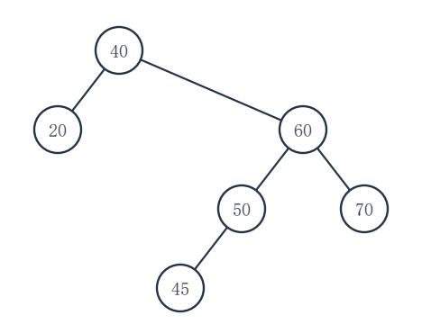
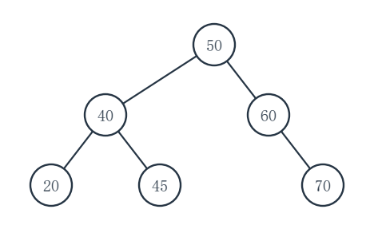

# 重邮802模拟试卷第4套参考答案

对应第6版题面。等价正确解法同样给分，复杂度应与实际实现一致。

## 一、程序阅读题

### 1（5分）

各空依次为：`16`；`5`；`6`；`O(n)`；`O(n)`。

数组最小值是16；对6个元素的递归从 n=6 调用到 n=1，共6层。每层回溯（除基本层）比较一次，故比较5次；递归栈深度为n。

### 2（5分）

`__1__ = pa`；`__2__ = free(pa)`；`__3__ = pb = pb->next`；时间复杂度 `O(m+n)`。

相等时把 A 当前结点接到结果尾部；A 键较小时释放该结点；B 键较小时仅前进 B。每个游标只向前，后续剩余 A 最多再扫描一次。B 原链不修改。

### 3（5分）

`__1__ = q->count == 4`；`__2__ = (q->rear + 1) % 4`；`__3__ = --q->count`；单次入队或出队最坏时间复杂度 `O(1)`。

满队列通过 `count==4` 判断，入队只移动 rear；出队只移动 front 并减 count，不随队列长度扫描。

### 4（5分）

`__1__ = t == NULL`；`__2__ = t->left == NULL && t->right == NULL`；`__3__ = leafCount(t->left) + leafCount(t->right)`；时间复杂度 `O(n)`。

空树贡献0，叶结点贡献1，其余结点的叶数为左右子树叶数之和；每个实结点只访问一次。样例叶结点为4、5、7，打印 `leaves=3`。

## 二、填空题

### 1（3分）

依次填 `O(n)`、`O(log n)`。递归树有 n 个叶、总基本操作次数 `2n-1`；最大调用深度为 `log_2n+1`，因此递归栈占 `O(log n)`。

### 2（3分）

依次填 `15`、`1060`。行主序偏移为 `2×6+3=15` 个元素，首地址 `1000+15×4=1060`。

### 3（3分）

依次填 `3`、`3`。先压入1、2、3，弹3、2；再压4弹4、弹1，最后压5弹5。首次弹出前已有3个元素，模拟全过程最大栈高也是3。

### 4（3分）

填 `0,1,1,2,1,2,3`。前 j-1 个字符的最长真前后缀长度（j=2..7）依次为 `0,0,1,0,1,2`，分别加1；首项固定0。

### 5（3分）

依次填 `c`、`原子`。`Tail(L)=((c,d))`，其 `Head` 是子表 `(c,d)`，再取 `Head` 得原子 `c`。

### 6（3分）

填 `33`。严格二叉Huffman树有L个叶时，总结点数 `2L-1`；取L=17得33。

### 7（3分）

依次填 `n`、`1`。强连通要求每个顶点入度、出度至少为1，因此至少n条弧；恰n条时各点入度与出度都恰为1，可由一个覆盖所有顶点的有向环实现。

### 8（3分）

填 `10`。最坏比较次数为 `floor(log_2(600))+1=10`，亦即 `ceil(log_2(600+1))=10`。

### 9（3分）

填 `(1,2,3,5,7,8,4,9)`。新键1放8号位，沿路径8→4→2→1与9、5、2逐层交换。

### 10（3分）

依次填 `16`、`4`。原森林总边数 `19-3=16`；加入一棵不相连的树，树数从3增至4。

## 三、综合应用题

### 1（10分）

（1）后缀式为 `12 4 - 3 5 + * 2 /`。

（2）前六个记号依次是 `12,4,-,3,5,+`。处理后栈底到栈顶为 `[8,8]`：先有 `12-4=8`，再有 `3+5=8`。

（3）结果为 `(8×8)÷2=32`。

（4）栈最多同时放 **3** 个整数：读入 `5` 后栈为 `[8,3,5]`。

### 2（10分）

（1）前四键的插入槽号依次是 `3、4、5、6`：10→3，17从3探测到4，24从3探测到5，5从5探测到6。

（2）删除17后，4号槽为 **DELETED（墓碑）**，不能改成EMPTY。

（3）查找24从 `H(24)=3` 开始，依次探测 `3→4→5`，共 **3次**；墓碑4不使查找提前失败。

（4）31从3开始探测，首个墓碑为4；继续到0号EMPTY后，回用4号。最终槽位：

| 槽号 | 0 | 1 | 2 | 3 | 4 | 5 | 6 |
|---|---|---|---|---:|---:|---:|---:|
| 内容/状态 | EMPTY | EMPTY | EMPTY | 10 | 31 | 24 | 5 |

### 3（10分）

（1）中序序列：`D,B,E,A,F,C,G`。

（2）按 D、E、F、G 顺序的左线索：`NULL、B、A、C`。

（3）按 D、E、F、G 顺序的右线索：`B、A、C、NULL`。

（4）B 的右指针仍指实际右孩子 E，所以 `rtag=0`。

核对：叶结点 D/E/F/G 的两孩子指针原本均空，才被改为前驱/后继线索。

### 4（10分）

（1）刚确定0并放松其出边后，候选距离（0～4）为 `[0,4,9,∞,∞]`。

（2）确定1后，2降为6、3为10；再确定2并放松后为 `[0,4,6,9,11]`。

（3）随后确定3，使4由11降为10。最终距离为 `[0,4,6,9,10]`，0到4的最短距离 **10**；一条最短路径是 `0→1→2→3→4`（权值4+2+3+1）。

### 5（10分）

（1）按事件0～5，`ve=[0,3,2,6,6,8]`。

（2）以工期8为汇点的最迟时间，`vl=[0,3,2,6,6,8]`。

（3）关键活动为 `0→1、0→2、1→3、2→4、3→5、4→5`；`1→4` 的时差为2，并非关键活动。

（4）工期 **8**；全部关键路径是 `0→1→3→5` 和 `0→2→4→5`，两条路径的工时均为8。

### 6（10分）

（1）普通 BST：

```text
       40
      /  \
     20   60
         /  \
        50   70
       /
      45
```

（2）插45后首次失衡的是 **40**，属于右左（RL）型：先在其右孩子60处右旋，再在40处左旋。AVL 最终为：

```text
       50
      /  \
     40   60
    /  \    \
   20  45    70
```

（3）普通 BST 的六键比较次数按输入顺序为 `1,2,2,3,3,4`，`ASL=15/6=2.5`；AVL 深度层数为1、2、2、3、3、3，`ASL=14/6=7/3≈2.333`。





### 7（10分）

（1）五次合并依次为 `5+8=13`、`11+13=24`、`14+19=33`、`24+33=57`、`43+57=100`。新权值依次 **13、24、33、57、100**。

（2）`WPL=13+24+33+57+100=227` bit（按100个字符统计）。

（3）F 的码长 **1**；A 的码长 **4**。

（4）定长编码需 `100×3=300` bit，比 Huffman 多 `300-227=73` bit。

## 四、算法设计与分析题

### 1（8分）

**基本思想。** 将环暂时断开，按原 n 个结点依次扫描。区间内的结点立即释放；区间外的原结点按扫描顺序接到新链尾。扫描结束后，若有保留结点就把新尾指回新首并更新尾指针，否则把尾指针设为 `NULL`。这同时处理原尾删除和全删空。

```c
#include <stdlib.h>
typedef struct Node { int key; struct Node *next; } Node;

int deleteRange(Node **tailRef, int n, int a, int b) {
    if (n == 0) return 0;
    Node *cur = (*tailRef)->next;
    (*tailRef)->next = NULL;  /* 暂时展开环 */
    Node *first = NULL, *last = NULL;
    int deleted = 0;
    for (int i = 0; i < n; ++i) {
        Node *next = cur->next;
        if (a <= cur->key && cur->key <= b) {
            free(cur);
            ++deleted;
        } else {
            if (first == NULL) first = cur;
            else last->next = cur;
            last = cur;
        }
        cur = next;
    }
    if (last == NULL) {
        *tailRef = NULL;
    } else {
        last->next = first;
        *tailRef = last;
    }
    return deleted;
}
```

原结点各访问一次，时间 `O(n)`；固定个数指针，辅助空间 `O(1)`。`n=0` 时原尾已为 `NULL`，直接返回0。

**建议评分（8分）：** 保留顺序及重建圆环的思想2分；完整C实现、释放与删空/尾结点处理5分；复杂度1分。

### 2（10分）

**基本思想。** 从根沿 BST 查找 x 的分支下行。沿途每个结点都可能成为当前最近键；比较绝对差，差相同时选较小键。遇到 x 可立即停止。空树不改写输出。

```c
#include <stdbool.h>
#include <stddef.h>
typedef struct Node {
    int key;
    struct Node *left, *right;
} Node;

bool closestKey(const Node *root, int x, int *out) {
    if (root == NULL) return false;
    bool have = false;
    long long bestDiff = 0;
    int bestKey = 0;
    for (const Node *p = root; p != NULL; ) {
        long long d = (long long)p->key - x;
        if (d < 0) d = -d;
        if (!have || d < bestDiff ||
            (d == bestDiff && p->key < bestKey)) {
            have = true;
            bestDiff = d;
            bestKey = p->key;
        }
        if (p->key == x) break;
        p = x < p->key ? p->left : p->right;
    }
    *out = bestKey;
    return true;
}
```

树高为 h，最多访问一条根到叶的查找路径，时间 `O(h)`，辅助空间 `O(1)`；平衡树时 `h=O(log n)`，最坏退化时 `h=O(n)`。差值提升为 `long long` 计算，避免中间减法溢出。

**建议评分（10分）：** BST分支查找与最近键更新思想2分；完整C实现含空树、并列取小和差值安全6分；复杂度2分。

### 3（12分）

**基本思想。** 失效边从原MST中去掉后，其余树边形成两个连通分量。先从失效边的一个端点出发，仅沿保留的树边标记一个分量。然后扫描原图矩阵，跳过失效边、无边及同分量边，从跨分量边中选最轻的一条；若没有则失效后图不连通。成功时其余 V-2 条树边加这条边构成新MST，并按 `原MST总权值-失效边权值+替换边权值` 求新权值。并列最轻边任选。

```c
#include <stdbool.h>
#include <limits.h>
typedef struct { int u, v, weight; } Edge;

bool repairMST(const int w[100][100], int V,
               const Edge mst[], int failedIndex,
               Edge *replacement, long long *newWeight) {
    bool inFirst[100] = {false};
    int stack[100], top = 0;
    int start = mst[failedIndex].u;
    inFirst[start] = true;
    stack[top++] = start;

    while (top > 0) {
        int u = stack[--top];
        for (int i = 0; i < V - 1; ++i) {
            if (i == failedIndex) continue;
            int v = -1;
            if (mst[i].u == u) v = mst[i].v;
            else if (mst[i].v == u) v = mst[i].u;
            if (v >= 0 && !inFirst[v]) {
                inFirst[v] = true;
                stack[top++] = v;
            }
        }
    }

    int best = INT_MAX;
    Edge chosen = {0, 0, 0};
    int a = mst[failedIndex].u, b = mst[failedIndex].v;
    for (int u = 0; u < V; ++u) {
        for (int v = u + 1; v < V; ++v) {
            if (inFirst[u] == inFirst[v]) continue;
            if ((u == a && v == b) || (u == b && v == a)) continue;
            if (w[u][v] != INT_MAX && w[u][v] < best) {
                best = w[u][v];
                chosen = (Edge){u, v, w[u][v]};
            }
        }
    }
    if (best == INT_MAX) return false;

    long long total = 0;
    for (int i = 0; i < V - 1; ++i) total += mst[i].weight;
    *replacement = chosen;
    *newWeight = total - mst[failedIndex].weight + best;
    return true;
}
```

标记分量时，每弹出一个顶点至多扫描 V-2 条保留树边；再扫描 V×V 矩阵，时间 `O(V^2)`。布尔数组和栈各至多 V 个元素，辅助空间 `O(V)`。失败时直到返回都未改写两个输出。V=2 时无可替换边，正确返回 `false`；零权边合法。

**建议评分（12分）：** 正确划分失效树边两侧分量的思想2分；分量标记C代码3分；跨分量最轻有效边及断连/并列处理3分；接口输出与总权值2分；复杂度2分。
