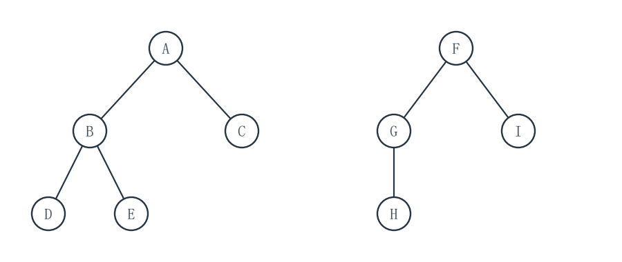
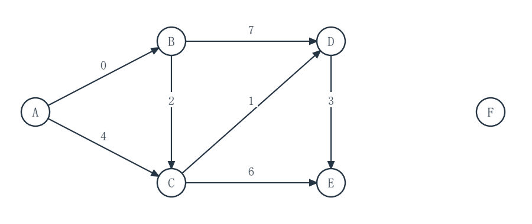
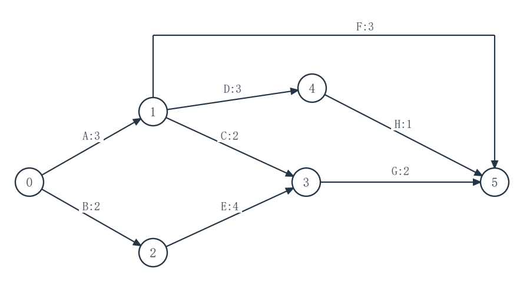

# 2027考研重邮802数据结构模拟试卷 第2套 保守卷

满分150分　考试时间180分钟

姓名：________________　准考证号：________________

请在题后作答区填写答案；算法设计题另附续答页。各大题内的小题从1开始编号，作答时写明小题及空号。

程序中的 __1__、__2__ 等为待填代码；请按空号作答，允许等价的正确表达式或语句。填空题直接写出所求结果。

程序使用C或类C记法，可省略标准头文件。未特别说明时，数组下标从0开始，整数运算不溢出，辅助容器容量足够。算法设计题须写基本思想、C语言实现和时间、辅助空间复杂度。

不使用计算器。各题独立，题内约定优先于本页统一约定。

## 一、程序阅读题（共4题，20分）

### 1（5分）

move 为一次 O(1) 的盘片移动；输入 n≥1。阅读程序并填写移动次数与复杂度。

```c
#include <stdio.h>
static unsigned long long moveCount = 0;
void move(char from, char to) {
    ++moveCount;
    printf("%c->%c\n", from, to);
}
void hanoi(int n, char from, char aux, char to) {
    if (n == 1) {
        move(from, to);
        return;
    }
    hanoi(n - 1, from, to, aux);
    move(from, to);
    hanoi(n - 1, aux, from, to);
}
int main(void) {
    hanoi(3, 'A', 'B', 'C');
    printf("moves=%llu\n", moveCount);
    return 0;
}
```

本次 move 共执行 __1__ 次（1分）。设 n 个盘的移动次数为 M(n)，M(1)=1；当 n>1 时，M(n)=__2__（2分）。程序时间复杂度为 O(__3__)（2分）。

作答区：

<br>
<br>
<br>
<br>


### 2（5分）

双向链表局部为 x<->q<->p<->y，x、y 为哨兵。补全相邻数据结点 q、p 的交换代码。

```c
#include <stdio.h>
typedef struct DNode {
    int data;
    struct DNode *prior, *next;
} DNode;
void swapWithPrior(DNode *p) {
    DNode *q = p->prior, *x = q->prior, *y = p->next;
    x->next = p;
    p->prior = x;
    p->next = __1__;
    q->prior = p;
    q->next = __2__;
    y->prior = __3__;
}
void printForward(const DNode *head, const DNode *tail) {
    const DNode *p = head->next;
    while (p != tail) {
        printf("%d ", p->data);
        p = p->next;
    }
    putchar('\n');
}
int main(void) {
    DNode head = {-1, NULL, NULL}, tail = {-1, NULL, NULL};
    DNode a = {10, NULL, NULL}, b = {20, NULL, NULL};
    head.next = &a; a.prior = &head;
    a.next = &b; b.prior = &a;
    b.next = &tail; tail.prior = &b;
    printForward(&head, &tail);
    swapWithPrior(&b);
    printForward(&head, &tail);
    printf("tail-prior=%d\n", tail.prior->data);
    return 0;
}
```

填写 __1__（1分）、__2__（2分）、__3__（2分），均为指针表达式。

作答区：

<br>
<br>
<br>
<br>


### 3（5分）

两个栈共用长度为 6 的数组，左栈、右栈分别从数组两端增长。补全代码。

```c
#include <stdio.h>
typedef struct {
    int data[6];
    int topL, topR;
} SharedStack;
void init(SharedStack *s) {
    s->topL = -1;
    s->topR = 6;
}
int full(const SharedStack *s) {
    return __1__;
}
int pushL(SharedStack *s, int x) {
    if (full(s)) return 0;
    s->data[++s->topL] = x;
    return 1;
}
int pushR(SharedStack *s, int x) {
    if (full(s)) return 0;
    s->data[__2__] = x;
    return 1;
}
int popR(SharedStack *s, int *out) {
    if (s->topR == 6) return 0;
    *out = s->data[__3__];
    return 1;
}
int main(void) {
    SharedStack s;
    int value = 0;
    init(&s);
    pushL(&s, 4);
    pushR(&s, 9);
    pushR(&s, 8);
    popR(&s, &value);
    printf("value=%d, topL=%d, topR=%d\n",
           value, s.topL, s.topR);
    return 0;
}
```

填写 __1__（1分）、__2__（2分）、__3__（2分）。__2__、__3__ 可在下标表达式中更新 topR。

作答区：

<br>
<br>
<br>
<br>


### 4（5分）

下列程序在一次递归中检查二叉树是否平衡；高度指根到最深叶的结点数，空树高度为 0。补全代码。

```c
#include <stdio.h>
typedef struct TNode {
    struct TNode *left, *right;
} TNode;
int heightIfBalanced(const TNode *t) {
    if (t == NULL) return __1__;
    int a = heightIfBalanced(t->left);
    if (a < 0) return -1;
    int b = heightIfBalanced(t->right);
    if (b < 0) return -1;
    if (__2__) return -1;
    return __3__;
}
int balanced(const TNode *t) {
    return heightIfBalanced(t) >= 0;
}
int main(void) {
    TNode x = {NULL, NULL}, y = {NULL, NULL};
    TNode root = {&x, &y};
    TNode p = {NULL, NULL}, q = {&p, NULL};
    TNode chain = {&q, NULL};
    printf("%d %d %d\n", balanced(&root),
           balanced(&chain), balanced(NULL));
    return 0;
}
```

填写 __1__（1分）、__2__（2分）、__3__（2分），均为表达式。

作答区：

<br>
<br>
<br>
<br>


## 二、填空题（共10题，30分）

### 1（3分）

按通常的二元运算规则，自左向右计算后缀表达式 8 3 - 2 × 4 +，其值为 __1__（3分）。运算符读入时先弹出右操作数。

### 2（3分）

元素 1、2、3、4 依次入栈，允许在任意两次入栈之间弹栈，最终全部出栈。所有可能的不同出栈序列共有 __1__ 种（3分）。

### 3（3分）

容量为 8 的循环队列留一个空槽，front 指向队首元素，rear 指向下一次入队位置。当前 front=6、rear=1，队中有 __1__ 个元素（1分）；此时再入队一个元素后 rear=__2__（2分）。

### 4（3分）

模式 P=aaaaab，位置从 1 开始。定义 π(i) 为 P[1..i] 的最长“真前缀且为后缀”的长度；定义 next[1]=0，j>1 时 next[j]=π(j-1)+1。则 next[6]=__1__（1分），π(6)=__2__（2分）。

### 5（3分）

三维数组 A[1..3][2..5][0..2] 按行优先连续存放，每个元素占 4 字节。A[1,2,0] 的地址为 400，则 A[2,3,2] 的地址是 __1__（3分）。

### 6（3分）

一片森林共有 12 个结点和 9 条边，边均连接本森林内的父子结点。森林共有 __1__ 棵树（3分）。

### 7（3分）

有 n 个结点的非空二叉链表，每个结点各有 left、right 两个孩子指针，整个结构没有共享结点。值为 NULL 的孩子指针共 __1__ 个（3分）。

### 8（3分）

对 16 个不同关键字组成的升序顺序表做折半查找。搜索区间采用闭区间 [low,high]，mid=floor((low+high)/2)；每轮与 A[mid] 作一次三路比较。一次成功查找最多比较 __1__ 次关键字（3分）。

### 9（3分）

顺序表示的小根堆初值为 [10,20,15,40,30,25]，数组下标从 1 开始。插入 12 并逐层上滤，新关键字最终位于下标 __1__（1分），上滤过程中与父结点进行了 __2__ 次关键字比较（2分）。

### 10（3分）

一棵严格二叉 Huffman 树有 15 个结点（每个非叶结点恰有两个孩子），其中叶结点有 __1__ 个（3分）。

## 三、综合应用题（共7题，70分）

### 1（10分）

有序森林有结点 A～I，下表给出各结点的父结点；“-”表示根。根从左到右为 A、F；同一父结点的孩子按字母序从左到右排列。

| 结点 | A | B | C | D | E | F | G | H | I |
|---|---|---|---|---|---|---|---|---|---|
| 父结点 | - | A | A | B | B | - | F | G | F |

按“第一个孩子为左孩子、下一个兄弟为右孩子”转换为二叉链表。



（1）列出转换后每个结点的左孩子、右孩子，空指针写 NULL。（4分）
（2）写出原森林的先根和后根遍历序列。（4分）
（3）写出原森林的根数、边数。（2分）

作答区：

<br>
<br>
<br>
<br>
<br>
<br>
<br>
<br>
<br>
<br>


### 2（10分）

升序表为 [3,8,12,17,21,26,31,44]，下标从 0 开始。按闭区间折半查找，mid=floor((low+high)/2)；每访问一个中间关键字算一次比较，区间变空即判失败。成功查找时八个关键字等概率；失败查找时九个相邻关键字之间及两端的间隙等概率。

（1）画出成功查找判定树，或用“结点:左孩子,右孩子”（空写 NULL）列出结构。（4分）
（2）求成功 ASL，写出按比较次数分组的计算式。（3分）
（3）求失败 ASL，写出九个失败间隙的比较次数或等价分组。（3分）

作答区：

<br>
<br>
<br>
<br>
<br>
<br>
<br>
<br>
<br>
<br>


### 3（10分）

散列表长 m=11，H(key)=key mod 11。依次插入 12、23、34、4、15、26、7。分别采用线性探测与拉链法，两个表互不影响。线性探测地址循环；查找失败到首个空槽也计一次。拉链法把冲突结点接在桶链尾，失败查找只计实际比较过的关键字，空桶计 0 次。成功查找的七个关键字等概率；失败查找的 11 个起始散列地址等概率。

（1）写出线性探测完成后的 0～10 号槽，以及拉链法的全部非空桶链。（4分）
（2）分别求两种方法的成功 ASL，写出关键字比较次数或等价分组。（3分）
（3）分别求两种方法的失败 ASL，写出各起始地址比较次数或等价分组。（3分）

作答区：

<br>
<br>
<br>
<br>
<br>
<br>
<br>
<br>
<br>
<br>


### 4（10分）

有向带权图的顶点为 A、B、C、D、E、F；F 是孤立顶点。全部弧及权值如下，未列出的弧不存在。以 A 为源点执行 Dijkstra 算法；暂定距离相同先确定字母较小的顶点。

| 弧 | A→B | A→C | B→C | B→D | C→D | C→E | D→E |
|---|---:|---:|---:|---:|---:|---:|---:|
| 权值 | 0 | 4 | 2 | 7 | 1 | 6 | 3 |



（1）逐轮写出选入已确定集合 S 的顶点，并在松弛其出弧后列出 B、C、D、E、F 的暂定距离；未可达记 ∞。只列可达顶点被选入的轮次。（6分）
（2）写出 A 到所有顶点的最终最短距离，不可达写 ∞。（2分）
（3）写出 A 到 E 的一条最短路径。（2分）

作答区：

<br>
<br>
<br>
<br>
<br>
<br>
<br>
<br>
<br>
<br>


### 5（10分）

AOE 网以事件 0 为唯一源点、事件 5 为唯一汇点，活动与持续时间如下。未列出的活动不存在。

| 活动 | A | B | C | D | E | F | G | H |
|---|---|---|---|---|---|---|---|---|
| 弧 | 0→1 | 0→2 | 1→3 | 1→4 | 2→3 | 1→5 | 3→5 | 4→5 |
| 持续时间 | 3 | 2 | 2 | 3 | 4 | 3 | 2 | 1 |



（1）写出事件 0～5 的最早发生时间 ve。（3分）
（2）写出事件 0～5 的最迟发生时间 vl。（3分）
（3）求工期，列出关键活动和全部关键路径。（4分）

作答区：

<br>
<br>
<br>
<br>
<br>
<br>
<br>
<br>
<br>
<br>


### 6（10分）

符号 A、B、C、D、E、F 的频率依次为 2、3、4、7、8、12。构造 Huffman 树时每次合并当前权值最小的两个结点；同权时按包含的最小符号字母序选择，左边标 0、右边标 1。

（1）按顺序列出每次合并的两个权值及合并后权值。（3分）
（2）画出 Huffman 树，或列出 A～F 的一组码字。（5分）
（3）求带权路径长度 WPL。（2分）

作答区：

<br>
<br>
<br>
<br>
<br>
<br>
<br>
<br>
<br>
<br>


### 7（10分）

关键字互异的数组 `A=[53,17,72,24,36,91,45,68]`，下标为 0～7。甲、乙分别从原数组开始，互不影响，均按升序处理。

甲用直接插入排序：先把 `A[0]` 视为已排序段，再依次处理 `i=1,2,…,7`；将 `A[i]` 插入有序前缀，前项大于待插关键字时才向右移动。

乙只执行快速排序的第一趟“挖坑”划分：保存首元素为枢轴，令左、右指针初值分别为 0、7，左端形成空位。从右向左找第一个小于枢轴的元素填左侧空位，左指针右移一格；再从左向右找第一个大于枢轴的元素填右侧空位，右指针左移一格。扫描和填入均以两指针尚未相遇为限；交替进行，两个指针相遇时把枢轴填入相遇位置。

（1）甲执行完 `i=4` 这一趟后，写出完整数组。（3分）
（2）甲执行完 `i=6` 这一趟后，写出完整数组。（2分）
（3）乙完成第一趟划分后，写出完整数组。（4分）
（4）乙的枢轴最终位于哪个下标？（1分）

作答区：

<br>
<br>
<br>
<br>
<br>
<br>
<br>
<br>
<br>
<br>


## 四、算法设计与分析题（共3题，30分）

### 1（8分）

带头结点的单链表存放整数。设计函数把全部负数结点稳定地移到全部非负数结点之前：两类结点各自的原相对次序必须保留。仅重连原有数据结点，不新建数据结点；头结点地址 L 保持不变。空表及只有一类结点的表也应正确处理。

```c
typedef struct Node {
    int data;
    struct Node *next;
} Node;
void stableNegFirst(Node *L);
```

请写出算法的基本思想、C语言实现，并分析时间复杂度和辅助空间复杂度。

作答区：

<br>
<br>
<br>
<br>
<br>
<br>
<br>
<br>
<br>
<br>


#### 第1题续答区（代码与分析）

<br>
<br>
<br>
<br>
<br>
<br>
<br>
<br>
<br>
<br>
<br>
<br>
<br>
<br>
<br>
<br>
<br>
<br>
<br>
<br>
<br>
<br>
<br>
<br>


### 2（10分）

普通二叉树的每个结点带有 count 字段。设计函数在每个结点的 count 中写入“以该结点为根的子树的叶结点数”；叶结点的左右孩子均为空，空树无需写入。不得改变树的孩子指针。

```c
typedef struct TNode {
    int data;
    int count;
    struct TNode *left, *right;
} TNode;
void fillLeafCounts(TNode *root);
```

请写出算法的基本思想、C语言实现，并分析时间复杂度和辅助空间复杂度。

作答区：

<br>
<br>
<br>
<br>
<br>
<br>
<br>
<br>
<br>
<br>


#### 第2题续答区（代码与分析）

<br>
<br>
<br>
<br>
<br>
<br>
<br>
<br>
<br>
<br>
<br>
<br>
<br>
<br>
<br>
<br>
<br>
<br>
<br>
<br>
<br>
<br>
<br>
<br>


### 3（12分）

无向简单图 G 用邻接表存储，顶点编号 0～V-1（1≤V≤100）。输入合法顶点 s、t（允许相同）和整数 k。设计函数寻找一条从 s 到 t、顶点不重复且边数不超过 k 的路径；找到时把完整顶点序列写入容量至少 V 的 path，将结点数写入 pathLen，返回 1。找不到或 k<0 时令 *pathLen=0，返回 0。无向边在两个端点的邻接链表中各出现一次，E 是无向边数。

```c
typedef struct Arc {
    int to;
    struct Arc *next;
} Arc;
typedef struct {
    int V, E;
    Arc **head;
} Graph;
int pathAtMostK(const Graph *G, int s, int t, int k,
                int *path, int *pathLen);
```

请写出算法的基本思想、C语言实现，并分析时间复杂度和辅助空间复杂度。

作答区：

<br>
<br>
<br>
<br>
<br>
<br>
<br>
<br>
<br>
<br>


#### 第3题续答区（代码与分析）

<br>
<br>
<br>
<br>
<br>
<br>
<br>
<br>
<br>
<br>
<br>
<br>
<br>
<br>
<br>
<br>
<br>
<br>
<br>
<br>
<br>
<br>
<br>
<br>

