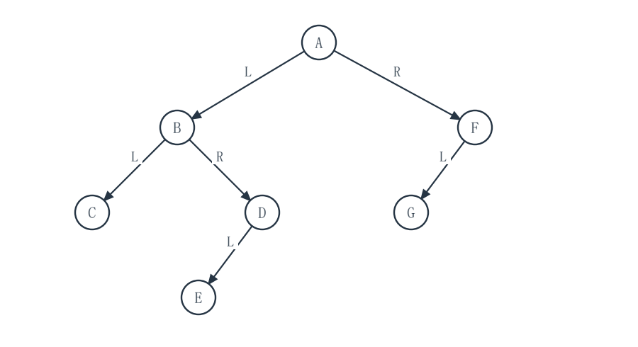
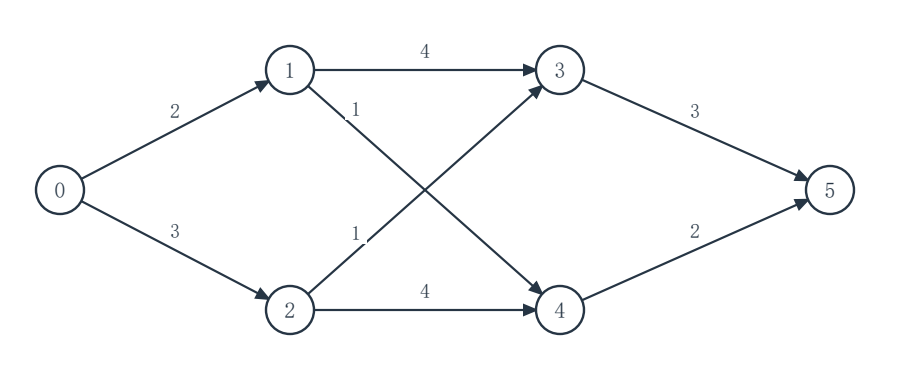
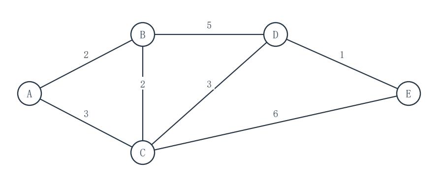

# 2027考研重邮802数据结构模拟试卷 第6套 适度创新卷

满分150分　考试时间180分钟

姓名：________________　准考证号：________________

请在题后作答区填写答案；算法设计题另附续答页。各大题内的小题从1开始编号，作答时写明小题及空号。

程序中的 __1__、__2__ 等为待填代码；请按空号作答，允许等价的正确表达式或语句。填空题直接写出所求结果。

程序使用C或类C记法，可省略标准头文件。未特别说明时，数组下标从0开始，整数运算不溢出，辅助容器容量足够。算法设计题须写基本思想、C语言实现和时间、辅助空间复杂度。

不使用计算器。各题独立，题内约定优先于本页统一约定。

## 一、程序阅读题（共4题，20分）

### 1（5分）

以 n=65536 调用 grow，count 是有效指针。分析时间复杂度时，假定整数运算不会溢出，且每次整数运算、比较和赋值均耗时常数。
```c
#include <stdio.h>
unsigned long long grow(unsigned long long n, int *count) {
    unsigned long long x = 2;
    *count = 0;
    while (x < n / 2) {
        x = x * x;
        ++(*count);
    }
    return x;
}
int main(void) {
    unsigned long long n = 65536ULL;
    int count = 0;
    unsigned long long x = grow(n, &count);
    printf("n=%llu x=%llu count=%d\n", n, x, count);
    return 0;
}
```
本次 grow 的返回值 x=__1__（1分），count=__2__（1分）；grow 关于 n 的时间复杂度为 __3__（2分），grow 的额外空间复杂度为 __4__（1分）。

作答区：

<br>
<br>
<br>
<br>


### 2（5分）

两条无头结点单链表 A、B 各有 m、n 个互不共享的结点，分别按 key 非递减排列。调用者将两表结点交给 mergeReverse；返回结果须非递增，同键时先从 A 取结点，只分析 mergeReverse。
```c
#include <stdio.h>
#include <stdlib.h>
typedef struct Node { int key; struct Node *next; } Node;
Node *fromArray(const int x[], int n) {
    Node dummy = {0, NULL}, *tail = &dummy;
    for (int i = 0; i < n; ++i) {
        Node *p = malloc(sizeof *p);
        if (p == NULL) exit(EXIT_FAILURE);
        p->key = x[i]; p->next = NULL;
        tail->next = p; tail = p;
    }
    return dummy.next;
}
Node *mergeReverse(Node *a, Node *b) {
    Node *out = NULL, *p;
    while (__1__) {
        if (b == NULL || (a != NULL && __2__)) {
            p = a; a = a->next;
        } else {
            p = b; b = b->next;
        }
        p->next = out;
        out = p;
    }
    return out;
}
int main(void) {
    const int x[] = {1, 3, 3}, y[] = {2, 3, 4};
    Node *a = fromArray(x, 3), *b = fromArray(y, 3);
    Node *p = mergeReverse(a, b);
    while (p != NULL) {
        Node *next = p->next;
        printf("%d ", p->key);
        free(p); p = next;
    }
    putchar('\n');
    return 0;
}
```
填 __1__（2分）、__2__（2分）；mergeReverse 的最坏时间复杂度为 __3__（1分），用 m、n 表示。

作答区：

<br>
<br>
<br>
<br>


### 3（5分）

二叉树结点的 left、right 指向左右孩子。调用时队列 q 为空且容量足够，empty、size、dequeue、enqueue 均为 O(1)；层号从 1 起，结果可由 int 表示。
```c
#include <stddef.h>
typedef struct Node { struct Node *left, *right; } Node;
typedef struct Queue Queue;
int empty(const Queue *q);
int size(const Queue *q);
Node *dequeue(Queue *q);
void enqueue(Queue *q, Node *p);
int weightedLeaves(Node *root, Queue *q) {
    if (root == NULL) return 0;
    enqueue(q, root);
    int total = 0, level = 1;
    while (!empty(q)) {
        int count = __1__;
        int leaves = 0;
        for (int j = 0; j < count; ++j) {
            Node *p = dequeue(q);
            if (__2__) ++leaves;
            if (p->left != NULL) enqueue(q, p->left);
            if (p->right != NULL) enqueue(q, p->right);
        }
        total += leaves * level;
        ++level;
    }
    return total;
}
int sample(Queue *q) {
    Node a = {NULL, NULL}, b = {NULL, NULL};
    Node c = {NULL, NULL};
    Node left = {&a, &b}, root = {&left, &c};
    return weightedLeaves(&root, q);
}
```
填 __1__（2分）、__2__（2分）；若树有 N 个结点，weightedLeaves 的最坏时间复杂度为 __3__（1分）。

作答区：

<br>
<br>
<br>
<br>


### 4（5分）

图的顶点编号为 0..V-1，head 是出弧邻接表。indeg 为可修改的入度副本，q 初始为空且容量至少 V；empty、enqueue、dequeue、output 均为 O(1)。
```c
#include <stddef.h>
typedef struct Queue Queue;
typedef struct Arc { int to; struct Arc *next; } Arc;
int empty(const Queue *q);
void enqueue(Queue *q, int x);
int dequeue(Queue *q);
void output(int x);
int kahn(int V, Arc *head[], int indeg[], Queue *q) {
    int count = 0;
    for (int u = 0; u < V; ++u)
        if (indeg[u] == 0) enqueue(q, u);
    while (__1__) {
        int u = dequeue(q);
        output(u);
        ++count;
        for (Arc *e = head[u]; e != NULL; e = e->next)
            if (__2__) enqueue(q, e->to);
    }
    return count == V;
}
int sampleDag(Queue *q) {
    Arc e23 = {3, NULL}, e12 = {2, NULL}, e02 = {2, NULL};
    Arc *head[4] = {&e02, &e12, &e23, NULL};
    int indeg[4] = {0, 0, 2, 1};
    return kahn(4, head, indeg, q);
}
int sampleCycle(Queue *q) {
    Arc e01 = {1, NULL}, e10 = {0, NULL};
    Arc *head[2] = {&e01, &e10};
    int indeg[2] = {1, 1};
    return kahn(2, head, indeg, q);
}
```
填 __1__（2分）、__2__（2分）；若图有 V 个顶点、E 条弧，kahn 的最坏时间复杂度为 __3__（1分）。

作答区：

<br>
<br>
<br>
<br>


## 二、填空题（共10题，30分）

### 1（3分）

循环队列使用长度为 7 的数组，front 指向队首元素的前一槽，rear 指向队尾元素，二者按模 7 移动。当前 front=5、rear=2，且队列未满；队列中有 __1__ 个元素（3分）。

### 2（3分）

C 语言二维数组 int A[4][5] 按行主序连续存储。假定 int 占 4 字节，A[0][0] 首地址为 100，则 A[2][3] 的首地址为 __1__（3分）。

### 3（3分）

数字 1、2、3、4 依次进入一个初始为空的栈，可在任意时刻弹出；每个数字恰进栈、出栈各一次。若出栈序列首项是 3，则完整出栈序列共有 __1__（3分）种。

### 4（3分）

文本 T=ababa、模式 P=aba，均从下标 0 开始。采用朴素模式匹配：对每个合法起点都从 P 的首字符起逐字符比较；失配或完整匹配后，起点右移 1，继续检查下一起点。全部匹配起点为 __1__（2分），所有合法起点的字符比较总次数为 __2__（1分）。

### 5（3分）

广义表的 Head(X) 取 X 的第一个元素，Tail(X) 返回去掉首元素后剩余元素组成的表。令 X=((a,b),(c,d),e)，则 Head(Tail(X))=__1__（3分）。

### 6（3分）

一个有序森林共有 13 个结点，其中 7 个是叶结点。按孩子-兄弟规则统一转换为二叉树：left 指首孩子，right 指下一兄弟，各树根也由 right 相连。转换后二叉树中 right 为空的结点数为 __1__（3分）。

### 7（3分）

一棵完全二叉树的根为第 1 层，已知第 4 层恰有 2 个叶结点，则该完全二叉树最多有 __1__（3分）个结点。

### 8（3分）

小根堆按 1 基数组存放，初始 A[1..6]=(2,7,4,9,8,6)。在末尾插入关键字 1 后按标准上滤调整，写出调整后的完整 A[1..7]：__1__（3分）。

### 9（3分）

一棵二叉树含 18 个结点，每个结点都有左、右两个孩子指针域。全树中空孩子指针域总数为 __1__（3分）。

### 10（3分）

对含 180 个互异关键字的升序数组作折半查找，每轮取当前闭区间的中点，下标向下取整；每访问一个关键字计一次比较。成功查找时最多比较 __1__（3分）次。

## 三、综合应用题（共7题，70分）

### 1（10分）

字符 A、B、C、D、E、F 的出现频率依次为 3、5、7、11、13、18。按 Huffman 算法每次合并当前最小的两棵树；若两棵待合并子树权值不同，将较小权值放左边，左边编码 0、右边编码 1。
（1）依次写出各次合并得到的新结点权值。（3分）
（2）画出 Huffman 树并写出全部字符的二进制编码。（5分）
（3）求该树的带权路径长度 WPL。（2分）

作答区：

<br>
<br>
<br>
<br>
<br>
<br>
<br>
<br>
<br>
<br>


### 2（10分）

下表给出孩子-兄弟二叉树各结点的 left、right 指针；left 指首孩子，right 指下一兄弟，各棵树的根也由 right 相连。NULL 表示空指针，森林和二叉树的根所在层均为 1。
| 结点 | A | B | C | D | E | F | G |
|---|---|---|---|---|---|---|---|
| left | B | C | NULL | E | NULL | G | NULL |
| right | F | D | NULL | NULL | NULL | NULL | NULL |


（1）恢复有序森林，写出各树的根和每个非叶结点从左到右的孩子；可画图或用括号表示。（4分）
（2）写出森林按从左到右逐树进行后根遍历的序列。（3分）
（3）分别求原森林与表中二叉树的最大深度。（3分）

作答区：

<br>
<br>
<br>
<br>
<br>
<br>
<br>
<br>
<br>
<br>


### 3（10分）

11 个互异关键字严格递增地存于 A[1..11]。折半查找使用闭区间 [lo,hi]，每轮 mid=floor((lo+hi)/2)，与 A[mid] 作一次三路关键字比较。已知 A[6]=25；查找目标 28 时，依次比较到的关键字为 25、33、28。其余键值未知，也无需猜测。
（1）按每次比较写出后续访问区间，并确定 33、28 所在下标。（4分）
（2）画出与该下标规则对应的完整 11 结点下标判定树，仅写下标。（3分）
（3）若 11 个关键字被等概率成功查找，求成功 ASL，根比较计 1 次。（3分）

作答区：

<br>
<br>
<br>
<br>
<br>
<br>
<br>
<br>
<br>
<br>


### 4（10分）

把互异关键字 30、10、20、50、40、60、70 依次插入初始为空的普通二叉排序树；另对同一插入序列逐次做 AVL 平衡调整。若把这七个键升序存入数组 A[1..7]，折半查找每轮取下中点 mid=floor((lo+hi)/2)。成功查找时根或首次比较计 1 次，七键等概率。
（1）画出普通二叉排序树，求其成功查找 ASL。（3分）
（2）画出最终 AVL 树，求其成功查找 ASL。（4分）
（3）画出折半查找的下标判定树，求其成功查找 ASL。（3分）

作答区：

<br>
<br>
<br>
<br>
<br>
<br>
<br>
<br>
<br>
<br>


### 5（10分）

AOE 网只有起点 0 和终点 5。活动按“起点→终点(持续时间)”给出：
0→1(2)，0→2(3)，1→3(4)，2→3(1)，2→4(4)，3→5(3)，4→5(2)，1→4(1)。
事件最早和最晚发生时刻记为 ve、vl；活动最早开始与最晚开始时刻记为 e、l。


（1）求各事件的 ve、vl 及总工期。（4分）
（2）按上述活动顺序填写全部活动的 e、l。（4分）
（3）写出全部关键活动及关键路径。（2分）

作答区：

<br>
<br>
<br>
<br>
<br>
<br>
<br>
<br>
<br>
<br>


### 6（10分）

同一正权无向连通图有顶点 A、B、C、D、E，边及权值为 AB:2，AC:3，BC:2，BD:5，CD:3，CE:6，DE:1。以 A 为单源最短路径的起点，分别在原图上求一棵最小生成树和一棵从 A 出发的最短路径树。


（1）给出最小生成树的边集及总边权。（4分）
（2）给出 A 到其他四个顶点的最短距离。（4分）
（3）给出一棵从 A 出发的最短路径树的边集及总边权。（2分）

作答区：

<br>
<br>
<br>
<br>
<br>
<br>
<br>
<br>
<br>
<br>


### 7（10分）

散列表地址为 0..10，初始为空，依次插入关键字 18、29、40、7、22、35、46。散列函数为 H(k)=k mod 11；发生冲突时作线性探测，按地址递增方向循环寻找首个空槽。插入或成功查找时，每访问一个槽计一次探测，七个关键字等概率被查找。
（1）填写全部关键字插入后的散列表，标明地址与关键字。（4分）
（2）按插入顺序写出各关键字成功查找的探测次数。（3分）
（3）求等概率成功查找的平均查找长度 ASL。（3分）

作答区：

<br>
<br>
<br>
<br>
<br>
<br>
<br>
<br>
<br>
<br>


## 四、算法设计与分析题（共3题，30分）

### 1（8分）

两条无头结点、结点互不共享的单链表 A、B 各按整数 key 严格递增，任一表可为空。设计 Node *symmetricDiff(Node *A, Node *B)，仅用原结点重连，返回两表的对称差：只保留恰在其中一表出现的键，结果仍严格递增；两表均有的键，其对应的两个结点均须释放。不得新建数据结点。
```c
#include <stdlib.h>
typedef struct Node { int key; struct Node *next; } Node;
Node *symmetricDiff(Node *A, Node *B);
```
请写出算法的基本思想、C语言实现，并分析时间复杂度和辅助空间复杂度。

作答区：

<br>
<br>
<br>
<br>
<br>
<br>
<br>
<br>
<br>
<br>


#### 第1题续答区（代码与分析）

<br>
<br>
<br>
<br>
<br>
<br>
<br>
<br>
<br>
<br>
<br>
<br>
<br>
<br>
<br>
<br>
<br>
<br>
<br>
<br>
<br>
<br>
<br>
<br>


### 2（10分）

一棵二叉树的 n 个结点标识互不相同，合法的先序数组 pre[0..n-1] 和中序数组 in[0..n-1] 已给出。设计 void toPost(const int pre[], const int in[], int n, int post[])，不创建树结点，直接把同一棵树的后序序列写入容量至少 n 的 post 数组；n=0 时不写入任何元素。
```c
void toPost(const int pre[], const int in[], int n, int post[]);
```
请写出算法的基本思想、C语言实现，并分析时间复杂度和辅助空间复杂度。

作答区：

<br>
<br>
<br>
<br>
<br>
<br>
<br>
<br>
<br>
<br>


#### 第2题续答区（代码与分析）

<br>
<br>
<br>
<br>
<br>
<br>
<br>
<br>
<br>
<br>
<br>
<br>
<br>
<br>
<br>
<br>
<br>
<br>
<br>
<br>
<br>
<br>
<br>
<br>


### 3（12分）

有向无环图 G 用邻接表存储，sigma 是其已验证合法的完整拓扑序。计划增加一条原图中不存在的弧 u→v，u、v 为合法顶点，允许 u=v；检查时不得修改 G。设计 State classifyArc(const Graph *G, const int sigma[], int u, int v)，判断加入后原序仍可用、需要重排但仍无环，或已经成环；只返回三种状态之一，不要求输出新拓扑序。
```c
typedef struct Arc { int to; struct Arc *next; } Arc;
typedef struct Graph { int V; Arc **head; } Graph;
typedef enum { ORDER_OK, REORDER, CYCLE } State;
State classifyArc(const Graph *G, const int sigma[], int u, int v);
```
请写出算法的基本思想、C语言实现，并分析时间复杂度和辅助空间复杂度。

作答区：

<br>
<br>
<br>
<br>
<br>
<br>
<br>
<br>
<br>
<br>


#### 第3题续答区（代码与分析）

<br>
<br>
<br>
<br>
<br>
<br>
<br>
<br>
<br>
<br>
<br>
<br>
<br>
<br>
<br>
<br>
<br>
<br>
<br>
<br>
<br>
<br>
<br>
<br>

