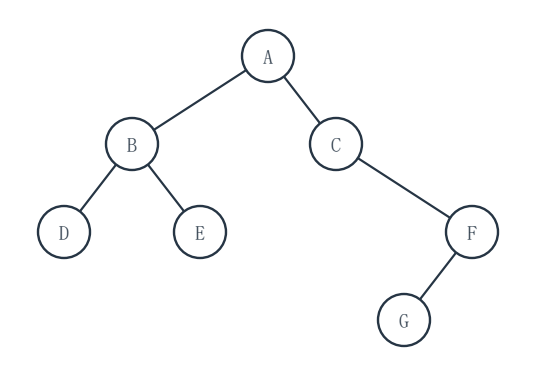
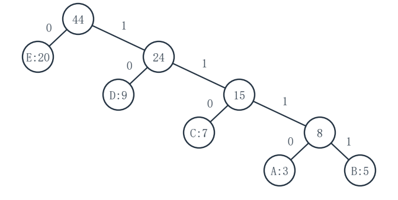
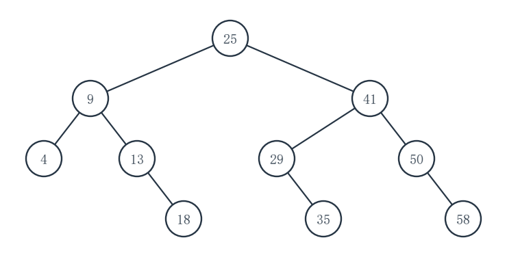
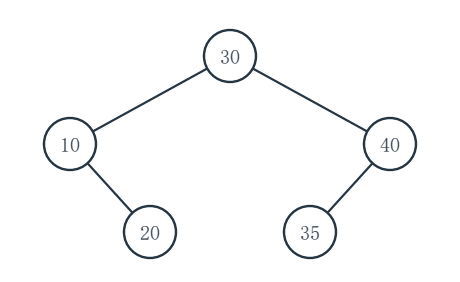
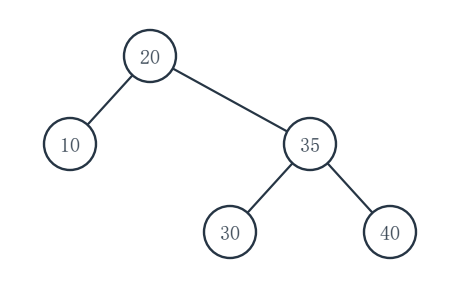

# 重邮802模拟试卷第1套参考答案

对应第6版题面。等价正确解法同样给分，复杂度应与实际实现一致。

## 一、程序阅读题

### 1（5分）

**填空：**__1__＝15；__2__＝n-1；__3__＝n。

外层的 `span` 依次为 1、2、4、8（本次 n=16），内层执行次数之和为 1+2+4+8=15。一般为 1+2+…+2^(k-1)=2^k-1=n-1，所以时间为 O(n)。本次 `outSum` 还会打印 47：四轮所加读数之和分别为 3、4、9、31。

### 2（5分）

**填空：**__1__＝`prev->next`；__2__＝`p`；__3__＝`prev->next`。

循环最终令 `prev` 指向 p 的前驱，包括 p 为首个数据结点时的头结点。先令 `s->next=p`，再令 `prev->next=s`。两次插入后的输出分别为 `4->9` 和 `7->4->8->9`。

### 3（5分）

**填空：**__1__＝`q->rear->next`；__2__＝`q->rear = NULL`；__3__＝`q->rear->next = x->next`。

入队时新结点接在原队首之前、原队尾之后。出队时，若只剩一个结点则队列变空；否则把尾结点的 `next` 改为原队首的后继。示例先后输出 `first=4, rear=9` 与 `second=9, empty=1, third-null=1`。

### 4（5分）

**填空：**__1__＝`0`；__2__＝`1`；__3__＝`leafCount(t->left) + leafCount(t->right)`。

空子树没有叶；叶结点自身贡献 1；非叶结点的叶数等于左右子树叶数之和。三次打印依次是 `tree: 3`、`single: 1`、`empty: 0`。

## 二、填空题

### 1（3分）

第1空：`a b + c * d -`。先将 `(a+b)` 写成 `a b +`，再与 c 相乘，最后减 d。

### 2（3分）

**__1__＝1056。**从 `A[1,0]` 到 `A[3,2]` 跨过 `(3-1)×6+(2-0)=14` 个元素，每个 4 字节，故地址为 `1000+14×4=1056`。

### 3（3分）

**填空：**__1__＝4；__2__＝`(r+1)%8 == f`。

队长为 `(r-f+8)%8=(2-6+8)%8=4`。保留一个空槽时，再入队的尾位置将与 `f` 相等即为满。

### 4（3分）

**填空：**__1__＝3；__2__＝1。

`P[1..4]=abab` 的最长相等真前后缀为 `ab`，长度 2，所以 `next[5]=2+1=3`。`P[1..6]=ababac` 没有非空相等真前后缀，所以 `next[7]=0+1=1`。

### 5（3分）

**__1__＝`()`。**`Tail(L)=((),c)`；其第一个元素是空表 `()`，而不是原子 c。

### 6（3分）

**__1__＝55。**高度为 6 的完全二叉树前 5 层满，共 `2^5-1=31` 个结点。第 5 层有 16 个结点，其中 4 个是叶，即 12 个有第 6 层孩子；为使总数最大，让这 12 个结点各有两个孩子，得到 `31+24=55`。

### 7（3分）

**__1__＝9。**第一次弹出 3 时，1、2、3 必须都已入栈，弹出 3 后栈内自底向上是 `(1,2)`，还可入栈 4、5。对剩下四次出栈按合法入弹规则枚举，得到 9 个不同序列。

### 8（3分）

**__1__＝7。**按 AVL 插入并旋转后为根 8，左右孩子分别为 4、12，四个叶为 2、6、10、14。每个结点的左右子树高度相同，故七个结点的平衡因子全为 0。

### 9（3分）

**填空：**__1__＝70；__2__＝3。

85 先放在下标 7，与下标 3 的 80 交换，上升到下标 3；其父结点 90 更大，停止。最终堆为 `[90,70,85,20,50,60,80]`，根的左孩子仍为 70。

### 10（3分）

**__1__＝7。**满 6 层最多 `2^6-1=63` 个结点，容纳 95 个结点至少需要第 7 层；按题给中点规则生成的折半判定树最大深度为 7，最坏成功查找比较 7 次。

## 三、综合应用题

### 1（10分）

**（1）重建结果（4分）：**

```text
        A
       / \
      B   C
     / \   \
    D   E   F
           /
          G
```

等价孩子表：`A:(B,C), B:(D,E), C:(NULL,F), D:(NULL,NULL), E:(NULL,NULL), F:(G,NULL), G:(NULL,NULL)`。

**（2）后序（2分）：**`DEBGFCA`。

**（3）指定线索（4分）：**中序为 `D B E A C G F`。C 原左指针为空，故左指针指 A、左标志 1；C 原右指针指孩子 F、右标志 0。G 的左、右指针原本均为空，分别线索到前驱 C、后继 F；两侧标志都为 1。



### 2（10分）

**（1）合并次序（3分）：**`3(A)+5(B)=8`；`7(C)+8(AB)=15`；`9(D)+15(CAB)=24`；`20(E)+24=44`。

**（2）一组码字（5分）：**

| 符号 | A | B | C | D | E |
|---|---|---|---|---|---|
| 码字 | 1110 | 1111 | 110 | 10 | 0 |

每次将较小权子树置左，左边标 0，右边标 1，符合题给并列规则。

**（3）WPL（2分）：**`3×4+5×4+7×3+9×2+20×1=91`；亦等于合并新权之和 `8+15+24+44=91`。



### 3（10分）

**（1）散列表（4分）：**

| 地址 | 0 | 1 | 2 | 3 | 4 | 5 | 6 | 7 | 8 | 9 | 10 |
|---|---|---|---|---|---|---|---|---|---|---|---|
| 键 | - | - | - | 14 | 25 | 36 | 5 | 16 | - | - | - |

**（2）成功 ASL（3分）：**按插入顺序，五键的探测次数依次为 `1,2,3,2,3`；`ASL成功=(1+2+3+2+3)/5=11/5=2.2`。

**（3）失败 ASL（3分）：**起始地址 0～10 的探测次数依次为 `1,1,1,6,5,4,3,2,1,1,1`，所以 `ASL失败=26/11≈2.364`。失败时最后遇到的空槽也算一次探测。

### 4（10分）

**（1）折半判定树（5分）：**

```text
        25
       /  \
      9    41
     / \   / \
    4  13 29  50
        \   \   \
        18  35  58
```

等价孩子表：`25:(9,41), 9:(4,13), 13:(NULL,18), 41:(29,50), 29:(NULL,35), 50:(NULL,58)`；4、18、35、58 为叶。

**（2）成功 ASL（3分）：**比较次数为 1 的键 1 个、为 2 的 2 个、为 3 的 4 个、为 4 的 3 个，所以 `ASL成功=(1×1+2×2+3×4+4×3)/10=29/10=2.9`。

**（3）失败查找 27（2分）：**依次比较 `25→41→29`，共 3 次；随后左侧区间变空。



### 5（10分）

**（1）Prim（5分）：**从 A 出发按入树顺序选 `AB(2)→BC(3)→CD(4)→DE(6)→EF(1)`。

**（2）Kruskal（3分）：**按全图边权由小到大考虑，纳入 `EF(1)→AB(2)→BC(3)→CD(4)→DE(6)`；权值 5 的 AC 会成环而跳过。

**（3）总权（2分）：**`1+2+3+4+6=16`。两种算法选到同一棵树，加入顺序不同。

### 6（10分）

**（1）普通 BST 与比较次数（3分）：**

```text
      30
     /  \
   10    40
     \   /
     20 35
```

键 `30,10,20,40,35` 的成功比较次数依次为 `1,2,3,2,3`。

**（2）普通 BST 成功 ASL（2分）：**`(1+2+3+2+3)/5=11/5=2.2`。

**（3）AVL（5分）：**插入 20 后，结点 30 首次出现 **LR** 失衡，先对 10 左旋、再对 30 右旋；插入 35 后，结点 30 出现 **RL** 失衡，先对 40 右旋、再对 30 左旋。最终 AVL 为：

```text
      20
     /  \
   10    35
        /  \
       30  40
```





### 7（10分）

**（1）首枢轴快排划分（5分）：**结果数组为 `[22,17,31,28,9,42,54,63]`，枢轴 42 最终下标为 **5**（0 基）。按题给代码，右扫依次把 22、31 填到左侧空位，左扫依次把 63、54 填到右侧空位，最终在下标 5 放回 42。

**（2）自下而上建小根堆（5分）：**结果数组为 `[9,17,31,22,42,54,63,28]`。按0基下标从最后非叶结点 3、2、1、0 依次下滤后，四个状态依次是：

```text
3: [42,17,63,22,9,54,31,28]
2: [42,17,31,22,9,54,63,28]
1: [42,9,31,22,17,54,63,28]
0: [9,17,31,22,42,54,63,28]
```

## 四、算法设计与分析题

### 1（8分）

**基本思想：**同时扫描有序的 A、B。A 当前键较小时将它保留并前进；B 当前键较小时只前进 B；两键相等时从 A 摘下并释放该结点。保留一个 A 的前驱指针，删除首个数据结点时也能正确接回头结点。

**C 语言实现：**

```c
#include <stdlib.h>
typedef struct Node {
    int data;
    struct Node *next;
} Node;

void listDifference(Node *A, const Node *B) {
    Node *prev = A, *pa = A->next;
    const Node *pb = B->next;
    while (pa != NULL && pb != NULL) {
        if (pa->data < pb->data) {
            prev = pa;
            pa = pa->next;
        } else if (pa->data > pb->data) {
            pb = pb->next;
        } else {
            Node *old = pa;
            pa = pa->next;
            prev->next = pa;
            free(old);
            pb = pb->next;
        }
    }
}
```

**复杂度：**设 A、B 分别有 m、n 个数据结点。两个游标都只向前，时间 O(m+n)，额外指针空间 O(1)；释放原结点不算新增辅助空间。A 或 B 为空时循环直接结束。**评分建议：**双指针思路 1 分；接链、释放与边界正确的代码 5 分；时间及辅助空间各 1 分，共 8 分。

### 2（10分）

**基本思想：**先遍历所有根叶路径，求最大的路径和；再遍历一次，沿当前路径把结点值暂写入调用者提供的 `path`。第一次遇到和等于最优值的叶结点时固定 `pathLen` 并返回。这样即使结点值为负也无需用 0 代替不存在的子树。

**C 语言实现：**

```c
typedef struct TNode {
    int data;
    struct TNode *left, *right;
} TNode;

static void scanBest(const TNode *p, long long sum,
                     long long *best, int *haveBest) {
    sum += p->data;
    if (p->left == 0 && p->right == 0) {
        if (!*haveBest || sum > *best) *best = sum;
        *haveBest = 1;
        return;
    }
    if (p->left != 0) scanBest(p->left, sum, best, haveBest);
    if (p->right != 0) scanBest(p->right, sum, best, haveBest);
}

static int savePath(const TNode *p, long long sum, long long best,
                    int path[], int depth, int *pathLen) {
    if (p == 0) return 0;
    path[depth] = p->data;
    sum += p->data;
    if (p->left == 0 && p->right == 0) {
        if (sum == best) {
            *pathLen = depth + 1;
            return 1;
        }
        return 0;
    }
    if (savePath(p->left, sum, best, path, depth + 1, pathLen)) return 1;
    return savePath(p->right, sum, best, path, depth + 1, pathLen);
}

int maxRootLeafSum(const TNode *root, int *path, int *pathLen) {
    long long best = 0;
    int haveBest = 0;
    *pathLen = 0;
    scanBest(root, 0, &best, &haveBest);  /* 题设 root 非空 */
    savePath(root, 0, best, path, 0, pathLen);
    return (int)best;                    /* 题设保证路径和在int范围内 */
}
```

**复杂度：**两次遍历各至多访问每个结点一次，时间 O(n)；递归调用栈深度 O(h)，最坏 O(n)。`path` 为题给输出缓冲区，至多写 h 个结点，不另复制整条路径；若计入输出占用则再计 O(h)。**评分建议：**负值与根叶路径的思路 2 分；两趟遍历、路径保存和边界代码 6 分；时间、空间各 1 分，共 10 分。

### 3（12分）

**基本思想：**一次 DFS 从 s 出发，把 w 视为禁止访问。每个可访问顶点只标记一次；递归当前路径直接写入 `path[depth]`。到 t 时固定长度并立即返回。某分支失败后，已完全探索过的顶点仍保持已访问；它不可能在别的分支再通向 t，因此既避免重复顶点，也保证线性复杂度。

**C 语言实现：**

```c
typedef struct Arc {
    int to;
    struct Arc *next;
} Arc;
typedef struct {
    int V, E;
    Arc **head;
} Graph;

static int dfsAvoid(const Graph *G, int u, int t, int w,
                    unsigned char seen[100], int path[],
                    int depth, int *pathLen) {
    seen[u] = 1;
    path[depth] = u;
    if (u == t) {
        *pathLen = depth + 1;
        return 1;
    }
    for (const Arc *e = G->head[u]; e != 0; e = e->next) {
        int v = e->to;
        if (v != w && !seen[v] &&
            dfsAvoid(G, v, t, w, seen, path, depth + 1, pathLen))
            return 1;
    }
    return 0;
}

int pathAvoidingVertex(const Graph *G, int s, int t, int w,
                       int *path, int *pathLen) {
    unsigned char seen[100] = {0};
    *pathLen = 0;
    return dfsAvoid(G, s, t, w, seen, path, 0, pathLen);
}
```

**复杂度：**每个顶点最多进入 DFS 一次，每条无向边的两条邻接记录最多扫描一次，时间 O(V+E)；`seen` 与递归栈共 O(V) 辅助空间。输出 `path` 容量 V 由调用者提供，实际写入至多 V 个编号。**评分建议：**禁点与单次DFS思路 2 分；标记、路径保存、成功/失败边界的代码 8 分；时间与空间复杂度各 1 分，共 12 分。
