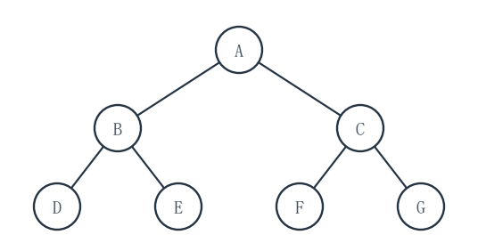
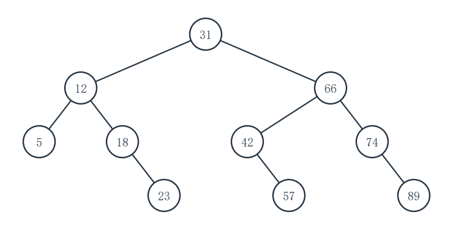
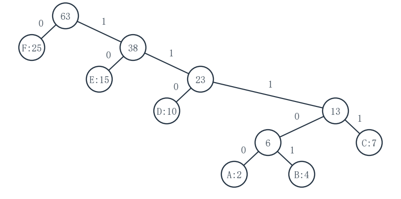
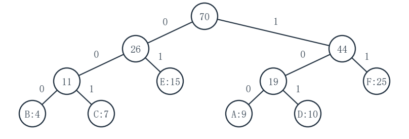
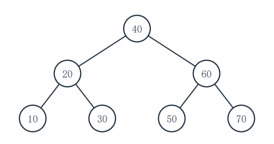

# 重邮802模拟试卷第5套参考答案

对应第6版题面。等价正确解法同样给分，复杂度应与实际实现一致。

## 一、程序阅读题

### 1（5分）

**填空：**__1__＝24；__2__＝n；__3__＝log_2n；__4__＝n log_2n。

设 F(n) 为返回值，则 F(1)=0，F(n)=2F(n/2)+n。因此 F(2)=2、F(4)=8、F(8)=24。每个非基例层的所有循环合计执行 n 次，共有 log_2n 层，故总时间为 O(n log n)。

### 2（5分）

**填空：**__1__＝pre->next；__2__＝p；__3__＝p->next；__4__＝O(n)；__5__＝O(1)。

删除 p 后，pre 仍指向其前驱，下一待查结点应取 pre->next；保留 p 时，先让 pre 前进到 p，再令 p 前进。每个原数据结点最多处理一次，只使用固定数量指针。

### 3（5分）

**填空：**__1__＝CAP；__2__＝s->top0 + 1 == s->top1；__3__＝s->top1 == CAP；__4__＝O(1)；__5__＝O(1)。

初始化时栈1的栈顶位于数组右边界之外。两个栈顶相邻即无空位；栈1的栈顶退回 CAP 即为空。每次操作仅做固定次数的比较和指针／下标修改。

### 4（5分）

**填空：**__1__＝key % m；__2__＝(pos + 1) % m；__3__＝O(m)。

先取题设的初始散列地址；冲突时沿环形地址加 1。for 循环至多检查 m 个槽，所以即使表满，一次插入也会在 O(m) 时间内返回失败。

## 二、填空题

### 1（3分）

**填空：**__1__＝(2,5,1,4,3,6,7)；__2__＝(2,1,4,3,5,6,7)；__3__＝8。

第一趟中 6 依次越过 2、5、1、4、3，共交换 5 次；第二趟中 5 越过 1、4、3，共交换 3 次。两趟合计 8 次。

### 2（3分）

**填空：**__1__＝a b c d e / - * +。

先把括号内 c-d/e 化为 c d e / -，再与 b 相乘，最后与 a 相加。

### 3（3分）

**填空：**__1__＝m-1；__2__＝m。

甲用一个永不存元素的槽区分空和满；乙有独立的 count，因此 m 个数组槽均可存元素。

### 4（3分）

**填空：**__1__＝(0,1,1,1,2,3,4)。

按题给 1 基定义，j=2、3、4 的前缀均无非空真前后缀，值为 1；j=5、6、7 时相应的最长真前后缀长度依次为 1、2、3，故值为 2、3、4。

### 5（3分）

**填空：**__1__＝10。

两地址相差 (246-200)/2＝23 个元素位置。设每行 c 列，则 A[2,3] 前有 2c+3 个元素，所以 2c+3＝23，c＝10。

### 6（3分）

**填空：**__1__＝18。

任意非空二叉树中，度为 2 的结点数 n_2＝叶结点数 n_0-1＝7。因此总数 n＝n_0+n_1+n_2＝8+3+7＝18。

### 7（3分）

**填空：**__1__＝16。

顶点 5 必须最后。若首项是 0，第二项为 1 时，剩余 2、3、4 可任意排列，有 3!＝6 种；第二项为 2 时，第三项必为 1，随后 3、4 有 2 种，共 8 种。首项为 1 时对称地也是 8 种，合计 16 种。

### 8（3分）

**填空：**__1__＝8、12、14、13；__2__＝4。

首轮中点为 8（值 16），目标 26 在右半；随后中点依次为 12（24）、14（28）、13（26），第 4 次命中。

### 9（3分）

**填空：**__1__＝(2,7,3,10,9,8,5)。

2 先放在下标 7，与父结点下标 3 的 5 交换，再与根结点 3 交换；其他位置不变。

### 10（3分）

**填空：**__1__＝109。

Huffman 编码树是严格二叉树，若叶结点数为 L，则总结点数为 2L-1。故 L＝(217+1)/2＝109。

## 三、综合应用题

### 1（10分）

**（1）树形：**

| 结点 | 左孩子 | 右孩子 |
|---|---|---|
| A | B | C |
| B | D | E |
| C | F | G |
| D、E、F、G | 空 | 空 |

先序首项 A 为根；中序在 A 左右分别切成 D、B、E 与 F、C、G，再各由先序确定 B、C 为子树根。

**（2）后序：**D、E、B、F、G、C、A。

**（3）中序前驱／后继：**D 为“空／B”；F 为“A／C”。中序线索只写入原空指针，不改变这棵树的孩子关系或中序序列。



### 2（10分）

**（1）折半查找判定树：**

| 结点 | 左孩子 | 右孩子 |
|---|---|---|
| 31 | 12 | 66 |
| 12 | 5 | 18 |
| 66 | 42 | 74 |
| 18 | 空 | 23 |
| 42 | 空 | 57 |
| 74 | 空 | 89 |
| 5、23、57、89 | 空 | 空 |

根取区间 1..10 的下中点 5；各子区间继续按同一规则取下中点。

**（2）查找 57：**31 → 66 → 42 → 57。

**（3）查找 60 失败：**31 → 66 → 42 → 57，随后落入空区间。

**（4）成功 ASL：**各层结点数依次为 1、2、4、3，因此
(1×1+2×2+4×3+3×4)/10＝29/10＝2.9 次。



### 3（10分）

**（1）原频率：**

| 步 | 合并的两棵树 | 新权 |
|---|---|---:|
| 1 | 2+4 | 6 |
| 2 | 6+7 | 13 |
| 3 | 10+13 | 23 |
| 4 | 15+23 | 38 |
| 5 | 25+38 | 63 |

最小 WPL 等于各次新权之和：6+13+23+38+63＝**143**。

**（2）只改频率、不改原树：**原树中 A 的码长为 5，新频率比原来增加 7，故 WPL＝143+7×5＝**178**。

**（3）用新频率重建：**此时频率为 4、7、9、10、15、25，依次合并
4+7→11，9+10→19，11+15→26，19+25→44，26+44→70。
新树的最小 WPL＝11+19+26+44+70＝**170**。新树比沿用旧树少 8。





### 4（10分）

**（1）最终普通二叉排序树：**

| 结点 | 左孩子 | 右孩子 |
|---|---|---|
| 40 | 20 | 60 |
| 20 | 10 | 30 |
| 60 | 50 | 70 |
| 10、30、50、70 | 空 | 空 |

**（2）后序：**10、30、20、50、70、60、40。

**（3）查找 55：**依次比较 40、60、50，随后应走 50 的空右孩子，故未成功。成功查找时第 1、2、3 层分别有 1、2、4 个结点，ASL＝(1+2×2+4×3)/7＝**17/7** 次。



### 5（10分）

**（1）插入过程：**

| 关键字 | 探测地址（按先后） | 最终地址 | 探测次数 |
|---:|---|---:|---:|
| 22 | 0 | 0 | 1 |
| 1 | 1 | 1 | 1 |
| 13 | 2 | 2 | 1 |
| 11 | 0、2、4 | 4 | 3 |
| 24 | 2、7 | 7 | 2 |
| 35 | 2、8 | 8 | 2 |
| 46 | 2、9 | 9 | 2 |

最终散列表：

| 地址 | 0 | 1 | 2 | 3 | 4 | 5 | 6 | 7 | 8 | 9 | 10 |
|---|---:|---:|---:|---:|---:|---:|---:|---:|---:|---:|---:|
| 关键字 | 22 | 1 | 13 | 空 | 11 | 空 | 空 | 24 | 35 | 46 | 空 |

**（2）成功 ASL：**查找按各自相同的双散列探测序列，次数即上表末列。ASL＝(1+1+1+3+2+2+2)/7＝**12/7** 次。

### 6（10分）

**（1）访问序列：**DFS：0、1、2、3、4、5、6；BFS：0、1、2、3、4、5、6。两种遍历的访问序列相同，但第一个分量中的树边不同。

**（2）生成森林树边：**

- DFS：0-1，1-2；3-4，4-5。
- BFS：0-1，0-2；3-4，4-5。

顶点 6 是单点树，无树边。

**（3）**连通分量为 {0,1,2}、{3,4,5}、{6}，共 **3** 个。每种生成森林均有 7-3＝**4** 条树边。

### 7（10分）

**（1）先按第二关键字稳定排序：**b、e、f、a、c、d（值为 1 的 b、e、f 在前，值为 2 的 a、c、d 在后）。

**（2）再按第一关键字稳定排序：**b、f、d、e、c、a。此时 A 组内为 b、f、d，B 组内为 e、c，既满足第二关键字次序，也保留完全同键记录 b、f 的原先后。

**（3）反向排序的结果：**先按第一关键字得到 b、d、f、c、e、a；再按第二关键字稳定排序，最终为 b、f、e、d、c、a。该次序优先按第二关键字分组，不是题设要求的最终主次关键字顺序。

## 四、算法设计与分析题

### 1（8分）

**基本思想：**用 pre 指向当前连续相等段之前保留的结点，p 指向该段当前结点。只要 p 与下一结点同键，就删除 p，把 pre 直接接到下一结点；直到 p 成为这一段原链的最后一个结点才保留。随后处理下一段。空表直接结束。

**C语言实现：**

```c
#include <stddef.h>
#include <stdlib.h>
typedef struct Node { int key; struct Node *next; } Node;

void keepLastOfEachKey(Node *L) {
    Node *pre = L, *p = L->next;
    while (p != NULL) {
        while (p->next != NULL && p->key == p->next->key) {
            Node *old = p;
            p = p->next;
            pre->next = p;
            free(old);
        }
        pre = p;
        p = p->next;
    }
}
```

**复杂度：**每个原数据结点最多访问或释放一次，时间 O(n)；除原链及释放操作外只用固定数量指针，辅助空间 O(1)。

**建议评分（8分）：**说明保留每段最后结点 2 分；正确重连并释放其余结点、处理空表与尾段 4 分；时间 1 分；空间 1 分。

### 2（10分）

**基本思想：**先由出弧表计算各顶点入度。按 P 的顺序模拟 Kahn 拓扑过程：每一步当前顶点必须入度为 0；取走后把它的出邻点入度各减 1。若 k 步均成立，由于原图是 DAG，剩余顶点总能继续取出，故 P 可作某个完整拓扑序的前缀。入度数组是副本，不改 G。

**C语言实现：**

```c
#include <stdbool.h>
#include <stddef.h>
#include <stdlib.h>
typedef struct Arc { int to; struct Arc *next; } Arc;
typedef struct Graph { int V; Arc **head; } Graph;

bool canBePrefix(const Graph *G, const int P[], int k) {
    if (k == 0) return true;
    int *indeg = calloc((size_t)G->V, sizeof *indeg);
    if (indeg == NULL) abort();
    for (int u = 0; u < G->V; ++u)
        for (const Arc *e = G->head[u]; e != NULL; e = e->next)
            ++indeg[e->to];
    for (int i = 0; i < k; ++i) {
        int u = P[i];
        if (indeg[u] != 0) {
            free(indeg);
            return false;
        }
        for (const Arc *e = G->head[u]; e != NULL; e = e->next)
            --indeg[e->to];
    }
    free(indeg);
    return true;
}
```

题设已保证 G 是 DAG，且 P 的元素合法且互异；内存分配失败属于资源错误，上述实现直接终止而不返回错误的真假分类。

**复杂度：**预处理遍历 V 个顶点和 E 条弧；模拟时每个前缀顶点及其出弧至多再访问一次。时间 O(V+E)，入度副本辅助空间 O(V)。

**建议评分（10分）：**入度模拟及可扩展性思想 2 分；入度计算、逐项判零与更新、释放内存的代码 6 分；时间 1 分；空间 1 分。

### 3（12分）

**基本思想：**对每个结点递归求左右子树的最大向下高度（以边数计，空子树高度为 -1）。经过该结点的最长路径长度为左高+右高+2；用全局于此次调用的 best 参数记录所有结点的最大值。递归只读原树。

**C语言实现：**

```c
#include <stddef.h>
typedef struct Node { struct Node *left, *right; } Node;

static int heightAndUpdate(const Node *p, int *best) {
    if (p == NULL) return -1;
    int left = heightAndUpdate(p->left, best);
    int right = heightAndUpdate(p->right, best);
    int through = left + right + 2;
    if (through > *best) *best = through;
    return (left > right ? left : right) + 1;
}

int treeDiameter(const Node *root) {
    int best = 0;
    heightAndUpdate(root, &best);
    return best;
}
```

**复杂度：**每个结点只处理一次，时间 O(n)；递归栈空间 O(h)，h 为树高，最坏退化链时 O(n)。空树和单结点均返回 0。

**建议评分（12分）：**说明“经过当前结点”与子树内最优同时比较的思想 3 分；空树高度、左右递归、best 更新及返回值等完整代码 7 分；时间 1 分；递归栈空间 1 分。
