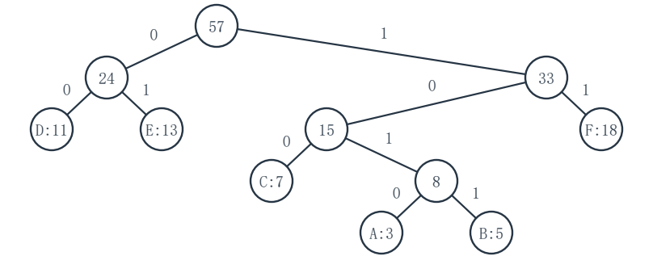
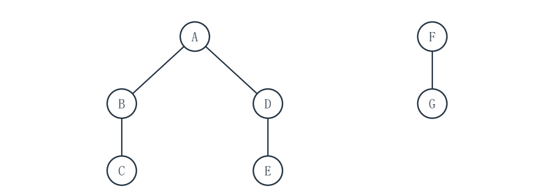
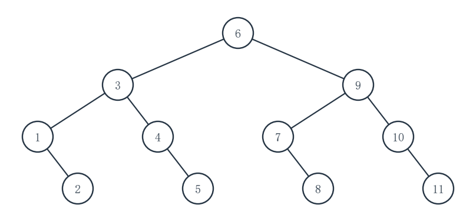
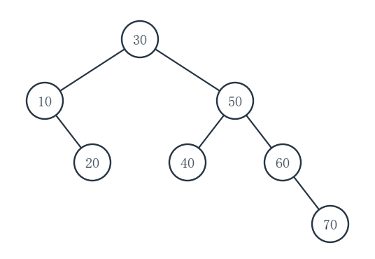
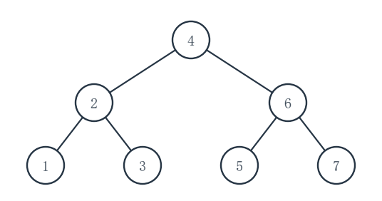

# 重邮802模拟试卷第6套参考答案

对应第6版题面。等价正确解法同样给分，复杂度应与实际实现一致。

## 一、程序阅读题

### 1（5分）

**填空：**__1__＝65536；__2__＝4；__3__＝O(log log n)；__4__＝O(1)。

x 从 2 开始依次平方为 4、16、256、65536，第四次平方后不再满足 x<n/2。执行 t 次平方后 x＝2^(2^t)，使它达到 n 的常数倍只需 O(log log n) 次；函数仅用固定数量标量变量。

### 2（5分）

**填空：**__1__＝a != NULL || b != NULL；__2__＝a->key <= b->key；__3__＝O(m+n)。

只要任一链表尚有结点就继续。两边均非空且同键时，使用 <= 使本轮先摘 A 的结点；摘出的结点头插到 out，故最终按非递增顺序排列。每轮恰消耗一个原结点。

### 3（5分）

**填空：**__1__＝size(q)；__2__＝p->left == NULL && p->right == NULL；__3__＝O(N)。

进入每层前用 size(q) 固定本层结点数；新入队的孩子留到下一层处理。左右孩子均空才是叶结点。每个结点恰出队一次，队列基本操作按题设为 O(1)。

### 4（5分）

**填空：**__1__＝!empty(q)；__2__＝--indeg[e->to] == 0；__3__＝O(V+E)。

队列非空时取出一个当前入度为零的顶点。删除其每条出弧对应的入度贡献，只有新入度恰为零时才入队。初始化扫描 V 个顶点，随后每个可输出顶点及其出弧至多处理一次。

## 二、填空题

### 1（3分）

**填空：**__1__＝4。

按题设 front 指队首的前一槽、rear 指队尾，元素数为 (rear-front+7) mod 7＝(2-5+7) mod 7＝4。占用的槽依次是 6、0、1、2。

### 2（3分）

**填空：**__1__＝152。

按行主序，A[2][3] 前有 2×5+3＝13 个 int；首地址＝100+13×4＝152。

### 3（3分）

**填空：**__1__＝3。

首项为 3 时，必须先将 1、2、3 依次入栈并弹出 3。此后完整出栈序列只能是 (3,2,1,4)、(3,2,4,1)、(3,4,2,1)，共 3 种。

### 4（3分）

**填空：**__1__＝0、2；__2__＝7。

合法起点是 0、1、2。起点 0 完整匹配，比较 3 次；起点 1 首字符 b 与 a 失配，比较 1 次；起点 2 完整匹配，比较 3 次。总数 3+1+3＝7。

### 5（3分）

**填空：**__1__＝(c,d)。

Tail(X)＝((c,d),e)，再取第一个元素就是子表 (c,d)，不是单个原子 c。

### 6（3分）

**填空：**__1__＝7。

right 为空的结点是每条兄弟链的末结点。13-7＝6 个非叶结点各有一条孩子链，再加上森林诸根组成的一条根链，故共有 6+1＝7 条兄弟链，也即 7 个空 right。

### 7（3分）

**填空：**__1__＝27。

为使结点数最多，前 4 层先填满，共 1+2+4+8＝15 个结点。第 4 层恰有 2 个叶结点，故其余 6 个结点可各有 2 个第 5 层孩子，最多再有 12 个，总数 15+12＝27。

### 8（3分）

**填空：**__1__＝(1,7,2,9,8,6,4)。

把 1 放入下标 7，先与其父结点下标 3 的 4 交换，再与根下标 1 的 2 交换；最后每个父结点均不大于孩子。

### 9（3分）

**填空：**__1__＝19。

18 个结点共有 36 个孩子指针域；非空指针恰对应树的 17 条边，所以空指针域数＝36-17＝19，也可直接用 n+1。

### 10（3分）

**填空：**__1__＝8。

折半判定树高度最多为 ceil(log_2(180+1))＝8；亦可看作 2^7-1＝127 个关键字不足以形成最坏 7 次查找的容量，而 2^8-1＝255 足够。实际 180 个关键字的下中点规则下存在深度 8 的结点。

## 三、综合应用题

### 1（10分）

**（1）各次合并新权：**3+5→8，7+8→15，11+13→24，15+18→33，24+33→57，即 **8、15、24、33、57**。

**（2）一种符合“小权在左、左0右1”的Huffman树：**

```
57
|--0:24
|  |--0:D(11)        D = 00
|  +--1:E(13)        E = 01
+--1:33
   |--0:15
   |  |--0:C(7)     C = 100
   |  +--1:8
   |     |--0:A(3)  A = 1010
   |     +--1:B(5)  B = 1011
   +--1:F(18)       F = 11
```

故 A、B、C、D、E、F 的编码依次为 **1010、1011、100、00、01、11**。

**（3）WPL：**内部合并权之和为 8+15+24+33+57＝**137**。按叶码长复算为 3×4+5×4+7×3+11×2+13×2+18×2＝137。



### 2（10分）

**（1）还原的有序森林：**两棵树的根依次为 A、F。A 的孩子从左到右为 B、D；B 的孩子为 C；D 的孩子为 E；F 的孩子为 G。

```
A
|-- B
|   +-- C
+-- D
    +-- E

F
+-- G
```

因为 A.right=F，F 是下一棵树的根；B.right=D，D 是 B 的兄弟而不是 B 的孩子。

**（2）逐树后根遍历：**C、B、E、D、A、G、F。

**（3）最大深度：**原森林为 **3** 层（A→B→C 或 A→D→E）；孩子-兄弟二叉树为 **4** 层（A→B→D→E，其中 B→D 是 right 边）。



### 3（10分）

**（1）访问区间与下标：**

| 比较 | 当前闭区间 | 中点下标 | 所比关键字 | 下一步 |
|---:|---|---:|---:|---|
| 1 | [1,11] | 6 | 25 | 28>25，转 [7,11] |
| 2 | [7,11] | 9 | 33 | 28<33，转 [7,8] |
| 3 | [7,8] | 7 | 28 | 找到 |

故 **33 在 A[9]，28 在 A[7]**；无须推测其他关键字的数值。

**（2）完整下标判定树：**

| 下标结点 | 左孩子 | 右孩子 |
|---:|---:|---:|
| 6 | 3 | 9 |
| 3 | 1 | 4 |
| 9 | 7 | 10 |
| 1 | 空 | 2 |
| 4 | 空 | 5 |
| 7 | 空 | 8 |
| 10 | 空 | 11 |
| 2、5、8、11 | 空 | 空 |

**（3）成功 ASL：**第 1、2、3、4 层分别为 1、2、4、4 个下标；ASL＝(1+2×2+4×3+4×4)/11＝**33/11＝3** 次。



### 4（10分）

**（1）普通BST：**

```
30
  L:10
    R:20
  R:50
    L:40
    R:60
      R:70
```

各层结点数为 1、2、3、1；成功 ASL＝(1+2×2+3×3+1×4)/7＝**18/7**。

**（2）逐次AVL调整后：**

```
40
  L:20
    L:10
    R:30
  R:60
    L:50
    R:70
```

插入 20 后对 30 作 LR 调整；插入 40 后对右侧 30 作 RL 调整；插入 60 后对 20 作左旋；插入 70 后对 50 作左旋。最终第 1、2、3 层结点数为 1、2、4，成功 ASL＝**17/7**。

**（3）升序数组的折半下标判定树：**

| 下标结点 | 左孩子 | 右孩子 |
|---:|---:|---:|
| 4 | 2 | 6 |
| 2 | 1 | 3 |
| 6 | 5 | 7 |
| 1、3、5、7 | 空 | 空 |

下标 4、2、6 分别对应键 40、20、60。ASL＝(1+2×2+4×3)/7＝**17/7**。






### 5（10分）

**（1）事件时刻与总工期：**

| 顶点 | 0 | 1 | 2 | 3 | 4 | 5 |
|---|---:|---:|---:|---:|---:|---:|
| ve | 0 | 2 | 3 | 6 | 7 | 9 |
| vl | 0 | 2 | 3 | 6 | 7 | 9 |

正向取前驱“最早时刻+工期”的最大值，逆向取后继“最晚时刻-工期”的最小值。总工期为 **9**。

**（2）按题面活动顺序：**

| 活动 | 0→1 | 0→2 | 1→3 | 2→3 | 2→4 | 3→5 | 4→5 | 1→4 |
|---|---:|---:|---:|---:|---:|---:|---:|---:|
| e | 0 | 0 | 2 | 3 | 3 | 6 | 7 | 2 |
| l | 0 | 0 | 2 | 5 | 3 | 6 | 7 | 6 |

活动 u→v 的 e＝ve[u]，l＝vl[v]-持续时间。

**（3）关键活动：**0→1、0→2、1→3、2→4、3→5、4→5。关键路径有 **0→1→3→5** 与 **0→2→4→5**，两者均长 9。

### 6（10分）

**（1）一棵MST：**按权值由小到大取 DE(1)、AB(2)、BC(2)、CD(3)，均不成环且连通五点，**总边权 8**。

**（2）从 A 出发的最短距离：**

| 终点 | B | C | D | E |
|---|---:|---:|---:|---:|
| 距离 | 2 | 3 | 6 | 7 |

例如到 D 经 A→C→D 为 3+3＝6，到 E 再经 D→E 为 7。

**（3）一棵A源最短路径树：**AB(2)、AC(3)、CD(3)、DE(1)，**总边权 9**。它分别实现上表四个最短距离。最小生成树的总权与最短路径树的总权不必相同。

### 7（10分）

**（1）最终散列表：**

| 地址 | 0 | 1 | 2 | 3 | 4 | 5 | 6 | 7 | 8 | 9 | 10 |
|---|---:|---:|---:|---:|---:|---:|---:|---:|---:|---:|
| 关键字 | 22 | 空 | 35 | 46 | 空 | 空 | 空 | 18 | 29 | 40 | 7 |

**（2）逐项探测：**

| 关键字 | 18 | 29 | 40 | 7 | 22 | 35 | 46 |
|---|---:|---:|---:|---:|---:|---:|---:|
| 最终地址 | 7 | 8 | 9 | 10 | 0 | 2 | 3 |
| 成功探测次数 | 1 | 2 | 3 | 4 | 1 | 1 | 2 |

18、29、40、7 的初始地址均为 7，依次占用 7、8、9、10；35 与 46 的初始地址均为 2。

**（3）成功 ASL：**(1+2+3+4+1+1+2)/7＝**14/7＝2** 次。

## 四、算法设计与分析题

### 1（8分）

**基本思想：**双指针同时扫描两条严格递增链。较小键只在一条链出现，把原结点摘下接到结果尾；相等键在两条链都出现，先保存各自后继再释放两个结点。某条链先结束时，直接把另一条余链接到结果尾。

**C语言实现：**

```c
#include <stddef.h>
#include <stdlib.h>
typedef struct Node { int key; struct Node *next; } Node;

Node *symmetricDiff(Node *A, Node *B) {
    Node dummy = {0, NULL};
    Node *tail = &dummy;
    while (A != NULL && B != NULL) {
        if (A->key < B->key) {
            Node *p = A;
            A = A->next;
            p->next = NULL;
            tail->next = p;
            tail = p;
        } else if (B->key < A->key) {
            Node *p = B;
            B = B->next;
            p->next = NULL;
            tail->next = p;
            tail = p;
        } else {
            Node *oldA = A, *oldB = B;
            A = A->next;
            B = B->next;
            free(oldA);
            free(oldB);
        }
    }
    tail->next = (A != NULL ? A : B);
    return dummy.next;
}
```

dummy 只是栈上的临时哨兵，不是新建的数据结点。结果中的结点均来自原链，输入结点互不共享，因此释放共同键对应的两个结点安全。

**复杂度：**每轮至少消耗一个原结点，时间 O(m+n)，辅助空间 O(1)。

**建议评分（8分）：**双指针比较与共键双释放思想 2 分；摘结点接尾、共键释放、余链连接的完整代码 4 分；时间 1 分；空间 1 分。

### 2（10分）

**基本思想：**先序当前段的首元素为根；在线性扫描对应中序段时找到该根，其左侧为左子树、右侧为右子树。按左、右、根递归处理，并用 out 指针顺序写入 post。不创建树结点。

**C语言实现：**

```c
static void fillPost(const int pre[], const int in[],
                     int preLeft, int inLeft, int len,
                     int post[], int *out) {
    if (len == 0) return;
    int root = pre[preLeft];
    int split = inLeft;
    while (in[split] != root) ++split;  /* 题设保证遍历合法且标识互异 */
    int leftSize = split - inLeft;
    fillPost(pre, in, preLeft + 1, inLeft, leftSize, post, out);
    fillPost(pre, in, preLeft + 1 + leftSize, split + 1,
             len - leftSize - 1, post, out);
    post[(*out)++] = root;
}

void toPost(const int pre[], const int in[], int n, int post[]) {
    int out = 0;
    fillPost(pre, in, 0, 0, n, post, &out);
}
```

**复杂度：**每层为定位根线性扫描中序段，最坏退化树的扫描长度为 n+(n-1)+...+1，时间 O(n^2)；递归栈辅助空间 O(h)，最坏 O(n)。post 是题目提供的输出数组，不计入辅助空间。n=0 时直接返回且不写 post。

**建议评分（10分）：**先中序划分及左、右、根写入思想 2 分；区间、左右规模、递归偏移、空段处理与输出位置代码 6 分；时间 1 分；空间 1 分。

### 3（12分）

**基本思想：**先扫描既有拓扑序，得到 u、v 的位置。若 u=v，新增自环必成环；若 u 在 v 前面，新弧也符合原序，返回 ORDER_OK。否则原序不再合法：此时只有原图中存在 v 到 u 的有向路径，新增 u→v 才会成环。用只读 DFS／栈搜索该路径；有路径返回 CYCLE，无路径返回 REORDER。检查过程不改 G，也不输出新序。

**C语言实现：**

```c
#include <stddef.h>
#include <stdlib.h>
typedef struct Arc { int to; struct Arc *next; } Arc;
typedef struct Graph { int V; Arc **head; } Graph;
typedef enum { ORDER_OK, REORDER, CYCLE } State;

State classifyArc(const Graph *G, const int sigma[], int u, int v) {
    if (u == v) return CYCLE;
    int V = G->V;
    int *pos = malloc((size_t)V * sizeof *pos);
    if (pos == NULL) abort();
    for (int i = 0; i < V; ++i) pos[sigma[i]] = i;
    if (pos[u] < pos[v]) {
        free(pos);
        return ORDER_OK;
    }
    free(pos);

    unsigned char *seen = calloc((size_t)V, sizeof *seen);
    int *stack = malloc((size_t)V * sizeof *stack);
    if (seen == NULL || stack == NULL) {
        free(seen);
        free(stack);
        abort();
    }
    int top = 0;
    stack[top++] = v;
    seen[v] = 1;
    while (top != 0) {
        int x = stack[--top];
        if (x == u) {
            free(seen);
            free(stack);
            return CYCLE;
        }
        for (const Arc *e = G->head[x]; e != NULL; e = e->next) {
            int y = e->to;
            if (!seen[y]) {
                seen[y] = 1;
                stack[top++] = y;
            }
        }
    }
    free(seen);
    free(stack);
    return REORDER;
}
```

输入顶点与既有拓扑序均合法；若系统内存不足，程序直接终止，不把资源错误误报成三种图状态之一。

**复杂度：**位置扫描 O(V)，必要时可达性搜索 O(V+E)，总时间 O(V+E)；位置表、访问标志和栈合计辅助空间 O(V)。

**建议评分（12分）：**按自环、顺序方向、逆序方向及 v→u 路径作三分类的思想 3 分；位置扫描、可达性搜索、三种返回及释放内存的代码 7 分；时间 1 分；空间 1 分。
