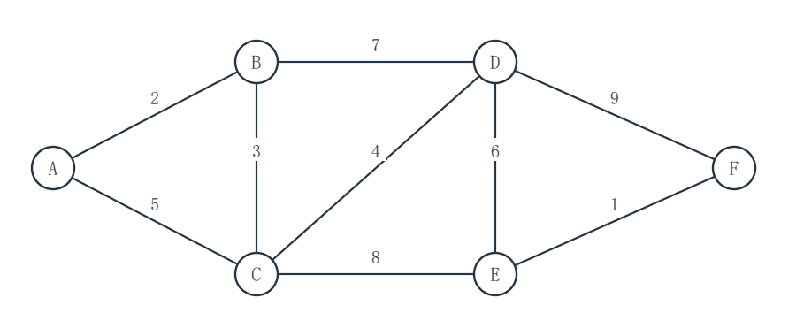

# 2027考研重邮802数据结构模拟试卷 第1套 保守卷

满分150分　考试时间180分钟

姓名：________________　准考证号：________________

请在题后作答区填写答案；算法设计题另附续答页。各大题内的小题从1开始编号，作答时写明小题及空号。

程序中的 __1__、__2__ 等为待填代码；请按空号作答，允许等价的正确表达式或语句。填空题直接写出所求结果。

程序使用C或类C记法，可省略标准头文件。未特别说明时，数组下标从0开始，整数运算不溢出，辅助容器容量足够。算法设计题须写基本思想、C语言实现和时间、辅助空间复杂度。

不使用计算器。各题独立，题内约定优先于本页统一约定。

## 一、程序阅读题（共4题，20分）

### 1（5分）

readings 存放 n=2^k（k≥1）个读数，outSum 有效。阅读程序并填写执行次数与复杂度。

```c
#include <stdio.h>
long countOps(const int readings[], int n, long *outSum) {
    long visits = 0;
    *outSum = 0;
    for (int span = 1; span < n; span *= 2) {
        for (int j = 0; j < span; ++j) {
            *outSum += readings[j];
            ++visits;
        }
    }
    return visits;
}
int main(void) {
    int readings[16] = {3, 1, 4, 1, 5, 9, 2, 6,
                        5, 3, 5, 8, 9, 7, 9, 3};
    long total = 0;
    long visits = countOps(readings, 16, &total);
    printf("visits=%ld, total=%ld\n", visits, total);
    return 0;
}
```

本次调用的 visits 值为 __1__（2分）；一般 n=2^k 时 countOps 返回 __2__（2分）；该函数时间复杂度为 O(__3__)（1分）。只统计源程序执行的循环次数，不考虑编译器优化。

作答区：

<br>
<br>
<br>
<br>


### 2（5分）

带头结点的单链表中，p 是表内数据结点，s 是尚未入表的新结点。补全在 p 前插入 s 的代码。

```c
#include <stdio.h>
typedef struct Node {
    int data;
    struct Node *next;
} Node;
void insertBefore(Node *head, Node *p, Node *s) {
    Node *prev = head;
    while (prev->next != p)
        prev = __1__;
    s->next = __2__;
    __3__ = s;
}
void printList(const Node *head) {
    const Node *p = head->next;
    while (p != NULL) {
        printf("%d", p->data);
        if (p->next != NULL) printf("->");
        p = p->next;
    }
    putchar('\n');
}
int main(void) {
    Node head = {0, NULL}, a = {4, NULL}, b = {9, NULL};
    Node s = {7, NULL}, t = {8, NULL};
    head.next = &a;
    a.next = &b;
    printList(&head);
    insertBefore(&head, &a, &s);
    insertBefore(&head, &b, &t);
    printList(&head);
    return 0;
}
```

填写 __1__（1分）、__2__（2分）、__3__（2分）。各空填一个表达式，勿改其余代码；p 是首个数据结点时也应正确。

作答区：

<br>
<br>
<br>
<br>


### 3（5分）

循环单链队列只存尾指针 rear；空队列时 rear=NULL，出队结点由调用者管理。补全代码。

```c
#include <stdio.h>
typedef struct Node {
    int data;
    struct Node *next;
} Node;
typedef struct { Node *rear; } Queue;
void enQueue(Queue *q, Node *x) {
    if (q->rear == NULL) {
        x->next = x;
        q->rear = x;
    } else {
        x->next = __1__;
        q->rear->next = x;
        q->rear = x;
    }
}
Node *deQueue(Queue *q) {
    if (q->rear == NULL) return NULL;
    Node *x = q->rear->next;
    if (x == q->rear) __2__;
    else __3__;
    x->next = NULL;
    return x;
}
int main(void) {
    Queue q = {NULL};
    Node a = {4, NULL}, b = {9, NULL};
    enQueue(&q, &a);
    enQueue(&q, &b);
    Node *first = deQueue(&q);
    printf("first=%d, rear=%d\n", first->data, q.rear->data);
    Node *second = deQueue(&q);
    Node *third = deQueue(&q);
    printf("second=%d, empty=%d, third-null=%d\n",
           second->data, q.rear == NULL, third == NULL);
    return 0;
}
```

填写 __1__（1分）、__2__（2分）、__3__（2分）。__1__ 填表达式；__2__、__3__ 各填一条不带分号的赋值语句。

作答区：

<br>
<br>
<br>
<br>


### 4（5分）

下列程序统计二叉树的叶结点数。空树的叶结点数为 0，叶结点的左右孩子均为空。补全代码。

```c
#include <stdio.h>
typedef struct TNode {
    int data;
    struct TNode *left, *right;
} TNode;
int leafCount(const TNode *t) {
    if (t == NULL) return __1__;
    if (t->left == NULL && t->right == NULL)
        return __2__;
    return __3__;
}
void report(const char *name, const TNode *root) {
    printf("%s: %d\n", name, leafCount(root));
}
int main(void) {
    TNode d = {4, NULL, NULL};
    TNode e = {5, NULL, NULL};
    TNode b = {2, &d, &e};
    TNode c = {3, NULL, NULL};
    TNode a = {1, &b, &c};
    report("tree", &a);
    report("single", &c);
    report("empty", NULL);
    return 0;
}
```

填写 __1__（1分）、__2__（1分）、__3__（3分），均为表达式。

作答区：

<br>
<br>
<br>
<br>


## 二、填空题（共10题，30分）

### 1（3分）

将中缀表达式 (a+b)×c-d 按通常优先级和左结合性转换为后缀表达式，结果为 __1__（3分）。运算数之间用空格分隔。

### 2（3分）

二维数组 A[1..4][0..5] 按行优先顺序连续存放，每个元素占 4 字节。A[1,0] 的起始地址为 1000，则 A[3,2] 的起始地址为 __1__（3分）。

### 3（3分）

循环队列使用长度为 8 的数组，f 指向队首元素的前一个位置，r 指向队尾元素，始终保留一个空槽。当前 f=6、r=2，队长为 __1__（1分）；用 f、r 表示的判满条件是 __2__（2分）。

### 4（3分）

模式 P=ababaca，字符位置从 1 开始。设 π(i) 为 P[1..i] 最长的相等真前缀与后缀的长度，并规定 next[1]=0，j>1 时 next[j]=π(j-1)+1。则 next[5]=__1__（1分），next[7]=__2__（2分）。

### 5（3分）

广义表 L=((a,b),(),c)。Head 取表的第一个元素，Tail 取除首元素外组成的表。Head(Tail(L)) 的结果是 __1__（3分）。请用广义表记法填写。

### 6（3分）

一棵完全二叉树高为 6 层，根为第 1 层，第 5 层恰有 4 个叶结点。该树最多有 __1__ 个结点（3分）。

### 7（3分）

元素 1、2、3、4、5 按顺序入栈，允许在任意两次入栈之间弹栈，最终全部出栈。若第一个弹出的元素规定为 3，则不同的完整出栈序列共有 __1__ 种（3分）。

### 8（3分）

依次向空 AVL 树插入 2、4、6、8、10、12、14。完成全部插入并按 AVL 规则调整后，平衡因子为 0 的结点共有 __1__ 个（3分）；平衡因子定义为左子树高度减右子树高度。

### 9（3分）

大根堆的顺序表初值为 [90,70,80,20,50,60]，把关键字 85 插入末尾并逐层上滤。完成插入后根的左孩子为 __1__（1分），新关键字所在的数组下标为 __2__（2分）；数组下标从 1 开始。

### 10（3分）

对 95 个互异关键字构成的升序表作折半查找。搜索区间为闭区间，mid=floor((low+high)/2)，每访问一个中间关键字计一次比较。成功查找最多比较 __1__ 次关键字（3分）。

## 三、综合应用题（共7题，70分）

### 1（10分）

二叉树的先序序列为 ABDECFG，中序序列为 DBEACGF。结点关键字互异。中序线索化时，仅用原本为空的孩子指针存前驱或后继；标志 0 表示孩子指针，1 表示线索，不设置头结点。

（1）画出重建的二叉树，或用“结点:左孩子,右孩子”（空写 NULL）列出结构。（4分）
（2）写出后序遍历序列。（2分）
（3）分别给出结点 C、G 在线索化后的左、右指针所指结点及对应标志；不存在的前驱/后继记 NULL。（4分）

作答区：

<br>
<br>
<br>
<br>
<br>
<br>
<br>
<br>
<br>
<br>


### 2（10分）

符号 A、B、C、D、E 的出现频率依次为 3、5、7、9、20。按 Huffman 方法，每次取当前权值最小的两个结点合并；两子树权值相同则按其最小符号的字母序选择，左边标 0、右边标 1。

（1）按先后顺序列出每次合并的两个权值及合并后权值。（3分）
（2）画出 Huffman 树，或列出 A～E 的一组对应码字。（5分）
（3）求带权路径长度 WPL。（2分）

作答区：

<br>
<br>
<br>
<br>
<br>
<br>
<br>
<br>
<br>
<br>


### 3（10分）

散列表长 m=11，地址为 0～10，散列函数 H(key)=key mod 11。按 14、25、36、5、16 的顺序插入，冲突时线性探测；空槽记“-”。成功查找的五个关键字等概率；失败查找的 11 个起始散列地址等概率，探测到首个空槽也计 1 次。

（1）写出插入完成后全部 0～10 号槽的内容。（4分）
（2）列出五个成功查找的探测次数，求成功 ASL。（3分）
（3）列出或分组给出 11 个起始地址的失败探测次数，求失败 ASL。（3分）

作答区：

<br>
<br>
<br>
<br>
<br>
<br>
<br>
<br>
<br>
<br>


### 4（10分）

升序表为 [4,9,13,18,25,29,35,41,50,58]，下标从 0 开始。按闭区间折半查找，mid=floor((low+high)/2)；每访问一个中间关键字并比较一次，区间变空即判失败。

（1）画出成功查找判定树，或用“结点:左孩子,右孩子”（空写 NULL）列出结构。（5分）
（2）各关键字等概率被查找时，求成功 ASL，写出按比较次数分组的计算式。（3分）
（3）查找不存在的 27 时，按顺序写出比较过的关键字和比较次数。（2分）

作答区：

<br>
<br>
<br>
<br>
<br>
<br>
<br>
<br>
<br>
<br>


### 5（10分）

无向连通带权图的顶点为 A、B、C、D、E、F，全部边及权值如下，未列出的边不存在。边权互异。

| 边 | AB | AC | BC | BD | CD | CE | DE | DF | EF |
|---|---:|---:|---:|---:|---:|---:|---:|---:|---:|
| 权值 | 2 | 5 | 3 | 7 | 4 | 8 | 6 | 9 | 1 |



（1）从 A 出发，按加入顺序列出 Prim 算法选取的 5 条边。（5分）
（2）按考虑权值由小到大，列出 Kruskal 算法纳入最小生成树的 5 条边。（3分）
（3）求最小生成树总权值。（2分）

作答区：

<br>
<br>
<br>
<br>
<br>
<br>
<br>
<br>
<br>
<br>


### 6（10分）

向空二叉排序树依次插入 30、10、20、40、35，关键字互异。另从空树开始按相同顺序插入 AVL 树；两棵树分别构造，互不影响。查找成功的五个关键字等概率，每访问一个结点算一次比较。

（1）画出普通二叉排序树，并列出其中五个关键字的成功查找比较次数。（3分）
（2）求普通二叉排序树的成功 ASL。（2分）
（3）按插入顺序写出 AVL 树每次发生的失衡类型，并画出全部插入完成后的 AVL 树。（5分）

作答区：

<br>
<br>
<br>
<br>
<br>
<br>
<br>
<br>
<br>
<br>


### 7（10分）

数组 A=[42,17,63,28,9,54,31,22]，下标从 0 开始。甲、乙分别从原数组开始，互不影响。

甲：以首元素为枢轴，仅执行如下“挖坑”式快速排序的一趟划分：
```c
int pivot=A[0], i=0, j=7;
while (i<j) {
    while (i<j && A[j]>=pivot) --j;
    if (i<j) A[i++]=A[j];
    while (i<j && A[i]<=pivot) ++i;
    if (i<j) A[j--]=A[i];
}
A[i]=pivot;
```
乙：按从最后一个非叶结点到根的顺序，自下而上筛选建小根堆；两个孩子都存在时选较小者。

（1）写出甲结束后的完整数组及枢轴最终下标。（5分）
（2）写出乙结束后的完整数组。（5分）

作答区：

<br>
<br>
<br>
<br>
<br>
<br>
<br>
<br>
<br>
<br>


## 四、算法设计与分析题（共3题，30分）

### 1（8分）

两个带头结点的单链表 A、B 均按 data 严格递增，且没有共享结点。设计函数求差集 A\B：删除 A 中所有关键字也在 B 中的原结点并释放它们；A 中保留的结点保持原先顺序，不新建数据结点，B 不变。空表允许，A 的头结点地址不变。

```c
typedef struct Node {
    int data;
    struct Node *next;
} Node;
void listDifference(Node *A, const Node *B);
```

请写出算法的基本思想、C语言实现，并分析时间复杂度和辅助空间复杂度。

作答区：

<br>
<br>
<br>
<br>
<br>
<br>
<br>
<br>
<br>
<br>


#### 第1题续答区（代码与分析）

<br>
<br>
<br>
<br>
<br>
<br>
<br>
<br>
<br>
<br>
<br>
<br>
<br>
<br>
<br>
<br>
<br>
<br>
<br>
<br>
<br>
<br>
<br>
<br>


### 2（10分）

一棵非空二叉树的结点 data 是整数，可为负数。本题所有从根到结点的路径权值和均在 int 范围内。设计函数求从根到某个叶结点的最大结点权值和，并把对应路径上的 data 按从根到叶的顺序写入 path；若多条路径的权值和并列，输出任意一条。path 的容量至少为结点总数，pathLen 为有效指针；函数返回最大权值和。叶结点的两个孩子均为空。

```c
typedef struct TNode {
    int data;
    struct TNode *left, *right;
} TNode;
int maxRootLeafSum(const TNode *root, int *path, int *pathLen);
```

请写出算法的基本思想、C语言实现，并分析时间复杂度和辅助空间复杂度。

作答区：

<br>
<br>
<br>
<br>
<br>
<br>
<br>
<br>
<br>
<br>


#### 第2题续答区（代码与分析）

<br>
<br>
<br>
<br>
<br>
<br>
<br>
<br>
<br>
<br>
<br>
<br>
<br>
<br>
<br>
<br>
<br>
<br>
<br>
<br>
<br>
<br>
<br>
<br>


### 3（12分）

无向简单图 G 用邻接表存储，顶点编号 0～V-1（1≤V≤100）。给定互不相同的合法顶点 s、t、w。设计函数找一条从 s 到 t、途中完全不经过 w、顶点不重复的路径。找到时将完整顶点序列写入容量至少 V 的 path，并把结点数写入 pathLen，返回 1；不存在时令 *pathLen=0，返回 0。无向边在两个端点的链表中各出现一次；E 表示无向边数。

```c
typedef struct Arc {
    int to;
    struct Arc *next;
} Arc;
typedef struct {
    int V, E;
    Arc **head;
} Graph;
int pathAvoidingVertex(const Graph *G, int s, int t, int w,
                       int *path, int *pathLen);
```

请写出算法的基本思想、C语言实现，并分析时间复杂度和辅助空间复杂度。

作答区：

<br>
<br>
<br>
<br>
<br>
<br>
<br>
<br>
<br>
<br>


#### 第3题续答区（代码与分析）

<br>
<br>
<br>
<br>
<br>
<br>
<br>
<br>
<br>
<br>
<br>
<br>
<br>
<br>
<br>
<br>
<br>
<br>
<br>
<br>
<br>
<br>
<br>
<br>

