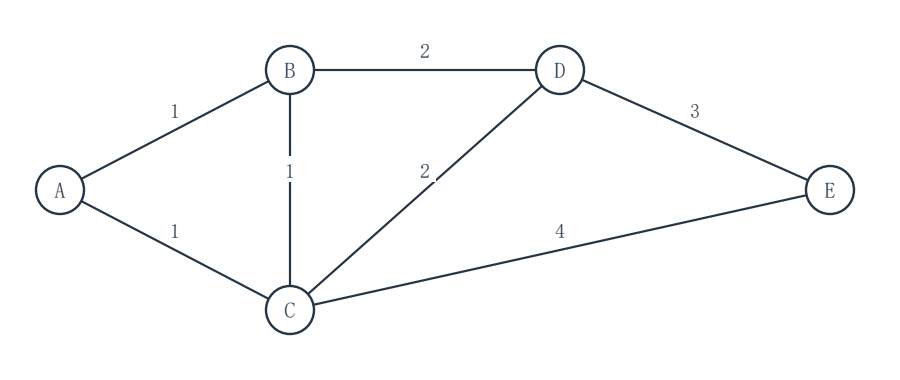

# 2027考研重邮802数据结构模拟试卷 第3套 保守卷

满分150分　考试时间180分钟

姓名：________________　准考证号：________________

请在题后作答区填写答案；算法设计题另附续答页。各大题内的小题从1开始编号，作答时写明小题及空号。

程序中的 __1__、__2__ 等为待填代码；请按空号作答，允许等价的正确表达式或语句。填空题直接写出所求结果。

程序使用C或类C记法，可省略标准头文件。未特别说明时，数组下标从0开始，整数运算不溢出，辅助容器容量足够。算法设计题须写基本思想、C语言实现和时间、辅助空间复杂度。

不使用计算器。各题独立，题内约定优先于本页统一约定。

## 一、程序阅读题（共4题，20分）

### 1（5分）

设 `n` 是 `int` 范围内的正整数。阅读程序；复杂度针对 `countOps(n)` 的一次调用。

```c
#include <stdio.h>

unsigned long long countOps(int n) {
    unsigned long long count = 0;
    for (long long i = 1; i <= n; i *= 2) {
        for (int j = n; j >= 1; --j) {
            ++count;
        }
    }
    return count;
}

int main(void) {
    int sample = 8;
    unsigned long long result = countOps(sample);
    printf("n=%d, count=%llu\n", sample, result);
    return 0;
}
```

当 `n=8` 时，外层 `i` 依次为 ______（1分），`count=______`（1分）。若 `n=2^k`（k≥0），外层执行 ______ 次（1分）；以 n 为自变量，`countOps(n)` 的时间复杂度为 ______（2分）。

作答区：

<br>
<br>
<br>
<br>


### 2（5分）

带头结点的单链表按 `key` 升序做简单选择排序，`tag` 仅用于辨认同键记录。比较相等时保留先遇到的结点作为 `best`；交换整个记录，不交换指针。补全程序。

```c
#include <stddef.h>
#include <stdio.h>
typedef struct Node {
    int key;
    char tag;
    struct Node *next;
} Node;

void selectionSort(Node *head) {
    for (Node *p = __1__; p != NULL; p = p->next) {
        Node *best = p;
        for (Node *q = __2__; q != NULL; q = q->next) {
            if (__3__) best = q;
        }
        if (best != p) {
            int key = p->key;
            char tag = p->tag;
            p->key = best->key;
            p->tag = best->tag;
            best->key = key;
            best->tag = tag;
        }
    }
}
int main(void) {
    Node nodes[4] = {
        {4, 'a', NULL}, {2, '-', NULL},
        {4, 'b', NULL}, {1, '-', NULL}
    };
    for (int i = 0; i < 3; ++i) nodes[i].next = &nodes[i + 1];
    Node head = {0, '-', &nodes[0]};
    selectionSort(&head);
    for (Node *p = head.next; p != NULL; p = p->next)
        printf("(%d,%c) ", p->key, p->tag);
    putchar('\n');
    return 0;
}
```

填代码空 `__1__`（1分）、`__2__`（1分）、`__3__`（1分）；写出程序打印的含 `tag` 记录序列 ______（1分），以及 n 个数据结点时 `selectionSort` 的最坏时间复杂度 ______（1分）。

作答区：

<br>
<br>
<br>
<br>


### 3（5分）

带头结点的链式队列中，`front` 指向头结点，`rear` 指向尾结点；空队列时二者指向同一结点。`init` 成功后调用以下程序。补全三个空。

```c
#include <stdio.h>
#include <stdlib.h>
typedef struct Node { int data; struct Node *next; } Node;
typedef struct { Node *front, *rear; } Queue;

int init(Queue *q) {
    Node *h = malloc(sizeof *h);
    if (h == NULL) return 0;
    h->next = NULL;
    q->front = q->rear = h;
    return 1;
}
int enq(Queue *q, int x) {
    Node *p = malloc(sizeof *p);
    if (p == NULL) return 0;
    p->data = x; p->next = NULL;
    __1__;
    q->rear = p;
    return 1;
}
int deq(Queue *q, int *out) {
    Node *p = q->front->next;
    if (p == NULL) return 0;
    *out = p->data;
    q->front->next = p->next;
    if (q->rear == p) __2__;
    free(p);
    return 1;
}
int empty(const Queue *q) { return __3__; }
int main(void) {
    Queue q; int x;
    if (!init(&q)) return 1;
    if (!enq(&q, 4) || !enq(&q, 7)) return 1;
    deq(&q, &x);
    if (!enq(&q, 9)) return 1;
    printf("%d %d\n", x, q.front->next->data);
    while (!empty(&q)) deq(&q, &x);
    free(q.front);
    return 0;
}
```

填 `__1__`（1分）、`__2__`（1分）、`__3__`（1分）；写出打印的两个整数 ______（1分）；队列非空时一次 `enq` 或 `deq` 的时间复杂度为 ______（1分）。

作答区：

<br>
<br>
<br>
<br>


### 4（5分）

无向图以邻接矩阵表示；顶点与邻点均按编号递增遍历。补全程序。

```c
#include <stdio.h>
enum { V = 4 };
int g[V][V] = {
    {0, 1, 1, 0}, {1, 0, 1, 0},
    {1, 1, 0, 0}, {0, 0, 0, 0}
};
int seen[V] = {0};
void dfs(int u) {
    seen[u] = 1;
    for (int v = 0; v < V; ++v) {
        if (__1__) {
            printf("%d->%d ", u, v);
            __2__;
        }
    }
}
int visitForest(void) {
    int components = 0;
    for (int u = 0; u < V; ++u) {
        if (__3__) {
            ++components;
            printf("C%d: ", components);
            dfs(u);
            putchar('\n');
        }
    }
    return components;
}
int main(void) {
    int total = visitForest();
    printf("components=%d\n", total);
    return 0;
}
```

填代码空 `__1__`（1分）、`__2__`（1分）、`__3__`（1分）。推广到 V 个顶点、仍用邻接矩阵遍历全部顶点时，`visitForest` 的时间复杂度为 ______（2分）。

作答区：

<br>
<br>
<br>
<br>


## 二、填空题（共10题，30分）

### 1（3分）

容量为 7 的循环队列以 `front` 指向队首、`rear` 指向下一入队位置，另用 `count` 记录元素数。初始三者均为 0；依次入队 2、4、6、8，出队两次，再入队 10、12、14。此时 `front=______`（1分），`rear=______`（1分），`count=______`（1分）。

### 2（3分）

一棵二进制 Huffman 树的每个非叶结点恰有两个孩子，所有字符只在叶结点。若整棵树共有 53 个结点，则叶结点共有 ______ 个（3分）。

### 3（3分）

互异元素 1、2、3、4、5、6 按此顺序依次入同一个空栈，入栈、出栈可交替进行，直到全部元素出栈。若第一个出栈元素为 4，则可能的完整出栈序列共有 ______ 种（3分）。

### 4（3分）

模式串 `P=ababbab` 从 1 编号。采用下列 KMP 约定：`next[1]=0`；对 j>1，`next[j]` 等于 P 的前 j-1 个字符中“最长真前缀且同时为后缀”的长度加 1；无非空匹配时该长度为 0。写出 `next[1..7]=______`（3分）。

### 5（3分）

后缀表达式 `8 3 2 + * 9 5 - / 6 +` 中各记号以空格分隔，运算符均为双目运算符，`/` 表示除法（本题每次除法均可整除）。按从左到右的顺序，用栈对该表达式求值，最终结果为 ______（3分）。

### 6（3分）

一棵非空树有 4 个度为 3 的结点、3 个度为 2 的结点、2 个度为 1 的结点，没有度超过 3 的结点。度为 0 的结点有 ______ 个（3分）。

### 7（3分）

有 n≥2 个顶点的简单有向图若强连通，至少需要 ______ 条弧（3分）。

### 8（3分）

一片森林有 27 个结点、4 棵树，则森林中的边共有 ______ 条（3分）。

### 9（3分）

小根堆用从 1 起编号的数组存为 `(1,4,2,9,7,6)`。插入键 0 并逐层上滤后，数组内容为 ______（3分）。

### 10（3分）

用二叉链表存储一棵有 23 个结点的非空二叉树，每个结点各有一个左孩子指针和一个右孩子指针。指向 `NULL` 的孩子指针共有 ______ 个（3分）。

## 三、综合应用题（共7题，70分）

### 1（10分）

一棵二叉树的结点互异，先序序列为 `M,F,C,H,T,Q,W`，中序序列为 `C,F,H,M,Q,T,W`。规定中序线索化后，结点原本为空的左指针指向中序前驱，原本为空的右指针指向中序后继；不存在前驱或后继时指向 `NULL`。

（1）画出该二叉树，标明每个结点的左、右孩子。（4分）

（2）写出该树的后序序列。（2分）

（3）中序线索化后，分别写出 C 的左指针、H 的右指针、Q 的左指针、W 的右指针所指向的结点（或 `NULL`）。（4分）

作答区：

<br>
<br>
<br>
<br>
<br>
<br>
<br>
<br>
<br>
<br>


### 2（10分）

将互异整数 `30,20,40,10,25,22` 依次插入空的普通二叉排序树（BST）；另从空树按同一顺序做 AVL 插入。树结点的左右孩子须分别标清。

（1）画出六个键插入后的普通 BST。（2分）

（2）写出 AVL 插入 22 后首次失衡的结点及应做的旋转次序。（2分）

（3）画出调整后的 AVL 树。（3分）

（4）分别写出两棵树中成功查找 22 所经过的键序列，并给出各自的比较次数。（3分）

作答区：

<br>
<br>
<br>
<br>
<br>
<br>
<br>
<br>
<br>
<br>


### 3（10分）

字符 A、B、C、D、E、F、G、H 的出现概率依次为 `0.07,0.19,0.02,0.06,0.32,0.03,0.21,0.10`，总和为 1。按每次合并两棵最小权树的方法构造二进制 Huffman 树；不要求写具体码字。

（1）依次写出七次合并产生的新权值。（4分）

（2）求 Huffman 编码的平均码长，单位为 bit/字符。（3分）

（3）若八种字符统一用 3 位定长编码，平均码长是多少？两种编码相差多少 bit/字符？（2分）

（4）所得 Huffman 树的总结点数是多少？（1分）

作答区：

<br>
<br>
<br>
<br>
<br>
<br>
<br>
<br>
<br>
<br>


### 4（10分）

长度为 11 的散列表槽号为 0～10，`H(k)=k mod 11`，冲突时从散列地址向后循环线性探测。将键 `22,33,14,25,36,47` 依次插入空表。成功查找只在找到目标键时停止；失败查找在遇到首个空槽时停止。所有已插入键等可能被成功查找；失败查询的初始散列地址 0～10 等可能。

（1）按槽号 0～10 写出插入后的散列表，空槽记为“空”。（4分）

（2）按插入顺序写出六个键成功查找各自需要的探测次数，并求成功平均查找长度 ASL。（3分）

（3）按初始地址 0～10 的顺序写出失败查找的探测次数，并求失败 ASL。（3分）

作答区：

<br>
<br>
<br>
<br>
<br>
<br>
<br>
<br>
<br>
<br>


### 5（10分）

无向带权图的顶点为 A、B、C、D、E，全部边如下。等权边按表中从左到右的顺序处理。

| 边 | AB | AC | BC | BD | CD | DE | CE |
|---|---:|---:|---:|---:|---:|---:|---:|
| 权 | 1 | 1 | 1 | 2 | 2 | 3 | 4 |



（1）按 Kruskal 算法，逐条写出从开始到选满 4 条树边为止每条已检查边的“入树”或“因成环略过”结果。（5分）

（2）写出所得最小生成树的边集与总权值。（2分）

（3）从 A 开始按 Prim 算法选边，等权时按上表边次序选，写出 4 条边的入树次序。（3分）

作答区：

<br>
<br>
<br>
<br>
<br>
<br>
<br>
<br>
<br>
<br>


### 6（10分）

升序顺序表的七个互异关键字依次为 `3,8,11,18,21,27,30`，下标为 1～7。折半查找每轮取 `mid=floor((low+high)/2)`，成功查找的比较次数为所经结点数；七个关键字被查询的概率相同。

（1）画出这七个关键字的折半查找判定树，标清左右孩子。（4分）

（2）求成功查找的平均查找长度 ASL。（3分）

（3）查找 21 时，依次与哪些关键字比较？（2分）

（4）查找 25 失败时共比较几次？（1分）

作答区：

<br>
<br>
<br>
<br>
<br>
<br>
<br>
<br>
<br>
<br>


### 7（10分）

对记录按整数关键字升序做自底向上的稳定二路归并排序。初始序列为 `(8a,3,7,1,8b,2,6,4)`，字母 a、b 标记两条同键记录。第一趟把相邻的长度为 1 的有序段两两归并，第二趟归并相邻的长度为 2 的有序段，第三趟归并相邻的长度为 4 的有序段。每次归并比较到相等关键字时，先取左段的记录。

（1）写出第一趟结束后的完整记录序列。（3分）
（2）写出第二趟结束后的完整记录序列。（3分）
（3）写出第三趟结束后的完整记录序列。（4分）

作答区：

<br>
<br>
<br>
<br>
<br>
<br>
<br>
<br>
<br>
<br>


## 四、算法设计与分析题（共3题，30分）

### 1（8分）

三条不带头结点的单链表分别按整数 `key` 非递减排列，各链可以为空，且三链互不共享结点。设计 `mergeThree`，只重连原有结点，返回合并后非递减单链表的首结点；若有相等关键字，它们之间的先后次序不限。全部为空时返回 `NULL`，不得新建或释放数据结点。

```c
typedef struct Node { int key; struct Node *next; } Node;
Node *mergeThree(Node *a, Node *b, Node *c);
```

请写出算法的基本思想、C语言实现，并分析时间复杂度和辅助空间复杂度。

作答区：

<br>
<br>
<br>
<br>
<br>
<br>
<br>
<br>
<br>
<br>


#### 第1题续答区（代码与分析）

<br>
<br>
<br>
<br>
<br>
<br>
<br>
<br>
<br>
<br>
<br>
<br>
<br>
<br>
<br>
<br>
<br>
<br>
<br>
<br>
<br>
<br>
<br>
<br>


### 2（10分）

二叉树结点含布尔字段 `mark`。设计 `longestMarkedPath`，在所有“从根到叶且沿途至少有一个 `mark` 为真结点”的路径中，输出一条结点数最多的路径；有多条等长路径时任选一条。调用者提供容量至少为树高的 `out` 数组和有效的 `len` 指针；成功时将根到叶的结点指针依次放入 `out`，通过 `*len` 返回路径结点数并返回 `true`；空树或无合格路径时令 `*len=0` 且返回 `false`。不得修改树。

```c
#include <stdbool.h>
typedef struct Node {
    int data;
    bool mark;
    struct Node *left, *right;
} Node;
bool longestMarkedPath(const Node *root, const Node *out[], int *len);
```

请写出算法的基本思想、C语言实现，并分析时间复杂度和辅助空间复杂度。

作答区：

<br>
<br>
<br>
<br>
<br>
<br>
<br>
<br>
<br>
<br>


#### 第2题续答区（代码与分析）

<br>
<br>
<br>
<br>
<br>
<br>
<br>
<br>
<br>
<br>
<br>
<br>
<br>
<br>
<br>
<br>
<br>
<br>
<br>
<br>
<br>
<br>
<br>
<br>


### 3（12分）

无向简单图用邻接矩阵 `g` 表示，顶点编号为 `0..V-1`，`1≤V≤12`；`g[u][v]` 为 1 当且仅当两点相邻。给定合法顶点 `s、t` 和整数 `k`（`0≤k≤V-1`），设计 `countPaths`，返回从 s 到 t、恰经过 k 条边且不重复顶点的简单路径条数。顶点序列不同的路径分别计数；当 s=t 且 k=0 时，单顶点路径计为 1 条。图不应被修改。

```c
int countPaths(const int g[12][12], int V, int s, int t, int k);
```

请写出算法的基本思想、C语言实现，并分析时间复杂度和辅助空间复杂度。

作答区：

<br>
<br>
<br>
<br>
<br>
<br>
<br>
<br>
<br>
<br>


#### 第3题续答区（代码与分析）

<br>
<br>
<br>
<br>
<br>
<br>
<br>
<br>
<br>
<br>
<br>
<br>
<br>
<br>
<br>
<br>
<br>
<br>
<br>
<br>
<br>
<br>
<br>
<br>

