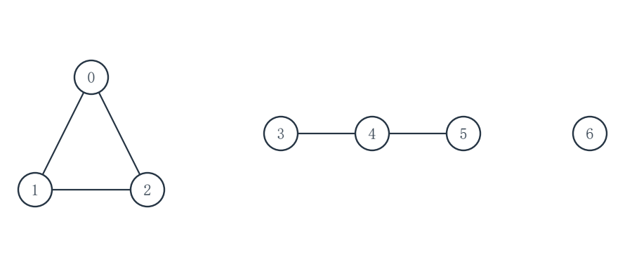

# 2027考研重邮802数据结构模拟试卷 第5套 适度创新卷

满分150分　考试时间180分钟

姓名：________________　准考证号：________________

请在题后作答区填写答案；算法设计题另附续答页。各大题内的小题从1开始编号，作答时写明小题及空号。

程序中的 __1__、__2__ 等为待填代码；请按空号作答，允许等价的正确表达式或语句。填空题直接写出所求结果。

程序使用C或类C记法，可省略标准头文件。未特别说明时，数组下标从0开始，整数运算不溢出，辅助容器容量足够。算法设计题须写基本思想、C语言实现和时间、辅助空间复杂度。

不使用计算器。各题独立，题内约定优先于本页统一约定。

## 一、程序阅读题（共4题，20分）

### 1（5分）

设 n≥1 且为 2 的幂。两次递归调用都实际执行，不共用返回值；假定整数运算不溢出，基本算术、比较与自增均计为常数时间。
```c
#include <stdio.h>
unsigned long long work(unsigned n) {
    if (n == 1) return 0;
    unsigned long long s = 0;
    for (unsigned i = 0; i < n; ++i) {
        ++s;
    }
    unsigned half = n / 2;
    unsigned long long left = work(half);
    unsigned long long right = work(half);
    return left + right + s;
}
int main(void) {
    const unsigned input[] = {2, 4, 8};
    for (unsigned i = 0; i < 3; ++i) {
        unsigned long long value = work(input[i]);
        printf("%u -> %llu\n", input[i], value);
    }
    return 0;
}
```
只分析一次 work(n) 调用。work(8) 的返回值为 __1__（1分）；当 n>1 时，每一层非基例调用中的循环总次数为 __2__（1分），非基例层数为 __3__（1分）；work(n) 的时间复杂度为 O(__4__)（2分）。

作答区：

<br>
<br>
<br>
<br>


### 2（5分）

带头结点的单链表有 n 个数据结点。程序建表后删除全部偶数结点并输出剩余元素；只分析 removeEven。待填处写指针表达式，head 非空。
```c
#include <stdio.h>
#include <stdlib.h>
typedef struct Node { int data; struct Node *next; } Node;
void removeEven(Node *head) {
    Node *pre = head, *p = head->next;
    while (p != NULL) {
        if (p->data % 2 == 0) {
            pre->next = p->next;
            free(p);
            p = __1__;
        } else {
            pre = __2__;
            p = __3__;
        }
    }
}
int main(void) {
    Node head = {0, NULL};
    const int input[] = {3, 8, 5, 6, 7};
    Node *tail = &head;
    for (int i = 0; i < 5; ++i) {
        Node *node = malloc(sizeof *node);
        if (node == NULL) exit(EXIT_FAILURE);
        node->data = input[i]; node->next = NULL;
        tail->next = node; tail = node;
    }
    removeEven(&head);
    Node *p = head.next;
    while (p != NULL) {
        Node *next = p->next;
        printf("%d ", p->data);
        free(p);
        p = next;
    }
    putchar('\n');
    return 0;
}
```
填 __1__（1分）、__2__（1分）、__3__（1分）；removeEven 的最坏时间复杂度为 __4__（1分），额外空间复杂度为 __5__（1分），均用 n 表示。

作答区：

<br>
<br>
<br>
<br>


### 3（5分）

两个栈共用长度为 CAP 的数组，栈0从左向右增长，栈1从右向左增长。CAP≥2；s、out 在调用时均为有效指针，所有操作均在初始化后进行。
```c
#include <stdio.h>
#define CAP 8
typedef struct {
    int a[CAP];
    int top0, top1;
} Shared;
void init(Shared *s) {
    s->top0 = -1;
    s->top1 = __1__;
}
int full(const Shared *s) {
    return __2__;
}
int push0(Shared *s, int x) {
    if (full(s)) return 0;
    s->a[++s->top0] = x;
    return 1;
}
int push1(Shared *s, int x) {
    if (full(s)) return 0;
    s->a[--s->top1] = x;
    return 1;
}
int pop1(Shared *s, int *out) {
    if (__3__) return 0;
    *out = s->a[s->top1++];
    return 1;
}
int main(void) {
    Shared s;
    int value;
    init(&s);
    push0(&s, 11);
    push1(&s, 72);
    push0(&s, 13);
    if (pop1(&s, &value)) printf("%d\n", value);
    return 0;
}
```
填 __1__（1分）、__2__（1分）、__3__（1分）；任一次 push 或 pop 的最坏时间复杂度为 __4__（1分），每次操作除既有数组外的额外空间复杂度为 __5__（1分）。

作答区：

<br>
<br>
<br>
<br>


### 4（5分）

给定容量 m≥1 的散列表，空槽用 -1 表示；待插入的关键字均为非负整数，每次调用前表中均不含该 key。散列函数为 H(key)=key mod m；发生冲突时，沿地址递增方向循环探测；若探测完 m 个槽仍无空槽，则插入失败。阅读完整程序，补全线性探测的关键表达式。
```c
#include <stdio.h>
enum { CAP = 11, EMPTY = -1 };
int insertLinear(int table[], int m, int key) {
    int pos = __1__;
    for (int step = 0; step < m; ++step) {
        if (table[pos] == EMPTY) {
            table[pos] = key;
            return 1;
        }
        pos = __2__;
    }
    return 0;
}
int main(void) {
    int table[CAP];
    const int keys[] = {7, 18, 29, 3};
    for (int i = 0; i < CAP; ++i)
        table[i] = EMPTY;
    for (int i = 0; i < 4; ++i)
        insertLinear(table, CAP, keys[i]);
    for (int i = 0; i < CAP; ++i)
        printf("%d ", table[i]);
    putchar('\n');
    return 0;
}
```
填 __1__（2分）、__2__（2分）；一次插入的最坏时间复杂度为 __3__（1分），用 m 表示。

作答区：

<br>
<br>
<br>
<br>


## 二、填空题（共10题，30分）

### 1（3分）

对数组 A=(6,2,5,1,4,3,7) 作升序冒泡排序。每趟从左向右比较相邻元素，只有前者大于后者才交换；第一趟依次比较下标(0,1)至(5,6)，第二趟依次比较(0,1)至(4,5)，不提前停止。第一趟结束后的数组为 __1__（1分）；第二趟结束后的数组为 __2__（1分）；这两趟合计交换 __3__（1分）次。

### 2（3分）

操作数均为单个字母，不含一元运算。中缀表达式 a+b*(c-d/e) 的后缀表达式为 __1__（3分）；相邻记号用空格分隔。

### 3（3分）

两个循环队列均用长度为 m（m≥2）的数组。甲留一个空槽，以 front==rear 判空、(rear+1)%m==front 判满；乙另设 count，以 count==0 判空、count==m 判满。甲最多容纳 __1__ 个元素（1分），乙最多容纳 __2__ 个元素（2分）；答案用 m 表示。

### 4（3分）

模式 P=abcabca，下标从 1 开始。采用约定 next[1]=0；对 j≥2，next[j] 为 P[1..j-1] 的最长真前后缀长度加 1，若最长长度为 0 则 next[j]=1。按下标 1 至 7 依次写出完整 next 数组：__1__（3分）。

### 5（3分）

二维数组 A 按行主序连续存放，各元素占 2 字节，A[0,0] 的首地址为 200，A[2,3] 的首地址为 246，各行列数相同。每行有 __1__ 列（3分）。

### 6（3分）

一棵非空二叉树有 8 个叶结点、3 个度为 1 的结点。这棵树共有 __1__ 个结点（3分）。

### 7（3分）

有向无环图的顶点为 0、1、2、3、4、5，弧集为 {0→2，0→3，1→3，1→4，2→5，3→5，4→5}。包含全部六个顶点的不同拓扑序共有 __1__ 个（3分）。

### 8（3分）

对升序数组 A[1..15]=(2,4,6,8,10,12,14,16,18,20,22,24,26,28,30) 折半查找 26。使用闭区间 [lo,hi]，每轮 mid=floor((lo+hi)/2)，每次访问 A[mid] 计一次比较。依次比较的数组下标为 __1__（2分），总比较次数为 __2__（1分）。

### 9（3分）

最小堆 A[1..6]=(3,7,5,10,9,8) 的下标从 1 开始；把 2 插入堆尾，再按通常的上滤过程恢复最小堆。插入后 A[1..7] 为 __1__（3分）。

### 10（3分）

一棵 Huffman 编码树是严格二叉树，共有 217 个结点，所有字符对应叶结点。字符数为 __1__（3分）。

## 三、综合应用题（共7题，70分）

### 1（10分）

一棵二叉树的结点标识互不相同，先序序列为 A、B、D、E、C、F、G，中序序列为 D、B、E、A、F、C、G。中序线索化时，仅将原本为空的左、右指针分别指向该结点的中序前驱、后继；首尾结点的相应线索仍为空。
（1）根据两种遍历序列画出二叉树，标明左右孩子。（4分）
（2）写出该树的后序遍历序列。（3分）
（3）写出结点 D 的中序前驱、后继，以及结点 F 的中序前驱、后继；不存在时写“空”。（3分）

作答区：

<br>
<br>
<br>
<br>
<br>
<br>
<br>
<br>
<br>
<br>


### 2（10分）

互异关键字 A[1..10]=(5,12,18,23,31,42,57,66,74,89) 已按升序存储。折半查找每轮采用闭区间 [lo,hi]，取 mid=floor((lo+hi)/2)，每访问一个关键字计一次比较；等概率成功查找时，每个关键字概率相同。
（1）画出该规则对应的完整折半查找判定树，结点写关键字。（5分）
（2）写出成功查找 57 时依次比较的关键字。（2分）
（3）写出未成功查找 60 时依次比较的关键字。（1分）
（4）求等概率成功查找的平均查找长度 ASL。（2分）

作答区：

<br>
<br>
<br>
<br>
<br>
<br>
<br>
<br>
<br>
<br>


### 3（10分）

字符 A、B、C、D、E、F 的出现频率依次为 2、4、7、10、15、25。按二叉 Huffman 树构造二进制前缀码，WPL 为各叶频率乘其码长之和；合并权如遇并列可任意选择。现只把 A 的频率从 2 改为 9，其他字符不变。
（1）列出原频率的每次 Huffman 合并权，并求原最小 WPL。（4分）
（2）若仍沿用原树的各字符码长，求新频率下的 WPL。（2分）
（3）按新频率重新构造 Huffman 树，列出每次合并权并求新的最小 WPL。（4分）

作答区：

<br>
<br>
<br>
<br>
<br>
<br>
<br>
<br>
<br>
<br>


### 4（10分）

互异整数 40、20、10、30、60、50、70 依次插入一棵初始为空的普通二叉排序树；左子树键小于根，右子树键大于根。查找成功时，根的比较次数计为 1，所有结点被查找的概率相等。
（1）画出最终二叉排序树。（4分）
（2）写出该树的后序遍历序列。（2分）
（3）写出查找 55 未成功时依次比较的关键字，并求七个结点等概率成功查找的 ASL。（4分）

作答区：

<br>
<br>
<br>
<br>
<br>
<br>
<br>
<br>
<br>
<br>


### 5（10分）

散列表地址为 0..10，依次插入关键字 22、1、13、11、24、35、46。采用双散列探测：H_0(k)=k mod 11，d(k)=1+(k mod 10)，第 i 次候选地址 H_i(k)=(H_0(k)+i·d(k)) mod 11（i 从 0 开始）。表初始为空，插入时遇到首个空槽即停。
（1）写出每个关键字的最终地址和插入探测次数，并填写最终散列表。（6分）
（2）假设这七个关键字被等概率成功查找，求成功 ASL。（4分）

作答区：

<br>
<br>
<br>
<br>
<br>
<br>
<br>
<br>
<br>
<br>


### 6（10分）

无向简单图的顶点为 0..6，边集为 {0-1，0-2，1-2，3-4，4-5}，顶点 6 孤立。邻接点均按编号递增访问；遍历完一个分量后，从最小未访问顶点重新启动。发现新顶点时将该边记为生成森林的树边。


（1）分别写出 DFS 与 BFS 的访问序列。（4分）
（2）分别列出两种生成森林的全部树边。（4分）
（3）给出连通分量数及每种森林的树边总数。（2分）

作答区：

<br>
<br>
<br>
<br>
<br>
<br>
<br>
<br>
<br>
<br>


### 7（10分）

六条记录按原顺序记为 a=(C,2)、b=(A,1)、c=(B,2)、d=(A,2)、e=(B,1)、f=(A,1)。要求按第一关键字字母 A<B<C 升序，再按第二关键字整数 1<2 升序；两个关键字均相同时保留原先后次序。每一趟都采用稳定排序。
（1）先按第二关键字、再按第一关键字排序，写出第一趟结束后的记录标识序列。（3分）
（2）写出第二趟结束后的记录标识序列。（3分）
（3）若改为先按第一关键字、再按第二关键字排序，写出最终记录标识序列。（4分）

作答区：

<br>
<br>
<br>
<br>
<br>
<br>
<br>
<br>
<br>
<br>


## 四、算法设计与分析题（共3题，30分）

### 1（8分）

带头结点的单链表 L 按整数 key 非递减排列，允许重复与空表。设计 void keepLastOfEachKey(Node *L)，对每种键值只保留它在原链中的最后一个数据结点，释放同键其余结点；保留结点原相对次序，头结点地址不变，不新建数据结点。
```c
typedef struct Node { int key; struct Node *next; } Node;
void keepLastOfEachKey(Node *L);
```
请写出算法的基本思想、C语言实现，并分析时间复杂度和辅助空间复杂度。

作答区：

<br>
<br>
<br>
<br>
<br>
<br>
<br>
<br>
<br>
<br>


#### 第1题续答区（代码与分析）

<br>
<br>
<br>
<br>
<br>
<br>
<br>
<br>
<br>
<br>
<br>
<br>
<br>
<br>
<br>
<br>
<br>
<br>
<br>
<br>
<br>
<br>
<br>
<br>


### 2（10分）

有向无环图 G 采用邻接表存储，顶点编号为 0..V-1。给定长度为 k 的整数序列 P，0≤k≤V，其中各元素互不相同且均为合法顶点编号。设计 bool canBePrefix(const Graph *G, const int P[], int k)，判断 P 能否作为 G 的某个完整拓扑序的前 k 项；k=0 时返回真。只返回真假，不修改 G。
```c
#include <stdbool.h>
typedef struct Arc { int to; struct Arc *next; } Arc;
typedef struct Graph { int V; Arc **head; } Graph;
bool canBePrefix(const Graph *G, const int P[], int k);
```
请写出算法的基本思想、C语言实现，并分析时间复杂度和辅助空间复杂度。

作答区：

<br>
<br>
<br>
<br>
<br>
<br>
<br>
<br>
<br>
<br>


#### 第2题续答区（代码与分析）

<br>
<br>
<br>
<br>
<br>
<br>
<br>
<br>
<br>
<br>
<br>
<br>
<br>
<br>
<br>
<br>
<br>
<br>
<br>
<br>
<br>
<br>
<br>
<br>


### 3（12分）

普通二叉树以左右孩子指针存储。设计 int treeDiameter(const Node *root)，返回树中任意两结点之间最长简单路径的边数；空树和单结点树均返回 0。不得改动原树。
```c
typedef struct Node { struct Node *left, *right; } Node;
int treeDiameter(const Node *root);
```
请写出算法的基本思想、C语言实现，并分析时间复杂度和辅助空间复杂度。

作答区：

<br>
<br>
<br>
<br>
<br>
<br>
<br>
<br>
<br>
<br>


#### 第3题续答区（代码与分析）

<br>
<br>
<br>
<br>
<br>
<br>
<br>
<br>
<br>
<br>
<br>
<br>
<br>
<br>
<br>
<br>
<br>
<br>
<br>
<br>
<br>
<br>
<br>
<br>

